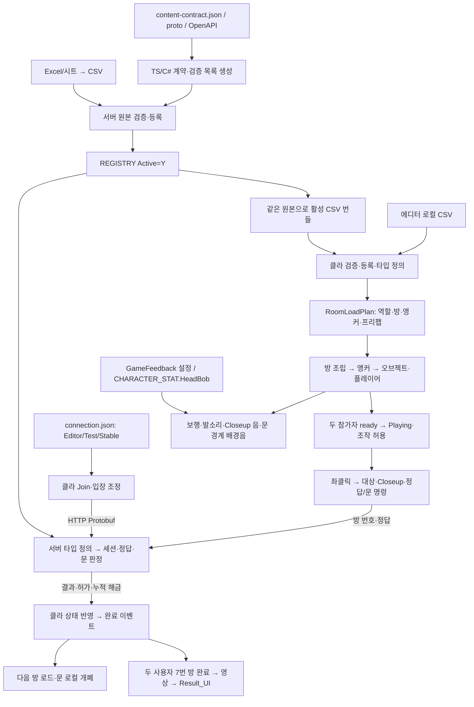
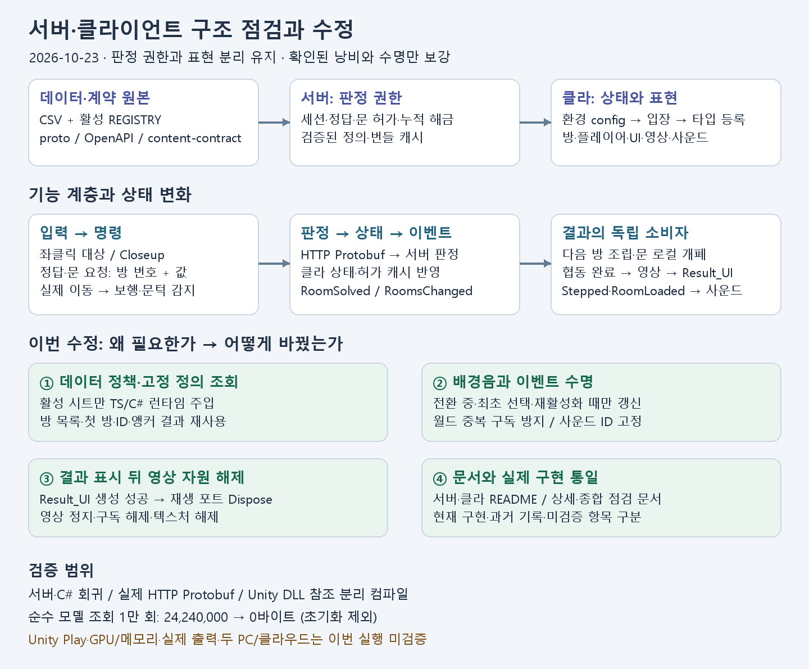

# 서버·클라이언트 종합 구조 점검

기준일: 2026-10-23. 현재 코드·README·설계 문서 대조와 확인된 문제의 수정 결과입니다.

## 목차

1. [결론과 이전 설계 대비](#1-결론과-이전-설계-대비)
2. [기능·데이터 연결 도식](#2-기능데이터-연결-도식)
3. [수정 요약과 연결성](#3-수정-요약과-연결성)
4. [자동화와 확장 규격](#4-자동화와-확장-규격)
5. [검사 결과와 남은 확인](#5-검사-결과와-남은-확인)

상세 문서: [클라이언트 점검·코드 해설](ClientArchitectureReview.md), 서버 저장소 `docs/ArchitectureReview.md`. 최신 구현 규격은 [RefactorConventions](RefactorConventions.md)입니다.

## 1. 결론과 이전 설계 대비

설계 방향이 무너진 상태는 아닙니다. **검증된 데이터·객체 책임·완료 이벤트·서버 판정/로컬 표현 분리**를 유지합니다. 이번에는 네이티브 영상 자원 보유, 고정 데이터 반복 구성, 오디오 반복 갱신, 데이터 활성 정책 불일치와 문서 지연을 바로잡았습니다.

| 기준 | 이전 문서의 의도 | 현재 실제 구현·차이 |
|---|---|---|
| 객체 책임 | 정의/상태/규칙/표현/인프라 분리 | 유지. GameEntryService의 방 요청은 RoomInteractionService로 분리, 공개 메서드는 호환 Facade |
| 이벤트 | 상태 반영 뒤 독립 소비자 통지 | RoomsChanged는 집합 변경 시, RoomSolved는 허가 캐시 반영 후. 오디오 Stepped/RoomLoaded와 영상 완료도 같은 방향 |
| 데이터 중심 | 안정 ID·시트 참조·검증 | 유지. 사운드는 사용자 결정으로 GameFeedback 에셋 사용. 기존 SOUND 시트를 다시 도입하지 않음 |
| 추상화 | 교체되는 규칙/외부 구현의 계약 | 정답 Strategy·Gateway·영상 포트·시계/소스 계약에 적용. 모든 구체 클래스에 인터페이스를 추가하지 않음 |
| 손·입력·문·엔딩 | 초기 문서에서 후속 작업 | 현재 코드에 연결됨. 모든 방 실제 콘텐츠/물리/음성 검증까지 완료했다는 뜻은 아님 |
| 최적화 | 불필요한 작업 제거·소유권 명확화 | 불변 계획 캐시, 오디오 변경 시 갱신, 영상 후 해제 보강 |
| 네트워크 | 서버가 정답·문 허가 결정 | 유지. 위치·문 각도·카메라/음원은 동기화하지 않음 |

## 2. 기능·데이터 연결 도식



### 2.1 테이블별 연결성

| 데이터 | 연결 대상과 의미 |
|---|---|
| REGISTRY | 활성 시트 주입/전송의 기준. 원본 검증 대상과 런타임 활성 대상을 구분 |
| ROOM_A/B | 역할별 ROOM.ID·RoomNo·PrefabID·PuzzleID·Next·ExitRule → 로드 순서·허가·엔딩 최종 방 |
| ANCHOR_INTERACT/NONINTERACT | RoomNo와 ALL/A/B로 필터 → AnchorID를 실제 Transform과 연결 → PrefabID 스폰 |
| PREFAB → COMPONENT | 프리팹 경로·기능 ID → 검증된 기능명/Params → 상호작용·Closeup·문/다이얼/콘솔 등 조립 |
| PUZZLE → PUZZLE_SLOT | 입력 방/앵커·슬롯 정의 → UI 입력 형태·서버 정답 비교. 정답은 서버 권한 |
| LOCK/CONSOLE 등 | AnchorRef → 입력 UI 슬롯/버튼 등 표시·입력 정의 |
| GAME_CONFIG → CHARACTER_STAT | 프로필 선택·이동/시점/캡슐/HeadBob 등 검증 수치 |
| GameFeedback 에셋 | 음원 직접 참조·순서·볼륨·Closeup 제한·3초 전환·Result_UI 참조. CSV SOUND는 사용하지 않음 |
| EndingVideo 에셋 + GAME_CONFIG | 영상 참조/경로·준비 제한/재시도. 종료 시간은 실제 영상 시작 시 고정 |

프리팹 경로나 기능명을 데이터에 추가해도 새 C# 기능 구현까지 자동 생성되지는 않습니다. 현재 지원 계약 내에서 조합하는 것이 데이터 기반 자동 조립입니다.

### 2.2 명령·결과·표현

```text
정답 UI → Submit(roomNo, answers) → 서버 인증/판정
                                    ↓
                       정답 결과 + doorAllowed + snapshot
                                    ↓
                  클라 상태·허가 캐시 갱신 → RoomSolved
                                    ├─ 방 해금 소비자 → 새 방 조립
                                    └─ 엔딩 소비자 → 상대 완료 대기/영상

문 좌클릭 → 최초 허가 조회 → true 캐시 → 이후 개폐는 로컬
걷기 → 실제 이동 거리 → Stepped → 발소리
열린 문 경계 통과 → 현재 방 변경 → 3초 배경음 전환
```

엔딩 대기에서 사용하는 문 허가 조회는 BothSolved 완료 확인입니다. 문을 실제로 열거나 통과해야 엔딩이 되는 조건이 아닙니다.

## 3. 수정 요약과 연결성

| 문제 | 왜 수정해야 하나 | 실제 수정과 효과 |
|---|---|---|
| 번들은 활성 시트만, 타입 정의는 남은 파일도 변환 | 서버/클라 소비자가 서로 다른 활성 범위를 해석 | TS/C# CsvGameData가 REGISTRY Active=Y로 주입을 통일 |
| 같은 방 정보의 wrapper/LINQ/배열 반복 생성 | 불변 정의 조회가 GC 비용 생성 | RoomLoadPlan 내부 캐시·ID 조회, 로컬 A/B 계획 재사용 |
| 배경음 전환 완료 후에도 매 프레임 같은 gain 적용 | 변경 없는 계산·엔진 호출 반복 | 상태 변경 결과 + 초기/재활성화 dirty 갱신 |
| Result_UI 표시 후 영상 자원 유지 | 결과 화면에서 쓰지 않는 네이티브 자원 보유 | 결과 생성 성공 후 영상 포트·텍스처 해제 |
| 사운드 enum이 순서에 의존 | 항목 삽입으로 기존 에셋 의미 변경 위험 | 기존 숫자 0~13 명시 고정 |
| BindWorld가 중복 구독 허용 | 재조립 시 중복 알림/수명 혼합 가능 | 같은 소유자 연결 멱등, 다른 소유자 연결 거부 |
| README·설계 문서가 초기 구현 기준 | 구현된 기능을 미완료로 오해 | 양쪽 README·상세 구조/관련 가이드 최신화 |



## 4. 자동화와 확장 규격

### 4.1 계약 자동화

- `.proto`: 메시지/필드 번호/oneof의 원본 → TS/C# 생성.
- OpenAPI: HTTP 경로·operationId·성공 outcome → 라우트/클라 호출 계약 생성, Swagger 문서화.
- `content-contract.json`: 기능명·파라미터·퍼즐 종류 → 양쪽 공통 계약/검증 목록 생성.
- CSV: 검증 → 원본 등록 → 활성 타입 정의/번들 → 씬 데이터 조립.
- 생성물 적용: 기존 로컬 도구의 검증·해시·백업 경로 사용. 서버 실행/클라우드 배포가 로컬 C# 기능 구현이나 Git 반영을 자동 수행하지는 않음.

이번에는 API/메시지를 바꾸지 않아 생성 계약을 불필요하게 다시 배포하지 않았습니다.

### 4.2 앞으로 지킬 설계 규격

기능 정의 → 책임·권한·자원 소유자 → 안정 ID/설정 → 상태·명령 → 완료 이벤트 → 어댑터/조립 → 비용 측정 → 실패·취소·재입장 검사 순서를 따릅니다.

정답 알고리즘을 추가하면 IPuzzleAnswerRule 구현·등록과 로컬 테스트 모드 지원 범위를 함께 정해야 합니다. 현재 7개 타입이 같은 비교 규칙을 공유하는 것을 별도 알고리즘 7개로 설명하지 않습니다. GoF State/Decorator/P2P/결정적 replay도 구현 증거 없이 적용했다고 기록하지 않습니다.

## 5. 검사 결과와 남은 확인

아래는 이번 최종 실행 결과입니다. 고정 코퍼스와 현재 콘텐츠 검사를 구분합니다.

| 검사 | 결과 |
|---|---|
| 서버 전체 회귀 | 176개 통과 |
| 클라이언트 CSV·입장·문·정답·상호작용 순수 회귀 | 312개 통과 |
| 실제 C# ↔ Node HTTP/Protobuf | 22개 통과 |
| 스폰·이동·시점·조작 | 78개 통과 |
| 보행·사운드·경계·시간 | 48개 통과 |
| 엔딩 협동 완료·재생 수명 | 41개 통과 |
| 콘텐츠 공통 생성 계약 | content:check 통과 |
| 관리 힙 할당 비교 | 1만 회 동일 조회: 24,240,000 → 0바이트. 초기화 제외·.NET 순수 모델 |
| Unity DLL 참조 전체 Editor/런타임 분리 컴파일 | 각각 오류 0·경고 58. 기존 SerializeField/호환 DTO 필드의 CS0649 경고 |
| Unity Play·GPU/Memory Profiler·실제 음성/영상·두 PC/클라우드 | 이번 실행에서 확인하지 않음 |

남은 우선 확인은 ① 결과 화면에서 VideoPlayer/RenderTexture가 남지 않는지, ② 전환/Disable/Enable 뒤 배경음이 정상 재개되는지, ③ A/B 전체 문·7번 방 협동 엔딩을 실제 빌드로 재현하는지입니다. Closeup 정적 미리보기의 상시 렌더링은 GPU 최적화 후보이며 실제 화면 검증 후 처리합니다.

조명/Light Probe 및 R01_LEDPanel 전용 소리는 보류합니다. 조명 앵커 작성이 끝나기 전 콘텐츠 검증 실패를 코드가 임의 위치로 숨기지 않습니다. 이번 작업은 CSV 원본·방/손 프리팹·베이크·기존 stable 빌드 폴더를 변경하지 않습니다.
