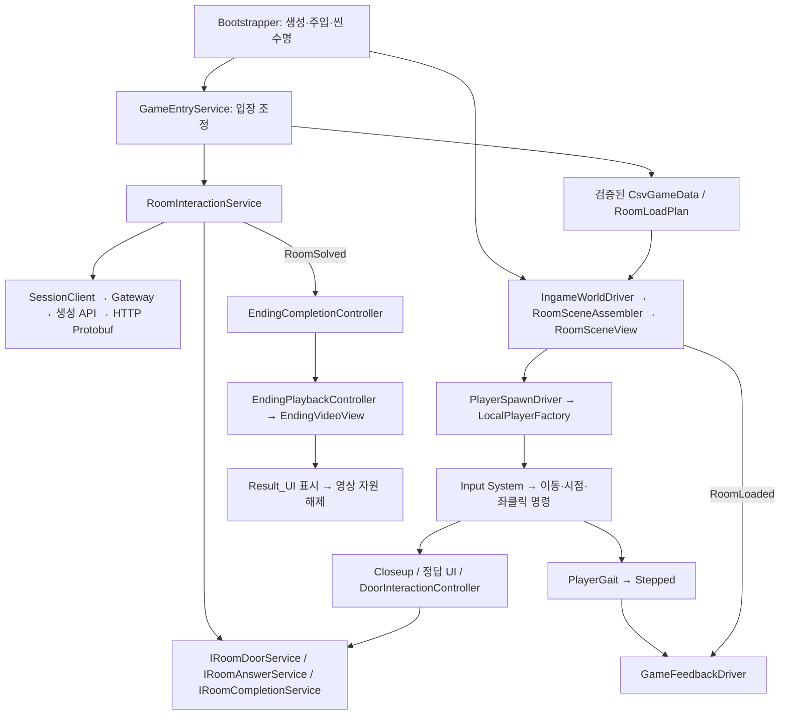
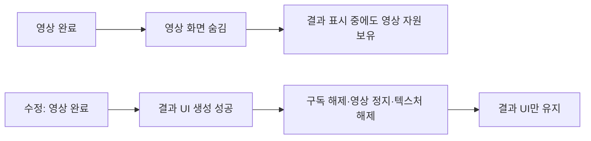

# 클라이언트 구조 점검·수정 보고서

기준일: 2026-10-23. [종합 구조·검사 결과](ArchitectureReview.md), [앞으로의 구현 규격](RefactorConventions.md), [보행·사운드·결과 설정](GameFeedback.md)을 함께 봅니다.

## 목차

1. [설계 방향과 변경점](#1-설계-방향과-변경점)
2. [기능 계층과 패턴](#2-기능-계층과-패턴)
3. [문제·이유·수정 방법](#3-문제이유수정-방법)
4. [남겨 둔 항목과 확장 규격](#4-남겨-둔-항목과-확장-규격)

## 1. 설계 방향과 변경점

정의/상태/규칙/표현/인프라를 분리하는 방향은 유지됩니다. 최근 추가된 손 모델, 보행 흔들림, 사운드, 영상 후 결과도 서버 판정 코드로 들어가지 않고 클라 표현에 연결되어 있습니다. 사운드는 사용자 결정에 따라 CSV 대신 **GameFeedback ScriptableObject**를 원본으로 사용합니다. 데이터 중심 설계가 반드시 모든 설정을 CSV로 저장한다는 뜻은 아닙니다.

이번에는 방 조회의 반복 할당, 배경음의 불필요한 갱신, 영상 종료 후 자원 보유, 사운드 직렬화 ID, 이벤트 연결 수명, 활성 시트 주입 정책을 수정했습니다. 상호작용/정답/문 API·플레이어 이동 규칙·7번 방 협동 엔딩 조건은 유지합니다.

범위는 Assets/3.Script의 C# 218개 파일(생성 코드 포함)에 대한 구조 분류, 핵심 입장/통신/데이터/월드/플레이어/상호작용/엔딩/오디오/음성 수명 경로 대조, 전체 소스 분리 컴파일과 순수 모델 회귀입니다. 모든 프리팹·애니메이션·셰이더의 실기 실행을 전수 검증했다는 의미는 아닙니다.

## 2. 기능 계층과 패턴

### 2.1 추상화와 다형성이 필요한 자리

| 계약·공통형 | 구현·소비자 | 의도 |
|---|---|---|
| `ISessionGateway` 계열 | HttpSessionGateway와 검사 대역 | 세션 규칙을 UnityWebRequest로부터 분리 |
| `IRoomDoorService`, `IRoomAnswerService`, `IRoomCompletionService` | GameEntryService/RoomInteractionService 및 검사 대역 | 문·입력·엔딩 소비자가 필요한 계약만 참조 |
| `IEndingVideoPlayback` | EndingVideoView, FakeVideo | 영상 준비/완료 상태를 Unity VideoPlayer와 분리 |
| `IVoiceGateway` | VivoxVoiceGateway | SDK와 음성 연결 수명을 분리. 장치 검증 완료를 의미하지 않음 |
| CSV 입력·검증 규칙 계약 | 파일/번들/메모리 입력과 각 validation rule | 같은 검사 규칙을 실제 입력과 자동 검사에서 재사용 |
| `RoomData`, `AnchorData` | 역할별 ROOM과 상호작용 여부별 ANCHOR 모델 | 실제 공통 데이터 관계를 상속으로 표현 |

MonoBehaviour Driver는 생명주기·입력/Transform/AudioSource 연결을 담당합니다. 순수 PlayerGait·AmbientCrossfade·DoorwayCrossing·EndingPlaybackController가 시간과 상태를 진행합니다. 현재는 GameFeedbackDriver가 구체 IngameWorldDriver를 연결하지만 같은 씬 수명의 Unity 어댑터 간 연결입니다. 모든 Driver를 추상화하는 것은 목적 없는 인터페이스 증가가 될 수 있습니다.

### 2.2 실제 패턴과 과장하면 안 되는 부분

| 패턴 | 현재 적용 | 범위 |
|---|---|---|
| Composition Root / DI | Bootstrapper가 서비스·구현을 생성·주입 | DI 프레임워크는 없음 |
| Facade | GameEntryService 공개 진입점, RoomSceneAssembler 공통 조립 | 입장 호환 메서드는 남기고 방 요청 책임을 분리 |
| Adapter | HTTP/Protobuf, Input System, VideoPlayer, AudioSource, Vivox | 외부 API를 순수 상태 규칙과 분리 |
| Observer | RoomsChanged·RoomSolved·Stepped·RoomLoaded·완료 이벤트 | 상태 반영 후 통지, 소유자 종료 시 구독 해제 |
| Factory | LocalPlayerFactory, HttpSessionGatewayFactory | 현재는 단순/정적 Factory도 포함. GoF Factory Method 상속 구조로 과장하지 않음 |
| Strategy 성격의 선택 | 서버/로컬 데이터 및 판정 경로, 방 배치 모드 | 일부는 enum/분기 선택. 모두 다형적 Strategy 클래스로 구현된 것은 아님 |
| 상태 모델 | 문 busy/open/allowed, 엔딩 phase, 준비 phase | 대부분 명시적 상태 필드. GoF State 객체 패턴은 아님 |
| 고정 음원 재사용 | 효과음 AudioSource 배열 | 설정된 수의 source 재사용. 범용 Object Pool 프레임워크가 아님 |

Decorator나 전역 이벤트 버스는 추가하지 않았습니다. UI 버튼이 명령을 직접 호출하고 성공한 상태 변화만 독립 소비자에게 알리는 현재 구조를 유지합니다.

## 3. 문제·이유·수정 방법

### 3.1 고정 방 데이터 조회에서 반복 할당 — 수정 완료

코드: [RoomLoadPlan.cs](../Assets/3.Script/World/RoomLoadPlan.cs), [LocalRoomProgression.cs](../Assets/3.Script/World/LocalRoomProgression.cs).

**기존:** Rooms getter마다 ReadOnlyCollection을 새로 만들고 First마다 LINQ와 중첩 탐색을 수행했습니다. Find는 캡처 lambda로 검색하고, Anchors는 같은 방도 매번 filter/sort/array/read-only wrapper를 생성했습니다. 로컬 판정은 요청마다 RoomLoadPlan 자체를 다시 만들었습니다.

**문제인 이유:** 정의는 입장 수명 동안 변하지 않는데 조회가 메모리 할당을 발생시킵니다. 기능이 늘어 조회 횟수가 많아지면 GC 부담이 커지고, 소비자가 불필요한 재구성을 유발하기 쉽습니다.

**수정:** Rooms는 한 번 만든 읽기 전용 view, Find/프리팹 경로는 ID dictionary, First는 최초 해석 후 캐시, Anchors는 역할별 계획 내부에서 RoomNo별 읽기 전용 결과를 재사용합니다. 캐시 적중 때도 lambda 캡처가 생기지 않도록 `BuildAnchors`를 별도 구성 경로로 분리했습니다. LocalRoomProgression은 A/B 계획을 생성자에서 한 번 만들고 재사용합니다.

**소유권:** 캐시는 CsvGameData 한 스냅샷에 종속됩니다. 재입장/데이터 교체에는 새 계획을 만듭니다. 기존 계획을 전역 캐시로 보관하거나 Unity GameObject를 캐시하지 않습니다. 초기 사전/목록 메모리는 늘지만 동일 정의의 반복 임시 객체는 줄입니다.

**실측:** 동일 고정 코퍼스 A 역할로 Rooms/First/Find/Anchors 묶음 조회 10,000회, 워밍업 이후 관리 힙 할당은 수정 전 **24,240,000바이트**, 수정 후 **0바이트**였습니다. .NET 10 순수 모델 검사이며 초기 구성 비용·Unity FPS·GPU·전체 게임 메모리 측정이 아닙니다.

### 3.2 전환이 끝난 배경음도 매 프레임 갱신 — 수정 완료

코드: [AmbientCrossfade.cs](../Assets/3.Script/Audio/AmbientCrossfade.cs), [GameFeedbackDriver.cs](../Assets/3.Script/Audio/GameFeedbackDriver.cs).

**기존:** 3초 전환이 완료돼도 Tick이 모든 채널 gain을 다시 계산하고 Driver가 매 LateUpdate에 source volume/isPlaying을 조회·설정했습니다.

**수정:** `IsTransitioning`과 Tick의 변경 결과를 추가했습니다. 전환 중/마지막 전환 프레임에만 계산 결과를 적용합니다. 최초 방 선택과 OnEnable은 `ambientDirty`를 세워 즉시 적용·재시작합니다. 방 전환 경계 검사는 계속 진행하므로 문턱 감지가 멈추지 않습니다. 빠른 역주행과 3번째 방 전환도 현재 gain에서 이어갑니다.

예: 60fps로 10초간 같은 방에 머무르면 기존에는 600회 채널 갱신 경로를 거칩니다. 변경 후 최초 dirty 적용과 실제 전환 기간 이후에는 같은 값의 반복 적용을 건너뜁니다. 이는 코드 경로의 변화이며 프레임 속도 상승치를 측정한 주장은 아닙니다. 런타임 Inspector에서 volume을 바꿔 즉시 반영하는 기능은 계약에 포함하지 않습니다.

### 3.3 결과 UI 뒤에 영상 자원 보유 — 수정 완료

코드: [EndingVideoDirector.cs](../Assets/3.Script/World/EndingVideoDirector.cs), [EndingVideoView.cs](../Assets/3.Script/World/EndingVideoView.cs).

**기존:** 영상이 끝나 Result_UI가 생성돼도 영상 화면을 숨기기만 했습니다. VideoPlayer·RenderTexture가 플레이어 파괴까지 남았습니다. 마지막 영상 프레임만 보여주던 시절의 수명이 결과 UI 추가 후에도 유지된 것입니다.

**수정 이유:** 결과 화면은 영상 텍스처가 필요 없습니다. 표시가 끝난 큰 네이티브 자원을 활성 플레이어 수명 끝까지 유지할 이유가 없습니다.

**수정:** 결과 UI 생성 성공 직후 ClearPlayback으로 이벤트를 해제하고 playback 포트를 Dispose합니다. 실제 View는 VideoPlayer 정지·targetTexture 연결 해제·RenderTexture.Release/Destroy를 수행합니다. 생성 중 Controller 조립이 실패해 View만 생긴 경우도 해제합니다. 완료 콜백 중 playback이 정리돼도 LateUpdate가 오래된 필드를 다시 읽지 않도록 지역 참조/동일성 확인을 사용합니다.

`completed`와 결과 View는 남아 비활성화/재활성화 시 결과만 다시 표시합니다. 결과 UI 생성 실패 때는 오류 안내를 유지하며 성공 경로처럼 강제로 화면을 제거하지 않습니다. 정리의 멱등성·늦은 콜백 무시를 순수 포트 검사에 추가했습니다. 실제 디코더/GPU 메모리 해제는 Unity Memory Profiler 확인 대상입니다.

### 3.4 사운드 enum의 암묵적 직렬화 번호 — 수정 완료

코드: [GameAudioCue.cs](../Assets/3.Script/Audio/GameAudioCue.cs).

GameFeedback 에셋은 enum을 숫자로 저장합니다. 기존처럼 암묵적 순서만 사용하면 중간에 항목을 추가했을 때 저장된 숫자가 다른 음원 동작으로 해석될 수 있습니다. 기존 Footstep=0부터 Wrong=13까지 명시적으로 고정했고, 기존 에셋은 그대로 사용합니다. 새 동작은 기존 번호를 재사용하지 않고 새 번호로 추가합니다.

### 3.5 월드 이벤트 중복 연결 — 수정 완료

코드: [GameFeedbackDriver.BindWorld](../Assets/3.Script/Audio/GameFeedbackDriver.cs).

기존 BindWorld는 호출할 때마다 RoomLoaded를 구독했습니다. 현재 Bootstrapper는 한 번 호출하지만 메서드 자체에는 같은 소유자 중복 연결 방지가 없었습니다. 같은 월드 재연결은 아무 작업 없이 반환하고, 다른 월드 연결은 예외로 막았습니다. 다른 입장에는 새 플레이어/Driver를 생성해야 합니다. 이렇게 해야 이전 방 ID·문 경계·Transform 캐시를 다른 월드와 섞지 않습니다. OnDestroy에서 해당 월드 구독을 한 번 해제합니다.

### 3.6 활성 데이터 정책이 번들과 다름 — 수정 완료

코드: [CsvGameData.cs](../Assets/3.Script/Data/Tables/CsvGameData.cs).

서버와 동일하게 REGISTRY를 먼저 해석하고 Active=Y인 시트만 런타임 타입 목록에 주입합니다. 비활성/미등록 시트는 빈 목록입니다. 파일이 없을 수 있는 선택 시트와 활성 시트의 실제 매핑 캐시는 기존 동작을 유지합니다. 원본 전체 검증과 저수준 명시적 매핑은 별도 책임입니다. SOUND 전용 이름 분기를 추가하지 않았습니다.

## 4. 남겨 둔 항목과 확장 규격

### 4.1 측정·설계 후 진행할 항목

| 항목 | 확인된 현재 구조 | 이번 처리와 이유 |
|---|---|---|
| Closeup 미리보기 | 표시용 메시 복사, 전용 Camera/RenderTexture/Light. Camera가 패널 동안 매 프레임 렌더링 | 정적인 대상은 1회 렌더 후보. URP 실제 화면·재표시·재질 변경 검증 후 처리. FPS/GPU 병목으로 확정하지 않음 |
| 구형 Wire DTO | 새 Protobuf 경로의 1회 변환과 별도로 호환 검사에서 참조 | 전부 미사용이라 단정하지 않고 향후 참조 제거 후 삭제 |
| Assembly 분리 | Generated.Protocol asmdef 외 게임 코드는 대체로 기본 어셈블리 | 라이브러리 추출 시 공개 계약·접근성·Unity 참조를 함께 정리. 이미 DLL로 분리됐다고 설명하지 않음 |
| 서버/로컬 판정 | 온라인 서버 권한, LocalRoomProgression은 개발 도구용 슬롯 비교 | 현재 회귀로 일치 확인. 새로운 Strategy 추가 시 양쪽 지원 범위도 명시해야 함 |
| Task.Yield 대기 | 씬 로드/요청 순서 대기에서 매 진행 주기 재확인 | 실제 대기 할당 측정 후 완료 통지 기반으로 교체 검토. 취소/순서 규칙을 먼저 보존 |
| 조명 | 기존 스폰 표 구조, Light Probe 작업 대기 | 사용자 요청으로 보류. CSV·방 프리팹·베이크 설정을 임의 변경하지 않음 |
| LED UI 소리 | 전용 UI 연결 보류 | 사용자 요청대로 R01_LEDPanel은 추가 작업하지 않음 |

### 4.2 유지할 규격

1. 콘텐츠/설정은 안정 ID와 검증된 데이터로, 가변 진행은 별도 상태 객체로 관리합니다.
2. 입력 → 명령/요청 → 상태 갱신 → 결과 이벤트 → 화면/소리 순서를 지킵니다.
3. 이벤트 구독·비동기 취소·생성한 Unity 자원의 소유자를 같은 입장/씬/플레이어 수명 안에서 명시합니다.
4. 고정 정의만 계획 내부에 캐시합니다. 데이터가 교체되면 새 계획을 조립합니다.
5. 순수 상태는 Tick과 주입한 시간으로 검사합니다. Unity 표현 시간과 서버 생존 시간의 기준을 섞지 않습니다.
6. 온라인은 서버가 정답/허가를 결정하고 문 회전·소리·카메라는 로컬에서 표현합니다. P2P/서버 권한 이전과 replay 결정성은 별도 작업입니다.
7. 성능 주장은 측정 범위와 도구를 붙입니다. 컴파일·순수 모델 검사를 실제 Play/Profiler/청취 검사로 대체하지 않습니다.
