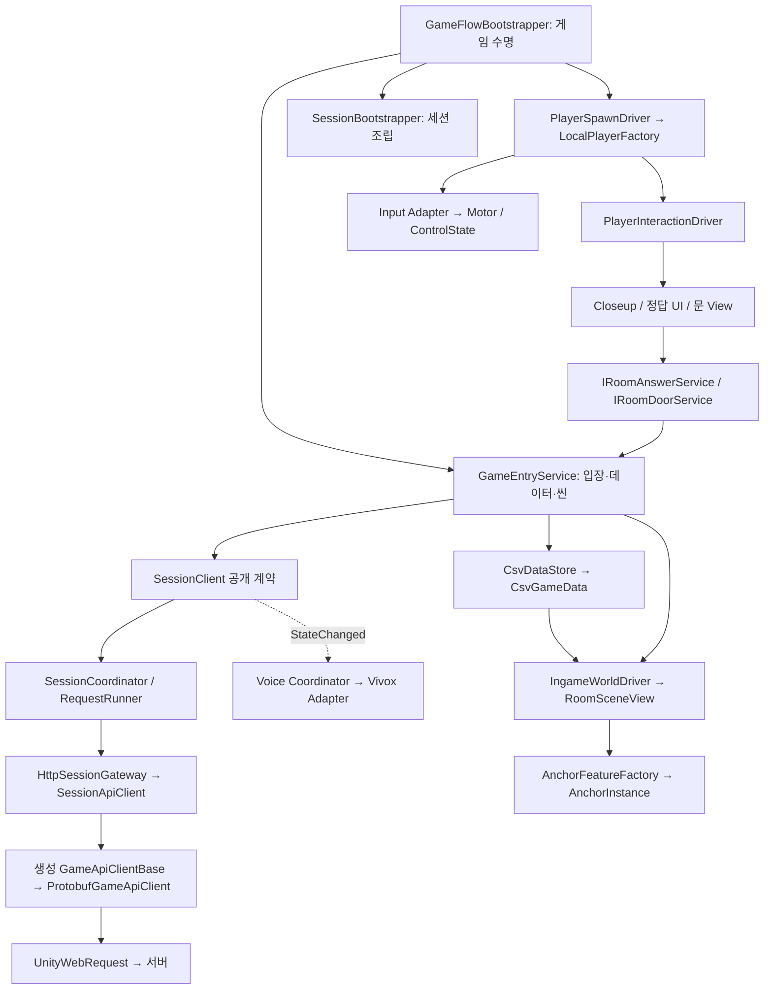
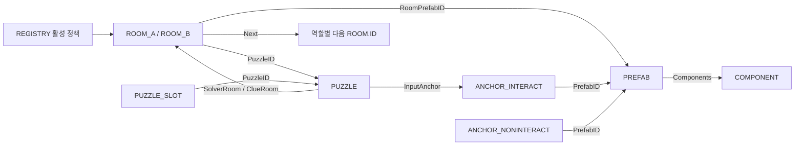
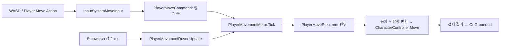
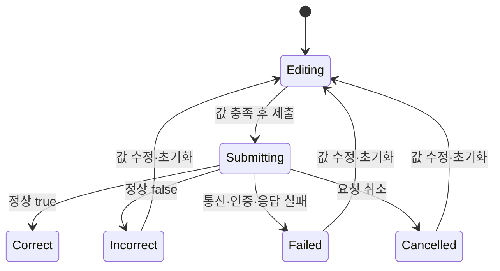
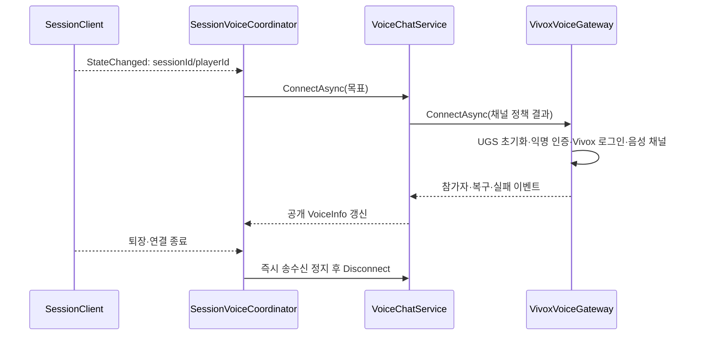

# Unity 클라이언트 코드·기능 계층과 설계 의도

> 문서 대조일: **2026-10-26**. 현재 코드·설정을 기준으로 설명을 점검했습니다. 본문의 과거 검사 수치·실행 기록은 해당 날짜의 결과입니다. [현재 상태·문서 검토 범위](문서_현행화_점검표.md)를 함께 확인합니다.


기준: 2026-10-26, `C:/Users/m/Desktop/listen`의 현재 로컬 코드·CSV·설정. Unity 6000.2.8f1입니다. 기능 계층의 상위부터 내려가며 설계 의도, 클래스·메서드, 데이터와 외부 어댑터를 설명합니다.

관련 문서: [전체 구조](ArchitectureReview.md), [서버 상세](C:/Users/m/Documents/Codex/2026-10-07/4-x20-2-x20/outputs/server/docs/ServerCodeArchitecture.md). 이번 문서 작업은 실행 코드·씬·CSV를 수정하지 않습니다.

## 목차

- [1. 클라이언트의 역할과 계층 설계](#1-클라이언트의-역할과-계층-설계)
- [2. 진입 계층 → 환경 설정과 Join](#2-진입-계층--환경-설정과-join)
- [3. 게임 응용 계층 → 데이터 등록·씬 전환·시작 대기](#3-게임-응용-계층--데이터-등록씬-전환시작-대기)
- [4. 세션·전송 계층 → 네트워크 라이브러리 경계](#4-세션전송-계층--네트워크-라이브러리-경계)
- [5. 데이터 계층 → CSV 정의·검증·런타임 주입](#5-데이터-계층--csv-정의검증런타임-주입)
- [6. 월드 계층 → 역할별 방·앵커·기능 생성](#6-월드-계층--역할별-방앵커기능-생성)
- [7. 플레이어 계층 → 스폰·이동·시점·충돌](#7-플레이어-계층--스폰이동시점충돌)
- [8. 상호작용 계층 → 좌클릭·Closeup·정답](#8-상호작용-계층--좌클릭closeup정답)
- [9. 진행 계층 → 문 허가·회전·다음 방 생성](#9-진행-계층--문-허가회전다음-방-생성)
- [10. 개발자 기능 계층 → 서버 없는 검사](#10-개발자-기능-계층--서버-없는-검사)
- [11. 음성 계층 → 세션 이벤트와 Vivox](#11-음성-계층--세션-이벤트와-vivox)
- [12. 자동화 계층 → 콘텐츠 참조·생성 코드·빌드](#12-자동화-계층--콘텐츠-참조생성-코드빌드)
- [13. 패턴·이벤트·확장 기준](#13-패턴이벤트확장-기준)
- [14. 검사와 코드 찾아보기](#14-검사와-코드-찾아보기)
- [손·입력·조명 수명의 현재 연결](#손입력조명-수명의-현재-연결)
- [소리·공동 엔딩의 현재 연결](#소리공동-엔딩의-현재-연결)

## 1. 클라이언트의 역할과 계층 설계

### 1.1 설계 개념 → 정의·상태·규칙·표현·인프라 분리

클라이언트는 역할에 맞는 방과 소품을 구성하고, 플레이어 입력을 명령으로 바꾸며, 서버 판정을 화면에 반영합니다. 온라인에서 정답과 문 허가를 최종 결정하는 주체는 서버입니다. 문 각도·카메라·충돌·Closeup은 각 PC의 로컬 표현입니다.

| 계층 | 대표 코드 | 분리 의도 |
|---|---|---|
| 데이터 정의 | CsvGameData, RoomData, AnchorData, CharacterStatData | 기획 수치·ID 관계를 실행 상태와 분리 |
| 실행 상태·규칙 | ClientSessionState, PlayerMovementMotor, PuzzleAnswerController | Unity 화면 없이 판정·수명 검사 |
| 응용 조정 | GameEntryService, SessionClient, SessionCoordinator | 입장·데이터 등록·요청 순서·진행 반영 조정 |
| 표현 | RoomSceneView, WorldDoorView, PuzzleAnswerView | Transform·Camera·uGUI·재질 처리 |
| 외부 어댑터 | ProtobufGameApiClient, InputSystemMoveInput, VivoxVoiceGateway | UnityWebRequest·Input System·SDK 의존성 격리 |
| 조립·수명 | GameFlowBootstrapper, SessionBootstrapper, Factory/Driver | 생성과 주입·활성화·구독 해제·정리 소유 |

이 구조는 향후 네트워크 코드를 라이브러리로 옮기기 쉽게 만들기 위한 책임 경계입니다. **현재 네트워크 소스가 이미 비공개 DLL로 분리된 것은 아닙니다.** Generated/Protocol만 별도 asmdef이며 대부분의 게임 코드는 Unity 기본 어셈블리 구성입니다. 추출 시 접근 제한·어셈블리 의존·Unity 전송 구현의 배치를 추가로 정리해야 합니다.

### 1.2 전체 기능 계층



실선은 호출·의존, 점선은 상태 반영 완료 알림입니다. 모든 호출이 전역 이벤트 버스를 거치는 구조는 아닙니다.

## 2. 진입 계층 → 환경 설정과 Join

### 2.1 config 선택과 버튼 입장

코드: [ClientConnectionSettings.cs](../Assets/3.Script/Configuration/ClientConnectionSettings.cs), [UnityClientConnectionConfig.cs](../Assets/3.Script/Configuration/Infrastructure/UnityClientConnectionConfig.cs), [ConfiguredServerConnection.cs](../Assets/3.Script/Configuration/ConfiguredServerConnection.cs), [ClientConnectionBuildValidator.cs](../Assets/3.Script/Editor/ClientConnectionBuildValidator.cs).

| 환경 | 선택 기준 | 현재 등록 주소 |
|---|---|---|
| Editor | `Application.isEditor` | `http://192.168.1.34:3001` |
| TestBuild | 플레이어의 `Debug.isDebugBuild` | `http://192.168.1.34:3001` |
| StableBuild | 일반 플레이어 빌드 | `http://32.236.55.218:3000` |

주소 원본은 [connection.json](../Assets/StreamingAssets/Configuration/connection.json)입니다. 주소는 현재 설정값이며 고정된 서비스 보장값은 아닙니다. `UnityClientConnectionConfig`가 파일과 Unity 환경을 읽고 `ClientConnectionSettings.Select`가 schemaVersion·주소를 검증합니다. 현재 파일 입력 어댑터는 Windows/Linux의 직접 파일 접근을 가정합니다.

현재 JoinMenuScreen은 탈출하기 입력으로 `ConnectAsync`를 호출합니다. `StartAsync`의 자동 접속은 구형 호환 화면에 남아 있고 새 메뉴는 호출하지 않습니다. running 플래그로 중복 시작을 막습니다. 주소 입력창을 거치지 않습니다. 빌드 전 Validator는 Development 옵션에 해당하는 프로필을 검사하여 빈 주소 등 설정 오류를 빌드 실패로 알립니다.

### 2.2 View → Presenter → 입장 서비스

코드: [JoinMenuScreen.cs](../Assets/3.Script/Session/Presentation/JoinMenuScreen.cs), [JoinMenuView.cs](../Assets/3.Script/Session/Presentation/JoinMenuView.cs), [GameEntryPresenter.cs](../Assets/3.Script/World/GameEntryPresenter.cs).

현재 JoinMenuScreen이 설정·GameEntryPresenter·JoinMenuView를 조립합니다. 구형 SessionConnectionScreen은 호환용이며 정상 Join의 활성 입구가 아닙니다. View는 JoinRequested/LocalRequested 이벤트를 내보내고 Presenter가 서비스를 호출합니다. `Changed` 이후 Render를 실행합니다. OnDisable에서 구독·화면 요청 수명을 정리합니다.

**의도:** 버튼·텍스트가 HTTP나 참가 토큰을 알지 않게 하며, 화면 제거가 진행 중인 게임 전체를 잘못 취소하지 않게 합니다. 로컬 테스트 A/B 버튼은 에디터 전용이며 Development Build에도 표시하지 않습니다. 현재 표시 언어와 오류 메시지 매핑은 한국어 기준입니다.

## 3. 게임 응용 계층 → 데이터 등록·씬 전환·시작 대기

### 3.1 `GameEntryService.EnterAsync`를 단계로 읽기

코드: [GameEntryService.cs](../Assets/3.Script/World/GameEntryService.cs).

1. disposed·중복 실행을 검사하고 호출자 토큰과 게임 소유자 토큰을 연결합니다.
2. 문 허가 캐시를 reset하고 이전 데이터·역할 진행·대기 방 목록을 초기화합니다.
3. 로컬 모드면 기존 서버 세션에서 leave, 온라인이면 필요 시 join합니다.
4. 로컬 `GameContentAssets.ReadLocalData` 또는 서버 `DownloadDataAsync` 중 하나를 선택합니다. 서버 실패를 로컬 원본으로 대체하지 않습니다.
5. 새 `CsvDataStore.TryRegister`로 검증하고 `CsvGameData`, 역할별 `RoomLoadPlan`을 구성합니다.
6. Data·Role·UnlockedRoomIds를 반영합니다. 온라인은 `SessionStartGate.WaitForParticipantsAsync`로 상대 입장을 기다립니다.
7. 씬 전환 시작 직전까지 화면 요청 취소를 허용합니다. **전환 시작 후에는 게임 소유자 토큰으로 이어서 실행**하여 Join 화면 제거가 입장을 취소하지 않게 합니다.
8. 실패하면 데이터와 로컬 진행을 비우고 이 입장에서 새로 확보한 서버 자리를 정리합니다. 기존 세션의 자리까지 무조건 제거하지 않습니다.

`GameEntryService`는 공개 계약을 유지하며 방 명령과 허가·완료 처리를 내부 `RoomInteractionService`에 위임합니다. `IRoomAnswerService`, `IRoomDoorService`, `IRoomCompletionService`를 통해 소비자와 연결합니다. 상호작용 모듈에는 이 좁은 계약을 주입하므로 UI가 SessionClient·토큰·Protobuf를 직접 참조하지 않습니다. `RoomsChanged`는 적용된 방 ID 목록을 World 쪽에 통지합니다.

### 3.2 Bootstrapper의 명시적 조립

코드: [GameFlowBootstrapper.cs](../Assets/3.Script/World/GameFlowBootstrapper.cs), [SessionBootstrapper.cs](../Assets/3.Script/Session/SessionBootstrapper.cs).

`GameFlowBootstrapper.Awake`가 중복 소유자를 막고 Resources의 GameContent를 확인한 뒤 서비스·로컬 데이터 함수·검증기·씬 전환 함수를 주입합니다. DontDestroyOnLoad로 Join→Ingame 동안 유지됩니다.

`EnterSceneAsync`는 Ingame 로드 완료 후 **활성 IngameWorldDriver가 정확히 하나**인지 검사하고 직접 Initialize합니다. 첫 방 준비 → PlayerSpawnDriver 생성·주입 → 이동·시점·상호작용 준비 → SessionGameplayDriver 순서입니다. Start 호출 순서를 우연에 맡기지 않습니다.

`SessionBootstrapper`는 SessionClient와 GatewayFactory·정수 시계·polling/ready/heartbeat Driver를 조립합니다. 각 Bootstrapper는 자신이 만든 서비스의 Dispose를 책임집니다.

### 3.3 상대 입장 대기와 양쪽 ready 대기

코드: [SessionStartGate.cs](../Assets/3.Script/World/SessionStartGate.cs), [GameplayReadinessCheck.cs](../Assets/3.Script/World/GameplayReadinessCheck.cs), [SessionSceneLoadedController.cs](../Assets/3.Script/Session/SessionSceneLoadedController.cs), [SessionGameplayDriver.cs](../Assets/3.Script/World/SessionGameplayDriver.cs).

| 조건 | 허용 동작 | 판정 코드 |
|---|---|---|
| 1명 접속 | Join에서 상대 대기 | StartGate.CanEnterScene=false |
| 2명 접속, Loading | 각자 Ingame 로드·로컬 준비 | CanEnterScene=true, CanPlay=false |
| 방·플레이어·입력 준비 | 서버에 ready 보고 | IsGameplayReady / ReadinessCheck |
| 서버 Playing | 대기 화면 해제·플레이 조작 허용 | StartGate.CanPlay=true |
| 상대 퇴장·연결 종료 | 다시 조작 잠금·대기 표시 | StateChanged → gate 갱신 |

`WorldReady && PlayerReady`에 활성 Ingame 씬 조건까지 포함합니다. 방만 생성됐거나 플레이어 입력이 실패한 상태를 ready로 보내지 않습니다. 로컬 테스트는 서버 준비 대기를 우회합니다. WaitForParticipants는 이벤트 구독 후 즉시 재검사하고 완료 직후에도 세션/참가 상태를 확인해 오래된 허용값을 쓰지 않습니다.

## 4. 세션·전송 계층 → 네트워크 라이브러리 경계

### 4.1 외부에 공개하는 기능 계약

| 계약 | 소비 기능 | 의미 |
|---|---|---|
| [ISessionConnectionService.cs](../Assets/3.Script/Session/Contracts/ISessionConnectionService.cs) | Join·시작 gate·자동 Driver·음성 | 접속·조회·ready·heartbeat·퇴장과 공개 상태/이벤트 |
| [ISessionContentService.cs](../Assets/3.Script/Session/Contracts/ISessionContentService.cs) | GameEntryService | CSV 다운로드·기존 퍼즐 제출·RoomsChanged |
| [ISessionRoomService.cs](../Assets/3.Script/Session/Contracts/ISessionRoomService.cs) | GameEntryService의 네트워크 분기 | 방 번호 정답·문 판정과 RoomDecision |
| [IRoomAnswerService.cs](../Assets/3.Script/World/IRoomAnswerService.cs) | PuzzleAnswerController | 게임 입력에 필요한 정답 제출만 공개 |
| [IRoomDoorService.cs](../Assets/3.Script/World/IRoomDoorService.cs) | DoorInteractionController | 방 번호별 문 사용 가능 여부만 공개 |

공개 SessionInfo에는 참가 토큰이 없습니다. 토큰은 ClientSessionState 내부에 유지합니다. 역할 A/B와 세션의 공개 상태를 값으로 전달하므로 MonoBehaviour·Transform을 네트워크 메시지에 넣지 않습니다.

### 4.2 요청이 내려가는 각 어댑터

| 순서 | 클래스·메서드 | 변환/소유 책임 |
|---|---|---|
| 1 | [SessionClient.cs](../Assets/3.Script/Session/Runtime/SessionClient.cs) | Facade. 요청 결과·공개 상태·연결 수명·오류 알림을 일관되게 제공 |
| 2 | [SessionCoordinator.cs](../Assets/3.Script/Session/SessionCoordinator.cs) | 내부 상태에서 sessionId/token 획득 → Gateway 호출 → 취소 검사 → snapshot 적용 |
| 3 | [SessionRequestRunner.cs](../Assets/3.Script/Session/SessionRequestRunner.cs) | 일반 요청/대기 명령/heartbeat/독점 leave의 순서 제어 |
| 4 | [HttpSessionGateway.cs](../Assets/3.Script/Networking/HttpSessionGateway.cs) | ISessionGateway 등 내부 포트 구현. DTO→세션 값, 전송 예외→SessionFailureCode |
| 5 | [SessionApiClient.cs](../Assets/3.Script/Networking/SessionApiClient.cs) | 생성 Protobuf 결과를 기존 내부 응답 모델로 매핑. 옛 DTO 명칭은 JSON 전송을 뜻하지 않음 |
| 6 | [HttpApi.cs](../Assets/3.Script/Generated/Protocol/HttpApi.cs) | 생성된 IGameApi·GameApiRoutes·GameApiClientBase. 메서드와 경로·성공 outcome 제공 |
| 7 | [ProtobufGameApiClient.cs](../Assets/3.Script/Networking/ProtobufGameApiClient.cs) | SendAsync override. UnityWebRequest·바이너리 업로드·취소·제한 시간 |
| 8 | [ProtobufApiResponseValidator.cs](../Assets/3.Script/Networking/ProtobufApiResponseValidator.cs) | HTTP 상태·미디어 타입·oneof·에러 enum·operation 계약 일치 검사 |

생성 기본 클래스가 경로와 호출 틀을 제공하고, 구체 클래스가 SendAsync를 구현하므로 **Template Method와 Adapter를 함께 사용**합니다. 생성 코드는 직접 편집하지 않고 서비스 로직은 생성 폴더 밖에 둡니다.

### 4.3 요청 순서·취소·늦은 응답 방지

`RunAsync`는 이미 일반 작업이 있으면 Busy, `RunAfterCurrentAsync`는 현재 작업 뒤에 명령 하나를 대기시킵니다. 무제한 FIFO가 아닙니다. `RunHeartbeatAsync`는 일반 작업과 별도 경로로 하나만 실행합니다. `RunExclusiveAsync`는 진행 중 작업 정리를 기다려 leave를 독점 실행합니다. 일반 폴링에 heartbeat가 막혀 자리가 만료되는 것을 방지하려는 구성입니다.

`SessionClient.connectionVersion`은 재연결/퇴장/종료 이후 이전 연결의 늦은 결과를 무시하는 기준입니다. 소유자·연결·호출자 취소 토큰을 조합합니다. `LeaveAsync`는 서버 확인에 실패해도 로컬을 종료하고 LeaveUnconfirmed를 알리며 서버 만료에 남은 자리 정리를 맡깁니다.

### 4.4 자동 조회·ready·heartbeat

| Driver / Controller | Update의 역할 | 기본 정책 |
|---|---|---|
| SessionPollingDriver / SessionPollingController | 정수 간격 Tick → query | 대기·준비 1000ms / Playing 5000ms |
| SessionSceneLoadedDriver / Controller | 현재 준비 조건 검사 → ready 재시도 | 1000ms |
| SessionHeartbeatDriver / Controller | Tick → 생존 확인·응답 단절 감시 | 전송 3000ms, 정상 응답 10000ms 부재 시 종료 |

heartbeat 요청 제한은 기본 2000ms, 일반 HTTP 제한은 10000ms입니다. UnityWebRequest timeout은 API 경계에서 초로 올림합니다. Stopwatch 정수 ms를 사용하지만 네트워크 지연/프레임 중단이 없는 정확한 실시간 보장을 뜻하지 않습니다. 게임 흐름은 coroutine보다 명시적 Update/Tick과 비동기 작업으로 나뉩니다.

## 5. 데이터 계층 → CSV 정의·검증·런타임 주입

### 5.1 동일 소비자에 두 데이터 소스를 넣는 이유

온라인은 서버가 제공한 CSV 스냅샷을, 에디터 로컬 테스트는 빌드 참조에 포함된 TextAsset을 사용합니다. 입력 소스가 달라도 이후 **CsvParser → CsvDataSet → CsvValidator → CsvDataStore → CsvGameData**는 공유합니다. 로컬 테스트가 온라인 실패를 숨기는 자동 fallback은 없습니다.

코드: [ICsvTextSource.cs](../Assets/3.Script/Common/Csv/ICsvTextSource.cs), [UnityTextAssetCsvSource.cs](../Assets/3.Script/Data/Infrastructure/UnityTextAssetCsvSource.cs), [Utf8CsvFileSource.cs](../Assets/3.Script/Data/Infrastructure/Utf8CsvFileSource.cs), [GameContentAssets.cs](../Assets/3.Script/Data/GameContentAssets.cs), [CsvDataStore.cs](../Assets/3.Script/Data/CsvDataStore.cs), [CsvGameData.cs](../Assets/3.Script/Data/Tables/CsvGameData.cs).

GameContentAssets의 현재 로컬 읽기는 TextAsset bytes를 엄격한 UTF-8로 직접 해석합니다. ICsvTextSource 구현은 공통 Loader/검사 도구에서 재사용하는 입력 어댑터입니다. 모든 경로가 반드시 같은 구체 어댑터 인스턴스를 경유하는 것은 아닙니다.

### 5.2 검증과 타입 변환

클라 스키마는 [CsvValidationRules.xml](../Assets/3.Script/Data/CsvValidation/Configuration/CsvValidationRules.xml), 서버는 CsvSchema.ts입니다. 둘은 **자동 생성된 단일 스키마가 아니므로 함께 관리**해야 합니다. 타입/참조/기능/캐릭터 규칙을 객체로 조합하고 파일·행·컬럼·원인으로 보고합니다. Editor의 UnityCsvResourceResolver가 실제 에셋 경로를 추가 검사할 수 있지만 플레이어 빌드는 AssetDatabase를 쓰지 않습니다.

CsvDataStore.TryRegister는 검증 실패 시 이전 데이터/캐시를 보존합니다. CsvTableMapping은 시트명과 변환 함수를 묶고 CsvGameData가 읽기 전용 테이블을 제공합니다. `RoomData → RoomAData/RoomBData`, `AnchorData → Interact/NonInteract`는 실제 공통 필드가 있는 is-a 상속입니다. 기능 조합은 상속 대신 COMPONENT와 Factory를 사용합니다.

문자열 정답·앞자리 0은 그대로 보존합니다. ID·ms·순서는 정수, Y/N은 bool, 원본 캐릭터/표현 수치는 float로 읽고 `CharacterStatUnits`에서 검증하며 정수 mm·ms·밀리도 단위로 정규화합니다. 모든 원본 수치가 처음부터 정수로 저장된 것은 아닙니다.

### 5.3 테이블 관계 지도



RoomNo는 화면 방 번호, ROOM.ID는 A/B를 구분한 고유 번호입니다. 참가자 A/B와 ROOM.Role의 Clue/Solver도 다른 구분입니다.

### 5.4 현재 테이블 컬럼·실행 연결 상태

| 테이블 | 상태 | 행 수 | 컬럼 |
|---|---|---:|---|
| [ANCHOR_INTERACT](../Assets/11.CSV/ANCHOR_INTERACT.csv) | 활성 | 16 | `ID`, `RoomNo`, `PlayerType`, `AnchorID`, `PrefabID`, `Active` |
| [ANCHOR_NONINTERACT](../Assets/11.CSV/ANCHOR_NONINTERACT.csv) | 활성 | 35 | `ID`, `RoomNo`, `PlayerType`, `AnchorID`, `PrefabID`, `Active` |
| [CHARACTER_STAT](../Assets/11.CSV/CHARACTER_STAT.csv) | 활성 | 1 | `ID`, `WalkSpeed`, `Acceleration`, `Deceleration`, `MouseSensitivity`, `PitchLimit`, `FOV`, `EyeHeight`, `CapsuleHeight`, `CapsuleRadius`, `StepOffset`, `InteractDistance`, `CloseUpOpenMs`, `HeadBob` |
| [COLOR_LETTER](../Assets/11.CSV/COLOR_LETTER.csv) | 활성 | 6 | `ID`, `PuzzleID`, `Letter`, `Color`, `SignAnchor` |
| [COMPONENT](../Assets/11.CSV/COMPONENT.csv) | 활성 | 8 | `ID`, `Script`, `Params` |
| [CONSOLE](../Assets/11.CSV/CONSOLE.csv) | 활성 | 1 | `AnchorRef`, `SlotCount`, `Buttons` |
| [GAME_CONFIG](../Assets/11.CSV/GAME_CONFIG.csv) | 활성 | 5 | `ID`, `Value`, `Type`, `Unit` |
| [LOCK](../Assets/11.CSV/LOCK.csv) | 활성 | 7 | `AnchorRef`, `DialFace`, `DialLetters`, `DisplayFace` |
| [PREFAB](../Assets/11.CSV/PREFAB.csv) | 활성 | 53 | `ID`, `Path`, `Group`, `Components` |
| [PUZZLE](../Assets/11.CSV/PUZZLE.csv) | 활성 | 8 | `ID`, `Type`, `SolverRoom`, `ClueRoom`, `InputAnchor`, `SlotCount`, `Active` |
| [PUZZLE_SLOT](../Assets/11.CSV/PUZZLE_SLOT.csv) | 활성 | 44 | `ID`, `PuzzleID`, `Slot`, `Display`, `Answer` |
| [REGISTRY](../Assets/11.CSV/REGISTRY.csv) | 활성 | 16 | `ID`, `Sheet`, `File`, `Parent`, `ParentKey`, `Uses`, `LoadOrder`, `Required`, `Active` |
| [ROOM_A](../Assets/11.CSV/ROOM_A.csv) | 활성 | 7 | `ID`, `RoomNo`, `Role`, `RoomPrefabID`, `PuzzleID`, `TargetMs`, `ExitRule`, `Active`, `Next` |
| [ROOM_B](../Assets/11.CSV/ROOM_B.csv) | 활성 | 7 | `ID`, `RoomNo`, `Role`, `RoomPrefabID`, `PuzzleID`, `TargetMs`, `ExitRule`, `Active`, `Next` |

## 6. 월드 계층 → 역할별 방·앵커·기능 생성

### 6.1 선택 규칙 `RoomLoadPlan`

코드: [RoomLoadPlan.cs](../Assets/3.Script/World/RoomLoadPlan.cs).

`Rooms`는 역할의 활성 ROOM만 보유합니다. `First`는 Next의 대상으로 참조되지 않는 활성 시작 행을 찾고 정확히 하나인지 검사합니다. `Anchors(room)`는 두 ANCHOR 테이블을 합쳐 **Active, RoomNo 일치, PlayerType=역할 또는 ALL**로 필터링하고 ID 순서로 정렬합니다. `PrefabPath`는 PrefabID로 PREFAB.Path를 찾습니다.

역할별 방 배치를 선택하는 규칙이 GameObject 이름 하드코딩이나 HTTP 응답 처리에 섞이지 않도록 분리한 클래스입니다.

### 6.2 전체 방 관리자 `IngameWorldDriver`

코드: [IngameWorldDriver.cs](../Assets/3.Script/World/IngameWorldDriver.cs).

`Initialize`가 현재 씬 RoomSceneView 중복과 참조를 확인하고 GameEntryService.RoomsChanged를 구독합니다. `ApplyRooms`는 역할에 속하고 아직 loaded에 없는 ROOM.ID만 생성합니다. 미리 둔 sceneRooms가 있으면 재사용하고 없으면 ROOM.RoomPrefabID로 외형 프리팹을 생성합니다.

생성 실패는 failures에 기록하고 RoomLoadFailed로 알리며 성공한 이전 방을 유지합니다. 첫 방이 정상 등록됐을 때 WorldReady를 설정합니다. 데이터 스냅샷 참조가 바뀌면 이전 계획으로 새 데이터를 적용하지 않습니다.

실제 게임과 개발자 미리보기는 `RoomSceneAssembler.Prepare`를 공유합니다. Authored 모드는 저장 위치를 유지하고 ConnectionPoints 모드는 이전 출구·다음 입구를 정렬합니다. `IngameWorldDriver`는 이전 방을 공통 조립기에 전달합니다. 모든 모드가 자동 정렬하는 것은 아닙니다.

### 6.3 한 방 생성 `RoomSceneView.Load`

코드: [RoomSceneView.cs](../Assets/3.Script/World/RoomSceneView.cs).

1. 역할별 앵커 목록에서 PlayerPresentation.SpawnPrefabId처럼 전용 Factory가 관리하는 행을 제외합니다.
2. 필요한 AnchorID 이름으로 Transform을 찾습니다. 중복 이름도 실패 조건입니다.
3. EmbeddedBinding이 있는 행은 기존 모델 경로를 사용하고, 나머지는 GameContentAssets.ResolvePrefab으로 프리팹을 찾습니다.
4. **생성 전 필요한 참조를 모두 확인**합니다. 방을 일시 비활성화하고 앵커 자식으로 Instantiate합니다.
5. 새 오브젝트의 localPosition=0, localRotation=identity를 적용하고 프리팹 localScale을 유지합니다. 자식 메시의 잘못된 원점까지 자동 수정하는 것은 아닙니다.
6. AnchorFeatureFactory.Compose로 기능을 조립하고 AnchorInstance.Initialize로 정의를 주입합니다.
7. 성공 시 IsLoaded=true, 실패 시 이번에 만든 객체와 가시성을 정리합니다. 기존 embedded 객체에 부착한 모든 컴포넌트를 완전히 역변환하는 일반 트랜잭션은 아닙니다.

### 6.4 `PREFAB.Components` → 기능 Factory

코드: [PrefabFeaturePlan.cs](../Assets/3.Script/World/PrefabFeaturePlan.cs), [WorldInteractionTarget.cs](../Assets/3.Script/Interaction/WorldInteractionTarget.cs), [AnchorInstance.cs](../Assets/3.Script/World/AnchorInstance.cs).

`PrefabFeaturePlan`이 PREFAB.Components의 `|` 구분 ID들을 COMPONENT.ID로 해석합니다. Script 중복/미등록 및 Closeup·Door·Dial/Console의 선행 기능을 검사합니다. Script 문자열을 임의 Type으로 Reflection 생성하지 않습니다.

| COMPONENT.Script | 실제 실행 연결 | 주의 |
|---|---|---|
| Interactable | Factory가 WorldInteractionTarget 부착 | 활성 Interact 앵커·클릭 가능한 비 Trigger Collider 필요 |
| CloseUpUI | 대상 기능 계획 → CloseupController/Preview | CamOffset 검증·관찰 방향 기준 배치 |
| DialLock | PuzzleInputPlan의 다이얼 UI 분기 | Interactable + CloseUpUI + LOCK 필요 |
| ButtonConsole | PuzzleInputPlan의 순서 입력 UI 분기 | CONSOLE.Buttons와 SlotCount 필요 |
| Door | Factory가 WorldDoorView 부착 | DoorHinge 자식 1개·문 판정 서비스 필요 |
| Spawn | 전용 PlayerSpawnPlan/Factory가 스폰 행 처리 | 임의 COMPONENT만으로 다른 Actor를 생성하는 범용 스포너는 아님 |
| LetterSign / ScreenText | 허용 선언·검증과 데이터 모델 존재 | 현재 이 모듈에는 값→문자 표시용 전용 자동 Binder가 연결되지 않음 |

AnchorInstance는 자식 MonoBehaviour 중 `IAnchorDataReceiver`에 같은 AnchorData와 CsvGameData를 주입합니다. 콘텐츠 ID·프리팹 이름별 switch를 늘리지 않고 알려진 기능을 조합하기 위한 Factory 방식입니다. 데이터에 새 Script 이름만 쓰면 새 C# 기능까지 생기는 것은 아닙니다.

### 6.5 1번 방 실제 행에서 생성과 정답까지

B 1번 방은 ROOM_B.ID=1002, RoomNo=1, PuzzleID=5001, Next=1004입니다. A 1번 방 ID는 1001이고 같은 퍼즐의 단서 방입니다. PUZZLE 5001의 SolverRoom=1002, ClueRoom=1001, InputAnchor=2030이며 슬롯 4개를 비교합니다.

B의 정답 제출은 B의 문과 1004를 먼저 해금합니다. A는 자기 문 허가 확인 뒤 1003을 해금합니다. 마지막은 A 1013/퍼즐 5007, B 1014/퍼즐 5008, BothSolved·Next=0이며 공동 완료 후 영상을 시작합니다.

위 참조가 유효해도 실제 프리팹의 AnchorID Transform·Collider·메시 원점·DoorHinge가 맞아야 합니다. CSV는 배치 대상 이름을 정하고 실제 좌표는 Transform이 소유합니다. **Anchor.ID는 정수 참조 키, AnchorID는 Unity 이름 문자열**입니다.

## 7. 플레이어 계층 → 스폰·이동·시점·충돌

### 7.1 스폰 계획과 Factory

코드: [PlayerSpawnPlan.cs](../Assets/3.Script/Player/PlayerSpawnPlan.cs), [PlayerCharacterSettings.cs](../Assets/3.Script/Player/PlayerCharacterSettings.cs), [PlayerSpawnDriver.cs](../Assets/3.Script/Player/PlayerSpawnDriver.cs), [LocalPlayerFactory.cs](../Assets/3.Script/Player/LocalPlayerFactory.cs).

PlayerPresentation의 `spawnPrefabId=13001`, `characterConfigId=16010`이 입력입니다. 스폰 계획은 첫 방의 활성 NONINTERACT 중 PrefabId=13001, PlayerType=역할 또는 ALL인 행을 **정확히 하나** 선택합니다. 방 중앙을 계산하거나 바닥 bounds로 위치를 추측하지 않습니다.

캐릭터는 `GAME_CONFIG 16010.Value=17001 → CHARACTER_STAT 17001`로 선택합니다. 현재 걷기 3m/s→3000mm/s, 가속10→10000mm/s², 감속12→12000mm/s², 눈높이1.6m→1600mm, 높이1.8m→1800mm, 반경0.3m→300mm, 상호작용2m→2000mm입니다.

LocalPlayerFactory는 비활성 루트에 CharacterController·카메라·AudioListener·VisualRoot·Input/Motor/Driver를 생성·주입한 뒤 활성화합니다. 현재 PlayerPresentation.modelA/modelB에 A/B 손 프리팹이 연결되어 있습니다. 두 프리팹의 공통 제어기에 이동 결과를 전달하며 모델 Collider를 제거하고 루트 모션을 끕니다. 모델 참조가 없을 때만 기존 대체 도형 경로를 사용합니다.

### 7.2 Input System Adapter → 이동 명령 → 물리 Adapter

코드: [InputSystemMoveInput.cs](../Assets/3.Script/Player/InputSystemMoveInput.cs), [InputActionLease.cs](../Assets/3.Script/Player/InputActionLease.cs), [PlayerMoveCommand.cs](../Assets/3.Script/Player/PlayerMoveCommand.cs), [PlayerMovementMotor.cs](../Assets/3.Script/Player/PlayerMovementMotor.cs), [PlayerMovementDriver.cs](../Assets/3.Script/Player/PlayerMovementDriver.cs).



Motor는 목표 속도·가감속·중력을 소유하고 1ms 단위 적분 및 잔여 분자로 절삭 오차를 보존합니다. 속도 내부 단위는 정수 μm/s, 출력은 mm입니다. 대각선 입력은 크기를 제한합니다. Driver는 실제 경과 ms를 최대100ms로 제한하고 Unity 경계에서만 m/float로 변환합니다. 긴 프레임의 남은 시간을 무제한 추격하는 방식은 아닙니다.

InputActionLease는 공유 Action의 활성화 수명을 관리합니다. Driver OnDisable/포커스/조작 상태 변경에서 입력·Motor를 리셋하여 UI를 닫은 뒤 이전 입력이 튀어나오는 것을 막습니다. 정수 계산만으로 Unity PhysX·프레임 입력·명령 순서까지 결정적 replay가 보장되는 것은 아닙니다.

### 7.3 마우스 시점과 공통 조작 잠금

코드: [InputSystemPointerInput.cs](../Assets/3.Script/Player/InputSystemPointerInput.cs), [PlayerPointerDriver.cs](../Assets/3.Script/Player/PlayerPointerDriver.cs), [PlayerLookMotor.cs](../Assets/3.Script/Player/PlayerLookMotor.cs), [PlayerLookDriver.cs](../Assets/3.Script/Player/PlayerLookDriver.cs), [PlayerControlState.cs](../Assets/3.Script/Player/PlayerControlState.cs).

Pointer Adapter가 Look·Primary·Cancel 입력을 읽고 PlayerLookCommand로 정규화합니다. LookMotor는 밀리픽셀·민감도·밀리도와 잔여값으로 yaw/pitch를 계산합니다. **마우스 델타는 이미 이동량이므로 deltaTime을 다시 곱하지 않습니다.** 몸체에는 yaw, 카메라에는 pitch를 적용하고 PitchLimit으로 제한합니다.

PlayerControlState는 활성·포커스·pause·포인터 capture·UI 잠금 수·시작 허가를 조합합니다. Closeup은 BlockForUi가 반환한 IDisposable을 소유합니다. 닫기/해제 시 잠금 수만 돌려주므로 다른 UI가 남아 있는 동안 잘못 이동이 재개되지 않습니다. 이는 수명 토큰/lease이며 입력 기능 전체를 Decorator로 포장한 구조는 아닙니다.

### 7.4 몸체 충돌과 화면 모델 보정

코드: [PlayerBodyConfiguration.cs](../Assets/3.Script/Player/PlayerBodyConfiguration.cs), [PlayerCollisionProbe.cs](../Assets/3.Script/Player/PlayerCollisionProbe.cs), [SolidSurfaceQuery.cs](../Assets/3.Script/Player/SolidSurfaceQuery.cs), [ViewModelObstructionDriver.cs](../Assets/3.Script/Player/ViewModelObstructionDriver.cs).

몸체는 CHARACTER_STAT의 캡슐 크기·단차와 표현 설정 skinWidth를 CharacterController에 적용합니다. PlayerCollisionProbe는 마지막 벽 접촉 Collider·점·법선을 관측하며 충돌 정책을 바꾸지 않습니다.

카메라 앞 모델은 별도 SphereCast/Overlap 질의로 벽에 들어가지 않는 거리를 구합니다. SolidSurfaceQuery는 자기 자식 Collider를 제외하고 정/역방향 검사로 단면 메시 누락을 보완하며 고정 크기 버퍼가 꽉 차면 보수적으로 거리를0으로 처리합니다. 손 모델 보정과 몸체 충돌은 다른 책임입니다. 메시·Collider의 실제 형상 오류까지 자동으로 해결하지는 않습니다.

## 8. 상호작용 계층 → 좌클릭·Closeup·정답

### 8.1 대상 탐색과 명령 분기

코드: [InteractionTargetFinder.cs](../Assets/3.Script/Interaction/InteractionTargetFinder.cs), [PlayerInteractionDriver.cs](../Assets/3.Script/Interaction/PlayerInteractionDriver.cs), [TargetHighlight.cs](../Assets/3.Script/Interaction/TargetHighlight.cs).

LateUpdate에서 게임 조작이 가능하면 화면 중앙 ray를 InteractDistanceMm까지 보냅니다. RaycastNonAlloc의 가장 가까운 타인 표면만 선택하여 벽 뒤 대상을 누르지 않습니다. 대상은 WorldInteractionTarget·활성 Interact 정의·Collider가 모두 준비되어야 합니다.

`InteractAsync`는 실제 좌클릭과 검사 코드가 공유하는 명령 진입점입니다. 중복 처리·UI 열림·조작 잠금을 검사하고 **Door면 문 Toggle**, 그 외 SupportsCloseup이면 패널 Open으로 분기합니다. Door에 CloseUpUI를 억지로 붙일 필요가 없습니다. TargetHighlight는 hover가 바뀔 때 소유한 표시를 정리합니다.

### 8.2 Closeup 상태·표현·리소스 수명

코드: [CloseupController.cs](../Assets/3.Script/Interaction/CloseupController.cs), [CloseupPanelView.cs](../Assets/3.Script/Interaction/CloseupPanelView.cs), [CloseupPreview.cs](../Assets/3.Script/Interaction/CloseupPreview.cs), [InteractionPresentationGeometry.cs](../Assets/3.Script/Interaction/InteractionPresentationGeometry.cs).

CloseupController는 ICloseupTarget와 UI 잠금 lease만 소유하는 순수 상태 객체입니다. `Open → Changed` 후 Driver가 Preview와 패널을 만듭니다. 대상이 사라지면 Refresh가 Close합니다. Close 시 UI 입력 Controller/View·RenderTexture·임시 오브젝트를 함께 정리합니다.

Preview는 원본의 Mesh/Material만 복사하고 통신·입력·물리 스크립트를 복제하지 않습니다. 별도 layer·카메라·조명·RenderTexture로 표시하고 원래 카메라 cullingMask를 복구합니다. SkinnedMesh의 BakeMesh 결과는 Preview가 소유해 Dispose합니다. 공유 원본 mesh/material을 함께 파괴하지 않습니다.

`CamOffset=0,0.3,-0.5`는 m 문자열을 정수 mm로 변환한 뒤 클릭 시 관찰자의 수평 방향 기준으로 해석합니다. 관찰한 면을 유지하는 방식이며 프리팹의 임의 “정면”을 자동 추론하는 기능은 아닙니다. bounds/FOV로 전체가 들어오게 거리를 보정합니다. 현재 Preview RT512 정사각형·표시480 정사각형으로 비율을 맞췄습니다.

### 8.3 데이터가 입력 UI가 되는 지점 `PuzzleInputPlan.Create`

코드: [PuzzleInputPlan.cs](../Assets/3.Script/Interaction/PuzzleInputPlan.cs).

1. 대상 PREFAB의 DialLock/Console을 확인합니다. 두 입력 기능을 동시에 선언하면 거절합니다.
2. `PUZZLE.InputAnchor == Anchor.ID`인 활성 퍼즐을 정확히 하나 찾습니다.
3. 현재 역할의 SolverRoom·ROOM.Role·RoomNo·PuzzleId가 맞는지 확인합니다.
4. PUZZLE_SLOT을 Slot순 정렬하고 SlotCount·1부터 연속 순서를 검사합니다.
5. LOCK/CONSOLE로 선택지를 구성하고 PUZZLE_SLOT.Display로 슬롯 라벨을 만듭니다. 이 Plan은 Answer 정답을 보관하지 않습니다.

| 입력 정의 | 생성하는 선택지 |
|---|---|
| LOCK.Number1_9 | 문자열 1~9 |
| LOCK.Number0_9 | 문자열 0~9 |
| LOCK.Letter9 | DialLetters의 고유 문자 9개 |
| LOCK.Color6 | COLOR_LETTER의 서로 다른 Color 6개. 현재 구현은 전체 ColorLetters를 사용하며 puzzleId로 추가 필터링하지 않음 |
| CONSOLE | Buttons 목록 순서, SlotCount 일치 |

선택지 종류를 늘리려면 데이터 검증과 이 입력 계획의 명시적 분기를 함께 확장해야 합니다. 모든 새 위젯이 데이터만으로 자동 생성되는 범용 UI 엔진은 아닙니다.

### 8.4 입력 상태와 서버 결과 표시

코드: [PuzzleAnswerController.cs](../Assets/3.Script/Interaction/PuzzleAnswerController.cs), [PuzzleAnswerView.cs](../Assets/3.Script/Interaction/PuzzleAnswerView.cs), [AnswerInputMessages.cs](../Assets/3.Script/Interaction/AnswerInputMessages.cs).

Controller는 Values·SelectedSlot·Phase를 소유합니다. 다이얼 Cycle, 순서형 Choose, Reset이 편집 상태를 바꿉니다. Submit은 값 복사본과 RoomNo를 IRoomAnswerService에 보내고 Changed로 UI를 갱신합니다. View는 데이터 수만큼 슬롯·이전/다음·선택 버튼·스크롤·제출 버튼을 생성합니다.



Submitting 중 중복 제출/편집을 막고 Correct 후 편집을 잠급니다. UI 종료 시 Controller.Dispose가 수명을 취소하며 늦은 결과를 반영하지 않습니다. 한국어 결과 문구는 AnswerInputMessages에 모아 두었습니다. 현재는 이 enum 기반 상태 모델이며 상태마다 별도 GoF State 클래스를 만든 구조는 아닙니다.

## 9. 진행 계층 → 문 허가·회전·다음 방 생성

### 9.1 응답을 상호작용 계약으로 바꾸는 지점

`GameEntryService`는 온라인이면 ISessionRoomService, 로컬 Join 테스트면 LocalRoomProgression으로 요청을 보냅니다. 명시적 IRoomAnswerService 구현은 정상 판정을 RoomAnswerResult.Decision으로, 알려진 SessionResultException을 Failed로 변환합니다. PuzzleAnswerController가 HTTP 실패와 오답을 구분할 수 있는 이유입니다.

### 9.2 공유 허가 캐시와 문별 상태

코드: [RoomPermissionService.cs](../Assets/3.Script/World/RoomPermissionService.cs), [DoorInteractionController.cs](../Assets/3.Script/Interaction/DoorInteractionController.cs).

RoomPermissionService는 게임 입장 수명당 하나입니다. roomNo별 permitted/pending과 generation을 소유하고 같은 방 중복 요청은 Busy로 거절합니다. 정상 doorAllowed=true만 캐시합니다. false는 다음 상호작용에서 다시 서버 확인을 할 수 있습니다. Reset 후 이전 응답이 허가를 추가하지 못하도록 generation을 대조합니다.

DoorInteractionController는 문 인스턴스의 IsOpen·IsBusy·allowed를 소유합니다. 첫 Toggle에서 IRoomDoorService로 허가받은 뒤 IsOpen을 바꾸고 Changed를 발행합니다. 이후 열고 닫기는 로컬입니다. 서비스 공통 캐시는 방의 권한 공유, Controller의 캐시는 해당 문 인스턴스의 개폐 작업 최적화입니다. 허가 영속성은 현재 “한번 허가되면 해당 입장에서 회수하지 않음” 정책을 전제로 합니다.

### 9.3 문 표현 `WorldDoorView`와 왼쪽 경첩

코드: [WorldDoorView.cs](../Assets/3.Script/Interaction/WorldDoorView.cs), [InteractionPresentationGeometry.cs](../Assets/3.Script/Interaction/InteractionPresentationGeometry.cs). 프리팹: [Door.prefab](../Assets/2.Model/Prefabs/Door.prefab). 역할별 방의 기존 문은 현재 방 프리팹과 embedded 경로를 함께 확인합니다.

WorldDoorView.Initialize는 활성 Door 선언과 자식 DoorHinge가 정확히 하나인지 검사하고 닫힌 localPosition/localRotation을 저장합니다. ApplyPose는 매번 닫힌 자세로 되돌린 다음 **월드 Y 회전과 경첩 중심 위치 이동을 함께 계산**합니다.

```text
openPosition = hingeWorld + rotationY(angle) × (closedWorldPosition - hingeWorld)
openWorldRotation = rotationY(angle) × closedWorldRotation
```

현재 R01 내부 기준 왼쪽 경첩 위치를 프리팹에 저장했습니다. 회전 후 Collider도 같은 계층에서 움직이고 Physics.SyncTransforms를 호출합니다. 닫으면 저장한 자세를 복구하므로 반복 개폐 오차가 누적되지 않습니다. 현재 즉시 자세 전환이며 보간 애니메이션·열리는 중 상태는 구현하지 않았습니다.

**DoorModelPoint는 문 스폰 위치, DoorPoint는 방 연결 출구, EntryPoint는 다음 방 입구, DoorHinge는 문 회전축**입니다. 서로 대체하면 배치·회전이 틀어집니다. 반대쪽에서 보면 고정 경첩의 화면상 좌우가 바뀌는 것이 정상입니다.

### 9.4 해금 → 생성 이벤트의 연결

서버 응답 snapshot → ClientSessionState.ApplySnapshot → RoomsChanged → GameEntryService.OnRoomsChanged → IngameWorldDriver.ApplyRooms 순서로 새 방을 만듭니다. 문이 열렸다는 로컬 이벤트가 서버에 별도 위치/애니메이션 동기화를 보내지 않습니다. 다음 방을 실제로 연결점에 맞추는 정책은 6.2와 10.2의 경로 차이를 확인해야 합니다.

## 10. 개발자 기능 계층 → 서버 없는 검사

### 10.1 두 가지 로컬 경로의 목적

| 경로 | 상태·서비스 | 할 수 있는 일 | 온라인과 다른 점 |
|---|---|---|---|
| Join의 에디터 테스트 A/B | GameEntryService + LocalRoomProgression | 실제 씬 전환·로컬 슬롯 정답·문 판정·플레이어 | 서버/음성 없음, 상대 상태 공유 없음 |
| Tools → Game → Room Clear Test | RoomClearPreviewSession + DeveloperRoomProgression | 방 복제·앵커 소품 구성·강제 클리어·다음 방 접합·플레이어/문 확인 | 문은 DeveloperRoomDoorService, 현재 SpawnPlayer는 정답 서비스 미주입 |

LocalRoomProgression은 온라인 서버 상태가 아니라 별도 테스트 상태입니다. BothSolved처럼 상대 퍼즐 완료가 필요한 경우 혼자 해당 역할로만 플레이하면 완료 조건을 만족시키기 어렵습니다. Room Clear Test의 강제 클리어는 서버 판정을 검증하는 도구가 아닙니다.

### 10.2 미리보기 방 생성·접합·정리

코드: [RoomClearTestWindow.cs](../Assets/3.Script/Editor/RoomClearTestWindow.cs), [RoomClearPreviewSession.cs](../Assets/3.Script/Editor/RoomClearPreviewSession.cs), [DeveloperRoomProgression.cs](../Assets/3.Script/Editor/DeveloperRoomProgression.cs), [DeveloperRoomDoorService.cs](../Assets/3.Script/Editor/DeveloperRoomDoorService.cs), [RoomConnectionAlignment.cs](../Assets/3.Script/World/RoomConnectionAlignment.cs).

Preview는 원본 씬 방을 숨기고 소유한 복제본에 실제 RoomSceneView.Load를 재사용합니다. 플레이어 스폰 행은 별도 Factory에 맡겨 이중 생성하지 않습니다. Clear는 다음 방을 성공적으로 준비·정렬한 뒤에만 클리어를 확정합니다. 연결 실패 시 새 복제본·위치를 정리합니다.

`Align`은 현재 방 Rxx_DoorPoint와 다음 방 Ryy_EntryPoint의 위치를 일치시키고 바깥 방향 Z+를 서로 반대로 정렬합니다. 회전 왜곡을 피하려고 양수 균등 스케일을 요구합니다. 창 닫기·Play 종료 시 Preview·플레이어를 제거하고 원본 가시성을 복구합니다.

DeveloperRoomDoorService는 **생성 가능한 해금 방의 문을 true로 허가**합니다. 방 클리어를 먼저 누르지 않아도 첫 방의 문을 확인할 수 있습니다. SpawnPlayer는 이 door 서비스를 주입하지만 answers는 주입하지 않으므로 이 경로에서 실제 정답 UI→API 완료를 검사했다고 판단하면 안 됩니다. 이 코드는 Editor 전용으로 빌드에서 제외됩니다.

## 11. 음성 계층 → 세션 이벤트와 Vivox

### 11.1 게임과 음성을 분리한 이유

코드: [VoiceBootstrapper.cs](../Assets/3.Script/Voice/VoiceBootstrapper.cs), [SessionVoiceCoordinator.cs](../Assets/3.Script/Voice/Runtime/SessionVoiceCoordinator.cs), [VoiceChatService.cs](../Assets/3.Script/Voice/Runtime/VoiceChatService.cs), [VivoxVoiceGateway.cs](../Assets/3.Script/Voice/Infrastructure/VivoxVoiceGateway.cs).

게임 서버는 텍스트 정답/진행만 처리하며 음성을 중계하지 않습니다. SessionVoiceCoordinator는 공개 SessionInfo만 구독하여 접속 목표를 만들고 IVoiceChatService를 조정합니다. 토큰·HTTP DTO를 음성 채널명에 사용하지 않습니다.



### 11.2 순서와 SDK 수명

Coordinator의 desired/version/pump는 이전 연결 작업 중 목표가 바뀌어도 최신 목표로 수렴합니다. VoiceChatService는 SemaphoreSlim으로 연결/정리를 직렬화하고 취소 불가능한 SDK 호출도 완료 후 보상 정리합니다. SDK Adapter는 프로세스 내 로그인 소유자를 검사해 샘플 기능의 외부 로그인을 임의로 로그아웃시키지 않습니다.

현재 채널 연결·인원 표시 코드와 장치의 실제 송수신은 다른 검증 항목입니다. Bluetooth 마이크/출력 장치 문제는 미해결 이력이 있으며, 연결됨만으로 양방향 음성 완료를 보장하지 않습니다.

## 12. 자동화 계층 → 콘텐츠 참조·생성 코드·빌드

### 12.1 GameContentBuilder가 자동으로 하는 범위

코드: [GameContentBuilder.cs](../Assets/3.Script/Editor/GameContentBuilder.cs), [GameContentAssets.cs](../Assets/3.Script/Data/GameContentAssets.cs).

CSV·모델 프리팹·검증 XML 변경을 AssetPostprocessor에서 감지해 지연 Rebuild하고, 빌드 전에도 Rebuild합니다. 수동 메뉴는 Tools → Game → Rebuild Content References입니다. GameContent.asset에 CSV TextAsset·XML·**Assets/2.Model 아래 모든 프리팹** 경로/참조를 수집합니다. CSV에서 사용한 프리팹만 골라 최소화하는 최적화 도구는 아닙니다.

런타임은 AssetDatabase 대신 이 참조 목록으로 CSV·프리팹을 해석합니다. 서버 CSV의 Prefab.Path가 달라져도 해당 프리팹이 클라 빌드에 없으면 생성할 수 없습니다. 새 시트의 C# 행 모델·검증 스키마는 자동 생성되지 않습니다.

### 12.2 Protobuf/OpenAPI 생성과 로컬 반영

서버 `api:sync -- --apply`가 검증 후 Generated/Protocol의 C# 메시지·HTTP 호출 계약·manifest를 반영합니다. 기능 UI/도메인/씬/프리팹은 생성 대상이 아닙니다. 생성 asmdef는 ESCAPE_PROTOBUF_RUNTIME 정의와 Protobuf 런타임 구성에 의존합니다. 상세 순서는 [서버 8장](C:/Users/m/Documents/Codex/2026-10-07/4-x20-2-x20/outputs/server/docs/ServerCodeArchitecture.md#8-자동화-계층--생성과-배포)과 [전체 8장](RefactorConventions.md#6-앞으로-기능을-추가하는-순서)을 참고합니다.

### 12.3 Stable 빌드와 텍스처 압축

Development Build 해제 시 stableBuild 설정을 사용합니다. 프로젝트의 배포 경로는 사용자 지정 기존 `build/Stable` 기준으로 운용합니다. 과거 별도 수정 확인 빌드 폴더가 존재한다고 이 경로가 자동 갱신되는 것은 아닙니다. 실행 파일과 Data·UnityPlayer.dll 등 같은 빌드의 전체 구성물을 함께 배포해야 합니다.

텍스처는 원본 해상도를 유지하면서 Standalone override에서 일반170개 BC7·노멀94개 BC5를 적용했고 UI5개·EXR2개는 제외했습니다. `.meta` 변경이며 원본 이미지/GUID는 유지합니다. **새 텍스처에 자동 적용하는 규칙은 없습니다.** 약4.56GB→2.16GB는 당시 BuildReport 측정치이며 이후 콘텐츠 증가 시 달라집니다. 메모리/실행 성능과 압축 파일 크기는 같은 지표가 아닙니다.

## 13. 패턴·이벤트·확장 기준

### 13.1 적용 패턴과 사용 이유

| 패턴/원칙 | 적용 코드 | 의도 |
|---|---|---|
| Composition Root / DI | Bootstrapper·Factory | 생성과 수명·선택 정책을 모아 View의 숨은 의존성을 줄임 |
| Facade | SessionClient·GameEntryService·VoiceChatService | 소비자에 좁은 사용 사례 제공 |
| Adapter | HTTP·Input·파일·Vivox·Unity Driver | 외부 기술 타입을 경계에서 변환 |
| Template Method | 생성 GameApiClientBase + SendAsync override | 경로 생성과 실제 전송 구현 분리 |
| Factory / Composition | LocalPlayerFactory·AnchorFeatureFactory·UI Factory | 역할·기능별 객체 구성 재사용 |
| Observer | Changed·RoomsChanged·StateChanged·Spawned | 상태 반영 뒤 독립 소비자 갱신 |
| MVP에 가까운 화면 분리 | Join Presenter/View, 정답 Controller/View | 버튼/렌더링과 비동기 요청 상태 분리 |
| 상태 모델 | ControlState·AnswerInputPhase·StartGate | 편집·대기·조작 허용 조건 명시 |
| 데이터 매핑 | CsvTableMapping·읽기 전용 행 모델 | 원본 문자열과 타입별 정의 분리 |

일부 컨트롤러는 enum/필드 기반 상태 관리이며 GoF State 클래스 계층을 사용하지 않습니다. Decorator·Pool·ECS·전역 EventBus는 현재 핵심 흐름에 구현된 것으로 보지 않습니다.

### 13.2 이벤트의 소유자와 구독 수명

| 이벤트 소유자 | 구독자 | 구독 해제 / 주의 |
|---|---|---|
| GameEntryService.Changed | Presenter·Bootstrapper | Dispose / OnDestroy |
| GameEntryService.RoomsChanged | IngameWorldDriver | OnDestroy. 반영 완료 후 새 방 생성 |
| SessionClient.StateChanged | StartGate·Heartbeat·VoiceCoordinator | 각 Dispose/Stop. 외부 SDK 작업은 별도 직렬화 |
| PlayerControlState.Changed | 이동·시점·Pointer | Driver OnDisable/OnDestroy |
| CloseupController.Changed | PlayerInteractionDriver | OnDestroy. UI·Preview의 소유자 정리 |
| PuzzleAnswerController.Changed | PuzzleAnswerView | View.Dispose |
| DoorInteractionController.Changed | WorldDoorView | OnDestroy |

여러 구독자의 등록 순서를 게임 규칙으로 삼지 않습니다. 필요한 명령 순서는 Coordinator/Bootstrapper의 직접 호출로 명시합니다.

### 13.3 현재 구현과 확장 계획의 경계

자동 데이터 연결은 **지원하는 Script/입력 종류·정의된 스키마·빌드에 포함된 자원** 안에서 동작합니다. CARD·FRAME·ARROW 등의 전용 자동 표시 Binder와 SOUND_LINK 범용 재생기는 현재 활성 기능이 아닙니다. HeadBob은 보행에서 사용하며 CloseUpOpenMs의 열기 보간과 TargetMs 제한 시간 승패는 적용하지 않습니다.

온라인/로컬 규칙은 TypeScript와 C#에 각각 존재하므로 정책 변경 시 비교 검사해야 합니다. 위치/문 애니메이션 네트워크 복제·호스트 이전·결정적 replay는 추가 설계가 필요합니다. 현재 로컬 플레이어를 그대로 전송하면 완성되는 구조는 아닙니다.

## 14. 검사와 코드 찾아보기

### 14.1 검사 계층과 의미

| 검사 | 범위 | 구분할 사항 |
|---|---|---|
| Tools/CsvValidation.Tests | 순수 C# 데이터·세션·진행·요청 수명 | 실제 UnityWebRequest/두 PC 검사는 별도 |
| Tools/PlayerSpawn.Tests | 스폰 계획·정수 단위·이동/시점 | 실제 메시 충돌 검사는 별도 |
| Editor의 Verify 메뉴 | 실제 Unity 참조·Play·프리팹·기능 | 현재 CSV와 선택 경로에 따라 범위 달라짐 |
| api:verify | C#↔TS 실제 HTTP/Protobuf | Unity/OS 마우스·음성 장치 검증은 아님 |
| Stable 빌드·두 PC | 패키지·리소스·실제 접속/표현 | 전체 7방 완주·가독성은 별도 시나리오 |

기존 작업 기록에서 최신 경첩 관련 순수 geometry 검사22개·미리보기54개와 A/B R01 실행 경로를 확인했습니다. 이는 전체7방 콘텐츠/두PC 음성 완료를 뜻하지 않습니다. 이 문서 작성 중에는 새 기능 테스트를 수행한 것으로 갱신하지 않았습니다.

### 14.2 기능 폴더별 소스 색인

아래 색인은 현재 파일의 클래스·인터페이스·열거형 선언입니다. 역할·연결·사용 의도는 같은 폴더의 상위 절을 참고하세요.

| 소스 | 선언 |
|---|---|
| [Assets/3.Script/Audio/AmbientCrossfade.cs](../Assets/3.Script/Audio/AmbientCrossfade.cs) | `AmbientCrossfade` |
| [Assets/3.Script/Audio/AudioCuePlaybackState.cs](../Assets/3.Script/Audio/AudioCuePlaybackState.cs) | `AudioCuePlaybackState` |
| [Assets/3.Script/Audio/DoorwayCrossingFrame.cs](../Assets/3.Script/Audio/DoorwayCrossingFrame.cs) | `DoorwayCrossingFrame` |
| [Assets/3.Script/Audio/GameAudioCue.cs](../Assets/3.Script/Audio/GameAudioCue.cs) | `GameAudioCue` |
| [Assets/3.Script/Audio/GameFeedbackDriver.cs](../Assets/3.Script/Audio/GameFeedbackDriver.cs) | `GameFeedbackDriver` |
| [Assets/3.Script/Audio/RoomDoorwayAudio.cs](../Assets/3.Script/Audio/RoomDoorwayAudio.cs) | `RoomDoorwayAudio` |
| [Assets/3.Script/Common/Csv/CsvDocument.cs](../Assets/3.Script/Common/Csv/CsvDocument.cs) | `CsvDocument` |
| [Assets/3.Script/Common/Csv/CsvLoader.cs](../Assets/3.Script/Common/Csv/CsvLoader.cs) | `CsvLoader` |
| [Assets/3.Script/Common/Csv/CsvParseException.cs](../Assets/3.Script/Common/Csv/CsvParseException.cs) | `CsvErrorCode`, `CsvParseException` |
| [Assets/3.Script/Common/Csv/CsvParser.cs](../Assets/3.Script/Common/Csv/CsvParser.cs) | `CsvParser`, `FieldState` |
| [Assets/3.Script/Common/Csv/CsvRow.cs](../Assets/3.Script/Common/Csv/CsvRow.cs) | `CsvRow` |
| [Assets/3.Script/Common/Csv/ICsvTextSource.cs](../Assets/3.Script/Common/Csv/ICsvTextSource.cs) | `ICsvTextSource` |
| [Assets/3.Script/Common/Networking/HttpServerAddress.cs](../Assets/3.Script/Common/Networking/HttpServerAddress.cs) | `HttpServerAddress` |
| [Assets/3.Script/Common/Readiness/AllReadinessCheck.cs](../Assets/3.Script/Common/Readiness/AllReadinessCheck.cs) | `AllReadinessCheck` |
| [Assets/3.Script/Common/Readiness/IReadinessCheck.cs](../Assets/3.Script/Common/Readiness/IReadinessCheck.cs) | `IReadinessCheck` |
| [Assets/3.Script/Common/Readiness/UnityReadinessChecks.cs](../Assets/3.Script/Common/Readiness/UnityReadinessChecks.cs) | `LoadedSceneReadinessCheck`, `ActiveComponentsReadinessCheck` |
| [Assets/3.Script/Common/Timing/IMillisecondClock.cs](../Assets/3.Script/Common/Timing/IMillisecondClock.cs) | `IMillisecondClock` |
| [Assets/3.Script/Common/Timing/MillisecondInterval.cs](../Assets/3.Script/Common/Timing/MillisecondInterval.cs) | `MillisecondInterval` |
| [Assets/3.Script/Common/Timing/StopwatchMillisecondClock.cs](../Assets/3.Script/Common/Timing/StopwatchMillisecondClock.cs) | `StopwatchMillisecondClock` |
| [Assets/3.Script/Configuration/ClientConnectionSettings.cs](../Assets/3.Script/Configuration/ClientConnectionSettings.cs) | `ClientExecutionEnvironment`, `ClientConnectionProfile`, `ClientConnectionDocument`, `ClientConnectionSettings` |
| [Assets/3.Script/Configuration/ConfiguredServerConnection.cs](../Assets/3.Script/Configuration/ConfiguredServerConnection.cs) | `ConfiguredServerConnection` |
| [Assets/3.Script/Configuration/Infrastructure/UnityClientConnectionConfig.cs](../Assets/3.Script/Configuration/Infrastructure/UnityClientConnectionConfig.cs) | `UnityClientConnectionConfig` |
| [Assets/3.Script/Data/ContentContract.cs](../Assets/3.Script/Data/ContentContract.cs) | `ContentContract` |
| [Assets/3.Script/Data/CsvDataSet.cs](../Assets/3.Script/Data/CsvDataSet.cs) | `CsvDataSet` |
| [Assets/3.Script/Data/CsvDataStore.cs](../Assets/3.Script/Data/CsvDataStore.cs) | `CsvDataStore` |
| [Assets/3.Script/Data/CsvTableMapping.cs](../Assets/3.Script/Data/CsvTableMapping.cs) | `CsvTableMapping`, `CsvRowReader` |
| [Assets/3.Script/Data/CsvValidation/Contracts/CsvValidationResult.cs](../Assets/3.Script/Data/CsvValidation/Contracts/CsvValidationResult.cs) | `CsvValidationReport`, `CsvValidationSeverity`, `CsvValidationCode`, `CsvValidationIssue` |
| [Assets/3.Script/Data/CsvValidation/Presentation/CsvValidationMessages.cs](../Assets/3.Script/Data/CsvValidation/Presentation/CsvValidationMessages.cs) | `CsvValidationMessages` |
| [Assets/3.Script/Data/CsvValidation/Rules/CharacterStatRule.cs](../Assets/3.Script/Data/CsvValidation/Rules/CharacterStatRule.cs) | `CsvCharacterStatRule` |
| [Assets/3.Script/Data/CsvValidation/Rules/ContentFeatureRule.cs](../Assets/3.Script/Data/CsvValidation/Rules/ContentFeatureRule.cs) | `ContentFeatureRule` |
| [Assets/3.Script/Data/CsvValidation/Rules/CsvGameRules.cs](../Assets/3.Script/Data/CsvValidation/Rules/CsvGameRules.cs) | `CsvRoomRule`, `CsvPuzzleRule`, `CsvValueRelationRule` |
| [Assets/3.Script/Data/CsvValidation/Rules/CsvTableRules.cs](../Assets/3.Script/Data/CsvValidation/Rules/CsvTableRules.cs) | `CsvSchemaRule`, `CsvReferenceRule`, `CsvResourceRule` |
| [Assets/3.Script/Data/CsvValidation/Rules/PrefabComponentRule.cs](../Assets/3.Script/Data/CsvValidation/Rules/PrefabComponentRule.cs) | `CsvPrefabComponentRule` |
| [Assets/3.Script/Data/CsvValidation/Runtime/CsvValidator.cs](../Assets/3.Script/Data/CsvValidation/Runtime/CsvValidator.cs) | `CsvValidator`, `ICsvValidationRule`, `ICsvResourceResolver`, `CsvValidationTable`, `CsvValidationContext` |
| [Assets/3.Script/Data/CsvValidation/Schema/CsvValidationCatalog.cs](../Assets/3.Script/Data/CsvValidation/Schema/CsvValidationCatalog.cs) | `CsvValueKind`, `CsvResourceKind`, `CsvColumnDefinition`, `CsvReferenceDefinition`, `CsvTableDefinition`, `CsvValidationCatalog`, `CsvTableTags` |
| [Assets/3.Script/Data/EndingVideoAssets.cs](../Assets/3.Script/Data/EndingVideoAssets.cs) | `EndingVideoAssets` |
| [Assets/3.Script/Data/GameContentAssets.cs](../Assets/3.Script/Data/GameContentAssets.cs) | `GameContentAssets`, `PrefabBinding` |
| [Assets/3.Script/Data/GameFeedbackAssets.cs](../Assets/3.Script/Data/GameFeedbackAssets.cs) | `GameFeedbackAssets`, `Effect`, `RoomAmbient` |
| [Assets/3.Script/Data/Infrastructure/UnityTextAssetCsvSource.cs](../Assets/3.Script/Data/Infrastructure/UnityTextAssetCsvSource.cs) | `UnityTextAssetCsvSource` |
| [Assets/3.Script/Data/Infrastructure/Utf8CsvFileSource.cs](../Assets/3.Script/Data/Infrastructure/Utf8CsvFileSource.cs) | `Utf8CsvFileSource` |
| [Assets/3.Script/Data/RoomExitRules.cs](../Assets/3.Script/Data/RoomExitRules.cs) | `RoomExitRules` |
| [Assets/3.Script/Data/RoomProbeLightingSettings.cs](../Assets/3.Script/Data/RoomProbeLightingSettings.cs) | `RoomProbeLightingSettings` |
| [Assets/3.Script/Data/Tables/AnchorData.cs](../Assets/3.Script/Data/Tables/AnchorData.cs) | `AnchorData` |
| [Assets/3.Script/Data/Tables/AnchorInteractData.cs](../Assets/3.Script/Data/Tables/AnchorInteractData.cs) | `AnchorInteractData` |
| [Assets/3.Script/Data/Tables/AnchorNonInteractData.cs](../Assets/3.Script/Data/Tables/AnchorNonInteractData.cs) | `AnchorNonInteractData` |
| [Assets/3.Script/Data/Tables/ArrowData.cs](../Assets/3.Script/Data/Tables/ArrowData.cs) | `ArrowData` |
| [Assets/3.Script/Data/Tables/CardData.cs](../Assets/3.Script/Data/Tables/CardData.cs) | `CardData` |
| [Assets/3.Script/Data/Tables/CharacterStatData.cs](../Assets/3.Script/Data/Tables/CharacterStatData.cs) | `CharacterStatData` |
| [Assets/3.Script/Data/Tables/CharacterStatUnits.cs](../Assets/3.Script/Data/Tables/CharacterStatUnits.cs) | `CharacterStatValueException`, `CharacterStatUnits` |
| [Assets/3.Script/Data/Tables/ColorLetterData.cs](../Assets/3.Script/Data/Tables/ColorLetterData.cs) | `ColorLetterData` |
| [Assets/3.Script/Data/Tables/ComponentData.cs](../Assets/3.Script/Data/Tables/ComponentData.cs) | `ComponentData` |
| [Assets/3.Script/Data/Tables/ConsoleData.cs](../Assets/3.Script/Data/Tables/ConsoleData.cs) | `ConsoleData` |
| [Assets/3.Script/Data/Tables/CsvGameData.cs](../Assets/3.Script/Data/Tables/CsvGameData.cs) | `CsvGameData` |
| [Assets/3.Script/Data/Tables/FormulaData.cs](../Assets/3.Script/Data/Tables/FormulaData.cs) | `FormulaData` |
| [Assets/3.Script/Data/Tables/FrameData.cs](../Assets/3.Script/Data/Tables/FrameData.cs) | `FrameData` |
| [Assets/3.Script/Data/Tables/GameConfigData.cs](../Assets/3.Script/Data/Tables/GameConfigData.cs) | `GameConfigData` |
| [Assets/3.Script/Data/Tables/LockData.cs](../Assets/3.Script/Data/Tables/LockData.cs) | `LockData` |
| [Assets/3.Script/Data/Tables/PaperData.cs](../Assets/3.Script/Data/Tables/PaperData.cs) | `PaperData` |
| [Assets/3.Script/Data/Tables/PrefabData.cs](../Assets/3.Script/Data/Tables/PrefabData.cs) | `PrefabData` |
| [Assets/3.Script/Data/Tables/PuzzleData.cs](../Assets/3.Script/Data/Tables/PuzzleData.cs) | `PuzzleData` |
| [Assets/3.Script/Data/Tables/PuzzleSlotData.cs](../Assets/3.Script/Data/Tables/PuzzleSlotData.cs) | `PuzzleSlotData` |
| [Assets/3.Script/Data/Tables/RegistryData.cs](../Assets/3.Script/Data/Tables/RegistryData.cs) | `RegistryData` |
| [Assets/3.Script/Data/Tables/RoomAData.cs](../Assets/3.Script/Data/Tables/RoomAData.cs) | `RoomAData` |
| [Assets/3.Script/Data/Tables/RoomBData.cs](../Assets/3.Script/Data/Tables/RoomBData.cs) | `RoomBData` |
| [Assets/3.Script/Data/Tables/RoomData.cs](../Assets/3.Script/Data/Tables/RoomData.cs) | `RoomData` |
| [Assets/3.Script/Data/Tables/SoundData.cs](../Assets/3.Script/Data/Tables/SoundData.cs) | `SoundData` |
| [Assets/3.Script/Data/Tables/SoundLinkData.cs](../Assets/3.Script/Data/Tables/SoundLinkData.cs) | `SoundLinkData` |
| [Assets/3.Script/Data/Tables/TvData.cs](../Assets/3.Script/Data/Tables/TvData.cs) | `TvData` |
| [Assets/3.Script/Data/Tables/WireData.cs](../Assets/3.Script/Data/Tables/WireData.cs) | `WireData` |
| [Assets/3.Script/Editor/AnswerInputChecks.cs](../Assets/3.Script/Editor/AnswerInputChecks.cs) | `AnswerInputChecks`, `LocalSession`, `TrackingService`, `IdlePointer` |
| [Assets/3.Script/Editor/ClientConnectionBuildValidator.cs](../Assets/3.Script/Editor/ClientConnectionBuildValidator.cs) | `ClientConnectionBuildValidator` |
| [Assets/3.Script/Editor/CsvValidation/UnityCsvResourceResolver.cs](../Assets/3.Script/Editor/CsvValidation/UnityCsvResourceResolver.cs) | `UnityCsvResourceResolver` |
| [Assets/3.Script/Editor/CsvValidatorWindow.cs](../Assets/3.Script/Editor/CsvValidatorWindow.cs) | `CsvValidatorWindow`, `CsvValidatorController` |
| [Assets/3.Script/Editor/DeveloperRoomDoorService.cs](../Assets/3.Script/Editor/DeveloperRoomDoorService.cs) | `DeveloperRoomDoorService` |
| [Assets/3.Script/Editor/DeveloperRoomProgression.cs](../Assets/3.Script/Editor/DeveloperRoomProgression.cs) | `DeveloperRoomProgression` |
| [Assets/3.Script/Editor/DoorwayAudioChecks.cs](../Assets/3.Script/Editor/DoorwayAudioChecks.cs) | `DoorwayAudioChecks` |
| [Assets/3.Script/Editor/GameContentBuilder.cs](../Assets/3.Script/Editor/GameContentBuilder.cs) | `GameContentBuilder` |
| [Assets/3.Script/Editor/GameFeedbackBuilder.cs](../Assets/3.Script/Editor/GameFeedbackBuilder.cs) | `GameFeedbackBuilder` |
| [Assets/3.Script/Editor/IngameEntryChecks.cs](../Assets/3.Script/Editor/IngameEntryChecks.cs) | `IngameEntryChecks` |
| [Assets/3.Script/Editor/InteractionChecks.cs](../Assets/3.Script/Editor/InteractionChecks.cs) | `InteractionChecks` |
| [Assets/3.Script/Editor/InteractionPresentationChecks.cs](../Assets/3.Script/Editor/InteractionPresentationChecks.cs) | `InteractionPresentationChecks` |
| [Assets/3.Script/Editor/JoinMenuChecks.cs](../Assets/3.Script/Editor/JoinMenuChecks.cs) | `JoinMenuChecks` |
| [Assets/3.Script/Editor/PlayerLookAndCollisionChecks.cs](../Assets/3.Script/Editor/PlayerLookAndCollisionChecks.cs) | `PlayerLookAndCollisionChecks` |
| [Assets/3.Script/Editor/PlayerMovementChecks.cs](../Assets/3.Script/Editor/PlayerMovementChecks.cs) | `PlayerMovementChecks`, `Clock`, `Input` |
| [Assets/3.Script/Editor/PlayerSpawnChecks.cs](../Assets/3.Script/Editor/PlayerSpawnChecks.cs) | `PlayerSpawnChecks` |
| [Assets/3.Script/Editor/RoomClearPreviewSession.cs](../Assets/3.Script/Editor/RoomClearPreviewSession.cs) | `RoomClearPreviewSession` |
| [Assets/3.Script/Editor/RoomClearTestWindow.cs](../Assets/3.Script/Editor/RoomClearTestWindow.cs) | `RoomClearTestWindow` |
| [Assets/3.Script/Editor/RoomCollisionChecks.cs](../Assets/3.Script/Editor/RoomCollisionChecks.cs) | `RoomCollisionChecks` |
| [Assets/3.Script/Editor/RoomConnectionAlignmentChecks.cs](../Assets/3.Script/Editor/RoomConnectionAlignmentChecks.cs) | `RoomConnectionAlignmentChecks` |
| [Assets/3.Script/Editor/RoomPreviewChecks.cs](../Assets/3.Script/Editor/RoomPreviewChecks.cs) | `RoomPreviewChecks`, `PreviewConnection` |
| [Assets/3.Script/Editor/RoomProbeBakeTools.cs](../Assets/3.Script/Editor/RoomProbeBakeTools.cs) | `RoomProbeBakeTools`, `BakeSession` |
| [Assets/3.Script/Interaction/AnswerInputMessages.cs](../Assets/3.Script/Interaction/AnswerInputMessages.cs) | `AnswerInputMessages` |
| [Assets/3.Script/Interaction/CloseupController.cs](../Assets/3.Script/Interaction/CloseupController.cs) | `ICloseupTarget`, `CloseupController` |
| [Assets/3.Script/Interaction/CloseupPanelView.cs](../Assets/3.Script/Interaction/CloseupPanelView.cs) | `CloseupPanelView` |
| [Assets/3.Script/Interaction/CloseupPreview.cs](../Assets/3.Script/Interaction/CloseupPreview.cs) | `CloseupPreview` |
| [Assets/3.Script/Interaction/DoorInteractionController.cs](../Assets/3.Script/Interaction/DoorInteractionController.cs) | `DoorInteractionController` |
| [Assets/3.Script/Interaction/InteractionPresentationGeometry.cs](../Assets/3.Script/Interaction/InteractionPresentationGeometry.cs) | `InteractionPresentationGeometry` |
| [Assets/3.Script/Interaction/InteractionPresentationSettings.cs](../Assets/3.Script/Interaction/InteractionPresentationSettings.cs) | `InteractionPresentationSettings` |
| [Assets/3.Script/Interaction/InteractionTargetFinder.cs](../Assets/3.Script/Interaction/InteractionTargetFinder.cs) | `InteractionTargetFinder` |
| [Assets/3.Script/Interaction/InteractionUiFactory.cs](../Assets/3.Script/Interaction/InteractionUiFactory.cs) | `InteractionUiFactory` |
| [Assets/3.Script/Interaction/PlayerInteractionDriver.cs](../Assets/3.Script/Interaction/PlayerInteractionDriver.cs) | `PlayerInteractionDriver` |
| [Assets/3.Script/Interaction/PuzzleAnswerController.cs](../Assets/3.Script/Interaction/PuzzleAnswerController.cs) | `AnswerInputPhase`, `PuzzleAnswerController` |
| [Assets/3.Script/Interaction/PuzzleAnswerView.cs](../Assets/3.Script/Interaction/PuzzleAnswerView.cs) | `PuzzleAnswerView` |
| [Assets/3.Script/Interaction/PuzzleInputPlan.cs](../Assets/3.Script/Interaction/PuzzleInputPlan.cs) | `PuzzleInputKind`, `PuzzleInputPlan` |
| [Assets/3.Script/Interaction/TargetHighlight.cs](../Assets/3.Script/Interaction/TargetHighlight.cs) | `TargetHighlight`, `InteractionObjectLifetime` |
| [Assets/3.Script/Interaction/WorldDoorView.cs](../Assets/3.Script/Interaction/WorldDoorView.cs) | `WorldDoorView` |
| [Assets/3.Script/Interaction/WorldInteractionTarget.cs](../Assets/3.Script/Interaction/WorldInteractionTarget.cs) | `WorldInteractionTarget`, `AnchorFeatureFactory` |
| [Assets/3.Script/Networking/HttpSessionGateway.cs](../Assets/3.Script/Networking/HttpSessionGateway.cs) | `HttpSessionGateway` |
| [Assets/3.Script/Networking/ProtobufApiResponseValidator.cs](../Assets/3.Script/Networking/ProtobufApiResponseValidator.cs) | `ProtobufApiResponseValidator` |
| [Assets/3.Script/Networking/ProtobufGameApiClient.cs](../Assets/3.Script/Networking/ProtobufGameApiClient.cs) | `ProtobufGameApiClient` |
| [Assets/3.Script/Networking/SessionApiClient.cs](../Assets/3.Script/Networking/SessionApiClient.cs) | `SessionApiClient` |
| [Assets/3.Script/Networking/SessionContentDtos.cs](../Assets/3.Script/Networking/SessionContentDtos.cs) | `CsvBundleDto`, `CsvTextDto`, `PuzzleSubmissionDto` |
| [Assets/3.Script/Networking/SessionDtos.cs](../Assets/3.Script/Networking/SessionDtos.cs) | `LeaveResponseDto`, `HeartbeatResponseDto`, `PlayerDto`, `JoinSessionResponseDto`, `SessionSnapshotDto`, `SceneLoadedResponseDto`, `PuzzleSubmissionResponseDto`, `QuerySessionResponseDto` |
| [Assets/3.Script/Networking/SessionTransportException.cs](../Assets/3.Script/Networking/SessionTransportException.cs) | `SessionTransportException` |
| [Assets/3.Script/Networking/UnitySessionGatewayFactory.cs](../Assets/3.Script/Networking/UnitySessionGatewayFactory.cs) | `HttpSessionGatewayFactory` |
| [Assets/3.Script/Player/FirstPersonPlayerRig.cs](../Assets/3.Script/Player/FirstPersonPlayerRig.cs) | `FirstPersonPlayerRig` |
| [Assets/3.Script/Player/InputActionLease.cs](../Assets/3.Script/Player/InputActionLease.cs) | `InputActionLease` |
| [Assets/3.Script/Player/InputSystemMoveInput.cs](../Assets/3.Script/Player/InputSystemMoveInput.cs) | `IPlayerMoveInput`, `InputSystemMoveInput` |
| [Assets/3.Script/Player/InputSystemPointerInput.cs](../Assets/3.Script/Player/InputSystemPointerInput.cs) | `IPlayerPointerInput`, `InputSystemPointerInput` |
| [Assets/3.Script/Player/LocalPlayerFactory.cs](../Assets/3.Script/Player/LocalPlayerFactory.cs) | `LocalPlayerFactory` |
| [Assets/3.Script/Player/PlayerBodyConfiguration.cs](../Assets/3.Script/Player/PlayerBodyConfiguration.cs) | `PlayerBodyConfiguration` |
| [Assets/3.Script/Player/PlayerCharacterSettings.cs](../Assets/3.Script/Player/PlayerCharacterSettings.cs) | `PlayerCharacterSettings` |
| [Assets/3.Script/Player/PlayerCollisionProbe.cs](../Assets/3.Script/Player/PlayerCollisionProbe.cs) | `PlayerCollisionProbe` |
| [Assets/3.Script/Player/PlayerControlState.cs](../Assets/3.Script/Player/PlayerControlState.cs) | `PlayerControlState`, `UiBlock` |
| [Assets/3.Script/Player/PlayerGait.cs](../Assets/3.Script/Player/PlayerGait.cs) | `PlayerGait` |
| [Assets/3.Script/Player/PlayerGaitDriver.cs](../Assets/3.Script/Player/PlayerGaitDriver.cs) | `PlayerGaitDriver` |
| [Assets/3.Script/Player/PlayerHandAnimationDriver.cs](../Assets/3.Script/Player/PlayerHandAnimationDriver.cs) | `PlayerHandAnimationDriver` |
| [Assets/3.Script/Player/PlayerLookDriver.cs](../Assets/3.Script/Player/PlayerLookDriver.cs) | `PlayerLookDriver` |
| [Assets/3.Script/Player/PlayerLookMotor.cs](../Assets/3.Script/Player/PlayerLookMotor.cs) | `PlayerLookMotor` |
| [Assets/3.Script/Player/PlayerMoveCommand.cs](../Assets/3.Script/Player/PlayerMoveCommand.cs) |  |
| [Assets/3.Script/Player/PlayerMovementDriver.cs](../Assets/3.Script/Player/PlayerMovementDriver.cs) | `PlayerMovementDriver` |
| [Assets/3.Script/Player/PlayerMovementMotor.cs](../Assets/3.Script/Player/PlayerMovementMotor.cs) | `PlayerMovementMotor` |
| [Assets/3.Script/Player/PlayerPointerDriver.cs](../Assets/3.Script/Player/PlayerPointerDriver.cs) | `PlayerPointerDriver` |
| [Assets/3.Script/Player/PlayerPresentationSettings.cs](../Assets/3.Script/Player/PlayerPresentationSettings.cs) | `PlayerPresentationSettings` |
| [Assets/3.Script/Player/PlayerSpawnDriver.cs](../Assets/3.Script/Player/PlayerSpawnDriver.cs) | `PlayerSpawnDriver` |
| [Assets/3.Script/Player/PlayerSpawnPlan.cs](../Assets/3.Script/Player/PlayerSpawnPlan.cs) | `PlayerSpawnPlan` |
| [Assets/3.Script/Player/SolidSurfaceQuery.cs](../Assets/3.Script/Player/SolidSurfaceQuery.cs) | `SolidSurfaceQuery` |
| [Assets/3.Script/Player/ViewModelObstructionDriver.cs](../Assets/3.Script/Player/ViewModelObstructionDriver.cs) | `ViewModelObstructionDriver` |
| [Assets/3.Script/Session/ClientSessionState.cs](../Assets/3.Script/Session/ClientSessionState.cs) | `ClientSessionState` |
| [Assets/3.Script/Session/Contracts/ClientSessionPhase.cs](../Assets/3.Script/Session/Contracts/ClientSessionPhase.cs) | `ClientSessionPhase` |
| [Assets/3.Script/Session/Contracts/ISessionConnectionService.cs](../Assets/3.Script/Session/Contracts/ISessionConnectionService.cs) | `ISessionConnectionService` |
| [Assets/3.Script/Session/Contracts/ISessionContentService.cs](../Assets/3.Script/Session/Contracts/ISessionContentService.cs) | `ISessionContentService` |
| [Assets/3.Script/Session/Contracts/ISessionRoomService.cs](../Assets/3.Script/Session/Contracts/ISessionRoomService.cs) | `RoomDecision`, `ISessionRoomService` |
| [Assets/3.Script/Session/Contracts/PuzzleSubmissionResult.cs](../Assets/3.Script/Session/Contracts/PuzzleSubmissionResult.cs) | `PuzzleSubmissionOutcome`, `PuzzleSubmissionResult` |
| [Assets/3.Script/Session/Contracts/SessionCommandResult.cs](../Assets/3.Script/Session/Contracts/SessionCommandResult.cs) | `SessionCommandOutcome`, `SessionCommandResult` |
| [Assets/3.Script/Session/Contracts/SessionConnectionStatus.cs](../Assets/3.Script/Session/Contracts/SessionConnectionStatus.cs) | `SessionConnectionStatus` |
| [Assets/3.Script/Session/Contracts/SessionFailureCode.cs](../Assets/3.Script/Session/Contracts/SessionFailureCode.cs) | `SessionFailureCode` |
| [Assets/3.Script/Session/Contracts/SessionInfo.cs](../Assets/3.Script/Session/Contracts/SessionInfo.cs) | `SessionInfo` |
| [Assets/3.Script/Session/Heartbeat/SessionHeartbeatController.cs](../Assets/3.Script/Session/Heartbeat/SessionHeartbeatController.cs) | `SessionHeartbeatController` |
| [Assets/3.Script/Session/Heartbeat/SessionHeartbeatDriver.cs](../Assets/3.Script/Session/Heartbeat/SessionHeartbeatDriver.cs) | `SessionHeartbeatDriver` |
| [Assets/3.Script/Session/Heartbeat/SessionHeartbeatSettings.cs](../Assets/3.Script/Session/Heartbeat/SessionHeartbeatSettings.cs) | `SessionHeartbeatSettings` |
| [Assets/3.Script/Session/Phase/SessionPhaseParser.cs](../Assets/3.Script/Session/Phase/SessionPhaseParser.cs) | `SessionPhaseParser` |
| [Assets/3.Script/Session/Presentation/ISessionConnectionView.cs](../Assets/3.Script/Session/Presentation/ISessionConnectionView.cs) | `ISessionConnectionView` |
| [Assets/3.Script/Session/Presentation/JoinMenuScreen.cs](../Assets/3.Script/Session/Presentation/JoinMenuScreen.cs) | `JoinMenuScreen` |
| [Assets/3.Script/Session/Presentation/JoinMenuView.cs](../Assets/3.Script/Session/Presentation/JoinMenuView.cs) | `JoinMenuView` |
| [Assets/3.Script/Session/Presentation/SessionConnectionPresentation.cs](../Assets/3.Script/Session/Presentation/SessionConnectionPresentation.cs) | `SessionConnectionPresentation` |
| [Assets/3.Script/Session/Presentation/SessionConnectionPresenter.cs](../Assets/3.Script/Session/Presentation/SessionConnectionPresenter.cs) | `SessionConnectionPresenter` |
| [Assets/3.Script/Session/Presentation/SessionConnectionScreen.cs](../Assets/3.Script/Session/Presentation/SessionConnectionScreen.cs) | `SessionConnectionScreen` |
| [Assets/3.Script/Session/Presentation/SessionConnectionView.cs](../Assets/3.Script/Session/Presentation/SessionConnectionView.cs) | `SessionConnectionView` |
| [Assets/3.Script/Session/Presentation/SessionDisconnectDialog.cs](../Assets/3.Script/Session/Presentation/SessionDisconnectDialog.cs) | `SessionDisconnectDialog` |
| [Assets/3.Script/Session/Presentation/SessionErrorMessages.cs](../Assets/3.Script/Session/Presentation/SessionErrorMessages.cs) | `SessionErrorMessages` |
| [Assets/3.Script/Session/Results/SessionPollingFailurePolicy.cs](../Assets/3.Script/Session/Results/SessionPollingFailurePolicy.cs) | `SessionPollingFailureAction`, `SessionPollingFailurePolicy` |
| [Assets/3.Script/Session/Results/SessionResultCodes.cs](../Assets/3.Script/Session/Results/SessionResultCodes.cs) | `SessionResultCodes` |
| [Assets/3.Script/Session/Results/SessionResultException.cs](../Assets/3.Script/Session/Results/SessionResultException.cs) | `SessionResultException` |
| [Assets/3.Script/Session/Results/SessionResultValidator.cs](../Assets/3.Script/Session/Results/SessionResultValidator.cs) | `SessionResultValidator` |
| [Assets/3.Script/Session/Runtime/ISessionContentGateway.cs](../Assets/3.Script/Session/Runtime/ISessionContentGateway.cs) | `ISessionContentGateway` |
| [Assets/3.Script/Session/Runtime/ISessionGateway.cs](../Assets/3.Script/Session/Runtime/ISessionGateway.cs) | `ISessionGateway`, `ISessionGatewayFactory` |
| [Assets/3.Script/Session/Runtime/ISessionRoomGateway.cs](../Assets/3.Script/Session/Runtime/ISessionRoomGateway.cs) | `SessionRoomDecisionData`, `ISessionRoomGateway` |
| [Assets/3.Script/Session/Runtime/SessionClient.cs](../Assets/3.Script/Session/Runtime/SessionClient.cs) | `SessionClient` |
| [Assets/3.Script/Session/Runtime/SessionGatewayData.cs](../Assets/3.Script/Session/Runtime/SessionGatewayData.cs) | `SessionPuzzleSubmissionData`, `SessionPlayerData`, `SessionJoinData`, `SessionSnapshotData` |
| [Assets/3.Script/Session/SessionBootstrapper.cs](../Assets/3.Script/Session/SessionBootstrapper.cs) | `SessionBootstrapper` |
| [Assets/3.Script/Session/SessionCommandExecutor.cs](../Assets/3.Script/Session/SessionCommandExecutor.cs) | `SessionCommandExecutor` |
| [Assets/3.Script/Session/SessionCoordinator.cs](../Assets/3.Script/Session/SessionCoordinator.cs) | `SessionCoordinator` |
| [Assets/3.Script/Session/SessionJoinTester.cs](../Assets/3.Script/Session/SessionJoinTester.cs) | `SessionJoinTester` |
| [Assets/3.Script/Session/SessionPollingController.cs](../Assets/3.Script/Session/SessionPollingController.cs) | `SessionPollingController` |
| [Assets/3.Script/Session/SessionPollingDriver.cs](../Assets/3.Script/Session/SessionPollingDriver.cs) | `SessionPollingDriver` |
| [Assets/3.Script/Session/SessionRequestRunner.cs](../Assets/3.Script/Session/SessionRequestRunner.cs) | `SessionRequestRunner` |
| [Assets/3.Script/Session/SessionSceneLoadedController.cs](../Assets/3.Script/Session/SessionSceneLoadedController.cs) | `SceneLoadedReportPhase`, `SessionSceneLoadedController` |
| [Assets/3.Script/Session/SessionSceneLoadedDriver.cs](../Assets/3.Script/Session/SessionSceneLoadedDriver.cs) | `SessionSceneLoadedDriver` |
| [Assets/3.Script/Tests/CsvLoadTester.cs](../Assets/3.Script/Tests/CsvLoadTester.cs) | `CsvLoadTester` |
| [Assets/3.Script/Tests/ProtocolRoundTripTester.cs](../Assets/3.Script/Tests/ProtocolRoundTripTester.cs) | `ProtocolRoundTripTester` |
| [Assets/3.Script/Voice/Contracts/IVoiceChatService.cs](../Assets/3.Script/Voice/Contracts/IVoiceChatService.cs) | `IVoiceChatService` |
| [Assets/3.Script/Voice/Contracts/VoiceConnectionRequest.cs](../Assets/3.Script/Voice/Contracts/VoiceConnectionRequest.cs) | `VoiceConnectionRequest` |
| [Assets/3.Script/Voice/Contracts/VoiceInfo.cs](../Assets/3.Script/Voice/Contracts/VoiceInfo.cs) | `VoiceConnectionStatus`, `VoiceFailureCode`, `VoiceInfo` |
| [Assets/3.Script/Voice/Infrastructure/VivoxVoiceGateway.cs](../Assets/3.Script/Voice/Infrastructure/VivoxVoiceGateway.cs) | `VivoxVoiceGateway` |
| [Assets/3.Script/Voice/Presentation/IVoiceStatusView.cs](../Assets/3.Script/Voice/Presentation/IVoiceStatusView.cs) | `IVoiceStatusView` |
| [Assets/3.Script/Voice/Presentation/VoiceStatusPresenter.cs](../Assets/3.Script/Voice/Presentation/VoiceStatusPresenter.cs) | `VoiceStatusPresenter` |
| [Assets/3.Script/Voice/Presentation/VoiceStatusScreen.cs](../Assets/3.Script/Voice/Presentation/VoiceStatusScreen.cs) | `VoiceStatusScreen` |
| [Assets/3.Script/Voice/Runtime/IVoiceGateway.cs](../Assets/3.Script/Voice/Runtime/IVoiceGateway.cs) | `IVoiceGateway`, `VoiceGatewayException` |
| [Assets/3.Script/Voice/Runtime/SessionVoiceCoordinator.cs](../Assets/3.Script/Voice/Runtime/SessionVoiceCoordinator.cs) | `SessionVoiceCoordinator` |
| [Assets/3.Script/Voice/Runtime/VoiceChannelPolicy.cs](../Assets/3.Script/Voice/Runtime/VoiceChannelPolicy.cs) | `VoiceChannelPolicy` |
| [Assets/3.Script/Voice/Runtime/VoiceChatService.cs](../Assets/3.Script/Voice/Runtime/VoiceChatService.cs) | `VoiceChatService` |
| [Assets/3.Script/Voice/VoiceBootstrapper.cs](../Assets/3.Script/Voice/VoiceBootstrapper.cs) | `VoiceBootstrapper` |
| [Assets/3.Script/World/AnchorInstance.cs](../Assets/3.Script/World/AnchorInstance.cs) | `IAnchorDataReceiver`, `AnchorInstance` |
| [Assets/3.Script/World/DoorwayCrossing.cs](../Assets/3.Script/World/DoorwayCrossing.cs) | `DoorwayCrossing` |
| [Assets/3.Script/World/EndingCompletionController.cs](../Assets/3.Script/World/EndingCompletionController.cs) | `EndingCompletionPhase`, `EndingCompletionController` |
| [Assets/3.Script/World/EndingPlaybackController.cs](../Assets/3.Script/World/EndingPlaybackController.cs) | `EndingPlaybackPhase`, `IEndingVideoPlayback`, `EndingPlaybackController` |
| [Assets/3.Script/World/EndingResultView.cs](../Assets/3.Script/World/EndingResultView.cs) | `EndingResultView` |
| [Assets/3.Script/World/EndingVideoDirector.cs](../Assets/3.Script/World/EndingVideoDirector.cs) | `EndingVideoDirector` |
| [Assets/3.Script/World/EndingVideoView.cs](../Assets/3.Script/World/EndingVideoView.cs) | `EndingVideoView` |
| [Assets/3.Script/World/EndingWaitingView.cs](../Assets/3.Script/World/EndingWaitingView.cs) | `EndingWaitingView` |
| [Assets/3.Script/World/EscapeRunClock.cs](../Assets/3.Script/World/EscapeRunClock.cs) | `EscapeRunClock` |
| [Assets/3.Script/World/GameEntryPresenter.cs](../Assets/3.Script/World/GameEntryPresenter.cs) | `IGameEntryView`, `GameEntryPresenter` |
| [Assets/3.Script/World/GameEntryService.cs](../Assets/3.Script/World/GameEntryService.cs) | `GameEntryService` |
| [Assets/3.Script/World/GameFlowBootstrapper.cs](../Assets/3.Script/World/GameFlowBootstrapper.cs) | `GameFlowBootstrapper` |
| [Assets/3.Script/World/GameplayReadinessCheck.cs](../Assets/3.Script/World/GameplayReadinessCheck.cs) | `GameplayReadinessCheck` |
| [Assets/3.Script/World/IngameWorldDriver.cs](../Assets/3.Script/World/IngameWorldDriver.cs) | `IngameWorldDriver` |
| [Assets/3.Script/World/IRoomAnswerService.cs](../Assets/3.Script/World/IRoomAnswerService.cs) | `IRoomAnswerService`, `RoomAnswerResult` |
| [Assets/3.Script/World/IRoomCompletionConnection.cs](../Assets/3.Script/World/IRoomCompletionConnection.cs) | `IRoomCompletionConnection` |
| [Assets/3.Script/World/IRoomCompletionService.cs](../Assets/3.Script/World/IRoomCompletionService.cs) | `IRoomCompletionService` |
| [Assets/3.Script/World/IRoomDoorService.cs](../Assets/3.Script/World/IRoomDoorService.cs) | `IRoomDoorService` |
| [Assets/3.Script/World/LocalRoomProgression.cs](../Assets/3.Script/World/LocalRoomProgression.cs) | `LocalRoomProgression` |
| [Assets/3.Script/World/PrefabFeaturePlan.cs](../Assets/3.Script/World/PrefabFeaturePlan.cs) | `FeatureScripts`, `PrefabFeaturePlan`, `ComponentParameters` |
| [Assets/3.Script/World/RoomConnectionAlignment.cs](../Assets/3.Script/World/RoomConnectionAlignment.cs) | `RoomConnectionAlignment` |
| [Assets/3.Script/World/RoomInteractionService.cs](../Assets/3.Script/World/RoomInteractionService.cs) | `RoomInteractionService` |
| [Assets/3.Script/World/RoomLoadPlan.cs](../Assets/3.Script/World/RoomLoadPlan.cs) | `RoomLoadPlan` |
| [Assets/3.Script/World/RoomPermissionService.cs](../Assets/3.Script/World/RoomPermissionService.cs) | `RoomPermissionService` |
| [Assets/3.Script/World/RoomProbeLightingDriver.cs](../Assets/3.Script/World/RoomProbeLightingDriver.cs) | `RoomProbeLightingDriver` |
| [Assets/3.Script/World/RoomSceneAssembler.cs](../Assets/3.Script/World/RoomSceneAssembler.cs) | `RoomPlacementMode`, `RoomSceneAssembler` |
| [Assets/3.Script/World/RoomSceneView.cs](../Assets/3.Script/World/RoomSceneView.cs) | `RoomSceneView`, `EmbeddedBinding` |
| [Assets/3.Script/World/SessionGameplayDriver.cs](../Assets/3.Script/World/SessionGameplayDriver.cs) | `SessionGameplayDriver` |
| [Assets/3.Script/World/SessionStartGate.cs](../Assets/3.Script/World/SessionStartGate.cs) | `SessionStartGate` |
| [Assets/3.Script/World/SessionWaitingView.cs](../Assets/3.Script/World/SessionWaitingView.cs) | `SessionWaitingView` |

## 손·입력·조명 수명의 현재 연결

실제 지면 수평 이동 결과 `MotionApplied`를 PlayerHandAnimationDriver가 관찰해 공통 Animator의 Speed를 갱신합니다. 벽에 막히거나 잠금·일시 정지·비활성화 상태에서는 0을 전달합니다. A/B 원본 제어기와 클립은 공유합니다.

LocalPlayerFactory는 활성화 성공 전 입력 복제본을 소유하고 생성 실패 시 직접 해제합니다. 성공 후 Driver가 소유하며 InputActionLease는 중복 해제와 해제 후 재활성화를 막습니다. 손·이동 컴포넌트 선행 파괴를 보호합니다.

RoomProbeLightingDriver는 역할별 원본을 복제해 전역 프로브를 연결하고 방 완료 이벤트로 수신 설정을 적용합니다. 파괴 시 현재 전역 소유자일 때만 복원합니다. MeshRenderer.receiveGI는 UNITY_EDITOR 안에서만 접근하고 플레이어는 lightProbeUsage를 사용합니다.

[손 동작·31개 수명/동작 검사 기록](PlayerHandAnimation.md), [프로브 제작·빌드 경계](RoomProbeLighting.md), [설계 규격](RefactorConventions.md)을 함께 봅니다. 이 수치는 2026-10-23 기록이며 이번 문서 갱신의 신규 실기 결과가 아닙니다.

## 소리·공동 엔딩의 현재 연결

GameFeedbackAssets가 발소리·클로즈업 음·문 음·방 배경음·Result_UI를 직접 참조합니다. 실제 지면 이동을 PlayerGait가 소비하고 문 경계 통과를 DoorwayCrossingFrame이 판정합니다. 열린 문의 닫힌 자세 기준 경계에서 1↔2처럼 양방향 이동하면 현재 음량에서 3초 크로스페이드합니다. SOUND 시트와 별도 조명 스폰 시트는 사용하지 않습니다.

EndingCompletionController는 자기 마지막 정답 이후에만 상대 완료를 확인합니다. 완료 전에는 조작을 잠그고, 허가가 확인되면 문 개폐·문턱 통과 없이 EndingVideoDirector가 영상을 시작합니다. 탈출 시간은 Ingame 진입부터 실제 영상 시작까지이며 완주 후 Result_UI를 만듭니다. 확인 버튼은 앱 종료이며 명시적 leave·Vivox 정리 완료 대기는 보장하지 않습니다. 결과 생성 성공 후 영상 포트·텍스처는 해제합니다.

[GameFeedback](GameFeedback.md), [EndingVideo](EndingVideo.md), [세션 조회 간격](SessionPolling.md)이 각 설정·수명을 설명합니다.

2026-10-26 손 초기화 검증 시점 보완: LocalPlayerFactory의 SetActive(true) 뒤 ValidateRuntimeBinding을 호출하고, 검증 전에는 Speed를 쓰지 않습니다. 파라미터 누락과 아직 초기화되지 않은 런타임 인스턴스를 구별합니다. [빌드 입장 중단 재현·수정](빌드_입장_중단_원인과_수정.md)을 참고합니다.
