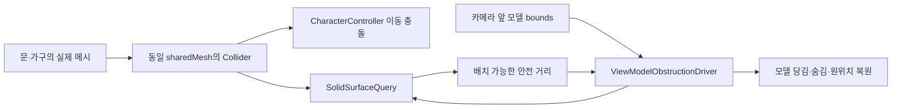

# R01 문·가구 충돌체와 모델 표면 감지 보완

2026-10-20. 마우스·WASD·공통 조작 상태는 유지하고, 충돌만 별도 기능 단위로 수정합니다.

## 확인된 원인

현재 공유 `Door.prefab`, R01 기본 방의 입구 `Door`, R01 A 소품 묶음의 `Hemnes.Drawer`에는 MeshFilter/Renderer만 있고 Collider가 없었습니다. 보이는 외형은 물리 충돌체를 자동으로 만들지 않습니다. 이 때문에 CharacterController가 열린 출입구를 통과하고, 손 대체 모델 보정도 가구·문 표면을 감지하지 못합니다.

사용자님 Unity 로그에서 실제 벽 접촉은 `Room_01_A_Structure` MeshCollider, 반경 300mm·skin 30mm, 표시 메시와 충돌 메시 동일로 확인했습니다. 기존 방 구조 전체를 감싼 BoxCollider 문제가 아닙니다. 현재 R01의 출입구 중앙에서 좌우로 이동하면 콜라이더 없는 문을 통과하는 것을 Unity 네이티브 검사에서 재현했습니다.

또한 단면 삼각형 메시에서 표면 뒷면 방향으로 접근하면 기존 단방향 SphereCast가 누락되어 모델이 계속 보이는 것을 재현했습니다. 같은 평면의 반대 winding에서는 감지가 동작했습니다. 이 검사는 R01의 모든 벽 면이 잘못됐다는 뜻은 아닙니다. 벽 메시의 방향과 무관하게 모델을 보호할 수 있도록 조회를 보완합니다.

## 수정 파일과 의도

| 파일 | 수정 |
|---|---|
| `Assets/2.Model/Prefabs/Door.prefab` | 문 MeshFilter와 같은 sharedMesh를 사용하는 non-convex MeshCollider 추가 |
| `Assets/2.Model/Prefabs/R01/SILENT_Room_01_Final/Prefabs/Room_01_Final.prefab` | 기존 입구 Door에도 같은 방식의 Collider 추가. 구조물의 기존 MeshCollider는 유지 |
| 같은 폴더의 `Room_01_Final 1.prefab` | Hemnes.Drawer에 같은 방식의 Collider 추가. 카드 모델에 임의의 통짜 벽은 만들지 않음 |
| `Player/SolidSurfaceQuery.cs` | 자기 플레이어/Trigger 제외·눈 위치 겹침·정방향/역방향 구 스윕을 한곳에 모은 Unity 물리 어댑터 |
| `Player/ViewModelObstructionDriver.cs` | bounds 계산과 표시 상태 소유는 유지하고 안전 거리 계산만 SolidSurfaceQuery에 위임 |
| `Editor/RoomCollisionChecks.cs` | 동일 단면 양방향·모델 복원·전역 설정 보존·실제 프리팹과 캡슐 충돌을 검사하는 재사용 메뉴 |

Collider는 GameObject의 실제 메시와 같은 Transform을 사용하므로 위치·회전·스케일이 시각 외형과 함께 적용됩니다. 프리팹 원본 MeshCollider라는 Unity의 데이터 구성을 재사용하며 프리팹별 충돌 스크립트를 만들지 않았습니다. CSV 앵커와 프리팹 선택 규칙은 변경하지 않았습니다. 새 방/가구도 물리 충돌이 필요한 외형에 Collider를 작성해야 합니다. 카드·UI 장식·손 모델까지 일괄 추가하지 않습니다.

## 표면 조회 계산

먼저 눈 위치에 구가 이미 겹치는지 검사하고, 카메라에서 모델 방향으로 정방향 SphereCast를 합니다. 뒷면 누락은 모델 끝보다 구 지름만큼 먼 위치에서 반대 방향으로 추가 조회합니다. 역방향 구가 닿은 중심 위치에서 지름 `2r`과 여유를 빼 눈 쪽의 안전 거리로 환산합니다. 두 결과 중 더 짧은 거리를 사용합니다. `Physics.queriesHitBackfaces` 전역 설정은 변경하지 않습니다.

고정 결과 버퍼를 재사용하며 포화되면 불완전한 결과로 관통을 허용하지 않습니다. 몸체 크기는 시트의 1800mm/300mm, skin은 설정의 30mm를 유지합니다. 이 모듈은 Unity의 bounds/충돌 조회를 담당하므로 float를 사용하며 게임 시간·이동·시점 상태의 정수 규칙을 바꾸지 않습니다. 프레임마다 메시를 복제하거나 Collider를 새로 만들지 않습니다.

## 검사

Play 종료 상태에서 **Tools > Game > Verify R01 Collision**을 실행합니다. 임시 씬에서 검사한 뒤 제거하고 원래 활성 씬을 복원합니다. 사용자님 원본 씬은 저장하지 않습니다. 실제 데이터와 분리한 단면 양방향 검사, 원상 복원, 실제 프리팹 Collider/메시 일치, 문·가구의 캡슐 차단, 실제 R01의 출입구를 피한 네 방향 벽 차단을 확인합니다.

적용 후 연결된 Unity 6000.2.8f1에서 이 검사를 실행해 **18개 네이티브 물리 검사 통과**를 확인했습니다. 실제 Unity의 스크립트 컴파일과 별도 Editor/Windows 대상 참조 컴파일도 통과했습니다. 별도 배치 Unity 실행은 라이선스 초기화 문제로 완료하지 못했으며, 통과 결과는 사용자님이 연결해 주신 본 프로젝트의 Unity MCP 검사입니다. 화면 렌더링·사용자님 마우스 조작·빌드 실행을 자동 검사했다는 의미는 아닙니다.

플레이 검토는 로컬 테스트 A로 새로 입장해서 진행합니다. 서랍·문으로 걸어가면 몸이 통과하지 않아야 하고, 큐브는 가까운 표면에서 당겨지거나 숨은 뒤 떨어지면 돌아와야 합니다. 문을 여는 게임 기능은 아직 연결되지 않았으므로 현재 닫힌 문이 막는 것은 정상입니다. 추후 문 기능은 문 외형과 그 Collider를 같은 오브젝트의 수명/회전으로 관리해야 합니다. 이번 수정은 잠금 허가·정답 API나 문 개방을 우회하지 않습니다.

실제 빌드·두 PC 검사는 이 충돌 단위의 Unity 네이티브 검사와 구분합니다. 온라인에서는 서버 CSV 번들을 사용하므로 이전에 확인된 서버/클라이언트 CSV 차이도 별도로 맞춰야 합니다.
