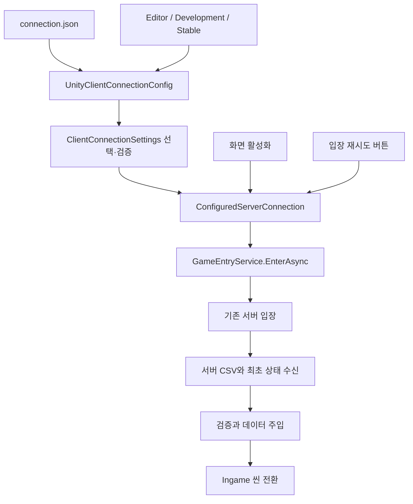

# 환경별 서버 주소와 Join 입장

2026-10-23 갱신. 환경별 접속 설정과 시작 메뉴 입장 안내입니다. 최신 메뉴 연결은 [Join 메뉴 가이드](JoinMenu.md)를 봅니다. 플레이어·Closeup·정답/문 API·HTTP Protobuf·협동 엔딩은 현재 코드에 연결되어 있습니다. 전체 구조와 이번 검사 결과는 [종합 점검](ArchitectureReview.md)을 봅니다.

## 설정 위치와 실행 환경

설정 파일은 `Assets/StreamingAssets/Configuration/connection.json`입니다. Unity 빌드에 함께 복사되며, Windows/Linux 빌드에서는 `실행파일이름_Data/StreamingAssets/Configuration/connection.json`에서 읽습니다. 빌드 폴더 전체를 전달해야 합니다.

| 환경 | 선택 조건 | 현재 주소 |
|---|---|---|
| Editor=0 | Unity Editor | http://127.0.0.1:3000 |
| TestBuild=1 | Development Build | http://192.168.1.34:3001 |
| StableBuild=2 | 일반 빌드 | connection.json에 등록한 클라우드 주소 |

에디터는 Development Build 체크 여부와 관계없이 editor 설정을 선택합니다. 현재 stableBuild 주소는 등록되어 있습니다. 주소를 바꿀 때 stableBuild.serverBaseUrl을 갱신하고 재실행/새 빌드에 반영합니다. 빈 주소는 검증 오류이며 다른 환경으로 대체하지 않습니다. config에 토큰이나 비밀 키를 저장하지 않습니다.

현재 Join의 Start_UI는 **탈출하기 버튼**으로 입장을 요청합니다. autoConnect 값과 관계없이 버튼 입력을 기다립니다. 이 설정은 기존 개발/호환 화면의 자동 실행용으로 보존하며 새 Join에서는 ConfiguredServerConnection.StartAsync를 호출하지 않습니다. 오류 후 탈출하기로 같은 config 주소에 재시도합니다. 주소 입력창·별도 자동 재시도 루프는 없습니다.

서버 없이 CSV를 검사하려면 Start_UI의 로컬 A/B 버튼을 사용합니다. 새 Join에서는 autoConnect를 변경할 필요가 없습니다. 로컬 A/B 버튼은 에디터에서만 표시합니다. Join 씬의 버튼에는 `EditorOnly` 태그를 지정하여 Development Build를 포함한 모든 빌드에서 오브젝트를 제외합니다. View도 에디터 여부로 표시를 제한합니다. 이미 실행한 앱이 설정 파일을 계속 감시하는 기능은 없으며 수정 후 재실행합니다. 안정화 빌드는 클라우드 주소를 설정하고 Development Build를 해제합니다.

## 바뀐 코드와 의도

| 파일 | 기능과 의도 |
|---|---|
| `Session/Presentation/JoinMenuScreen.cs` | config를 읽고 Presenter를 조립합니다. 자동 시작 대신 탈출하기 입력을 기다립니다. |
| `Configuration/ClientConnectionSettings.cs` | JSON 문서·프로필과 불변 실행 설정을 분리합니다. schemaVersion=1을 확인하고 현재 환경의 프로필만 선택·검증합니다. 알 수 없는 환경이나 빈 주소를 거절합니다. |
| `Common/Networking/HttpServerAddress.cs` | 주소 검증·공백/끝 슬래시 정리를 공통화합니다. config와 실제 HTTP 클라이언트가 같은 계약을 사용합니다. HTTP/HTTPS만 허용하고 사용자 정보·query·fragment는 거절합니다. |
| `Configuration/ConfiguredServerConnection.cs` | 자동 입장과 버튼 재시도의 공통 명령입니다. 최초 자동 실행은 한 번이며 진행 중인 접속과 중복 실행하지 않습니다. 취소·실패 후 명시적인 재시도를 지원합니다. |
| `Configuration/Infrastructure/UnityClientConnectionConfig.cs` | Unity 실행 환경을 판별하고 StreamingAssets 파일을 읽는 어댑터입니다. 현재 Windows/Linux 파일 시스템을 대상으로 합니다. Android/WebGL 입력 방식은 별도 어댑터가 필요합니다. |
| `Editor/ClientConnectionBuildValidator.cs` | 빌드 옵션에 맞는 환경을 검사합니다. 잘못된 설정으로 빌드 파일을 만드는 일을 사전에 막습니다. |
| `World/GameEntryPresenter.cs` | View의 입력 문자열 대신 주입한 설정을 사용합니다. 자동/수동 입장 모두 기존 GameEntryService를 호출합니다. |
| `Session/Presentation/SessionConnectionPresenter.cs` | 콘텐츠 입장이 없는 세션 화면도 같은 설정·공통 명령을 사용합니다. |
| `Session/Presentation/SessionConnectionScreen.cs` | 설정 로드 → Presenter 조립 → 자동 입장을 연결합니다. 비활성화 시 요청을 취소하고 구독을 해제합니다. 이전 활성화의 늦은 오류가 새 화면을 덮지 않도록 구분합니다. |
| `SessionConnectionView`, `ISessionConnectionView` | 주소 입력창과 관련 View 참조를 제거하고, 로컬 테스트 버튼은 에디터에서만 표시합니다. 오류·입장·로컬 테스트 화면은 기존 구조를 재사용합니다. |
| `Networking/SessionApiClient.cs` | 주소 검증을 공통 HttpServerAddress에 위임합니다. 이번 단계의 네트워크 본문 형식은 변경하지 않았습니다. |

설정 선택은 순수 C# 로직, 파일/빌드 환경 판별은 Unity 어댑터, 입장은 기존 서비스가 담당합니다. 설정 객체는 생성자 DI로 전달합니다. 자동 입장을 위해 HTTP 요청이나 CSV 동기화 로직을 다시 구현하지 않습니다. 상태 반영 이벤트와 방 로더는 기존 구조를 유지합니다.

## 검사와 사용자님 확인 순서

기존 123개와 신규 31개, 총 154개 순수 C# 검사를 통과했습니다. 설치된 .NET 10 SDK에서 같은 소스의 임시 프로젝트로 실행했으며 기존 검사 프로젝트의 net8 대상은 유지합니다. 실제 config JSON 값, 주소 검증, 환경 선택, 중복 요청, 취소, 실패 후 재시도, Presenter와 기존 입장/데이터/씬 전환 연결을 검사합니다.

Unity 6000.2.8f1의 .NET Standard 2.1·UnityEngine·UnityEditor·uGUI·TMP 참조 컴파일도 통과했습니다. 실제 Unity Play와 Windows 빌드 실행 확인은 별도입니다.

1. 로컬 개발 서버를 127.0.0.1:3000에 실행하고 Join을 Play합니다. 입력이나 버튼 클릭 없이 입장과 Ingame 전환을 확인합니다.
2. 에디터 서버를 끈 뒤 Play하면 접속 오류가 표시되는지 확인합니다. 서버를 켜고 입장 버튼으로 재시도합니다.
3. 로컬 A/B 검사는 Join Play 후 Start_UI의 해당 버튼을 선택합니다. 새 메뉴에서는 config의 autoConnect를 바꾸지 않아도 됩니다.
4. Docker 테스트 서버가 호스트 3001 포트를 공개한 상태에서 Development Build를 체크해 Windows 테스트 빌드를 만듭니다.
5. 새 빌드의 Join 화면에 주소 입력창과 로컬 테스트 버튼이 없는지 확인합니다. 두 PC에서 192.168.1.34:3001로 자동 입장하는지 확인합니다. 해당 IP와 포트의 접근 가능 여부는 LAN·방화벽 설정에 따릅니다.
6. 등록된 stableBuild 주소를 확인한 뒤 Development Build를 해제해 기존 stable 폴더에 빌드합니다. 빈 주소 거부 검사는 별도 설정 사본으로 확인합니다.

## 현재 통신 상태

게임 API는 Google Protobuf 바이너리로 전환했습니다. 입장·조회·ready·heartbeat·퇴장·CSV 묶음·문·정답 API가 같은 바이너리 경계를 사용합니다. config JSON은 로컬 편집용 파일로 유지합니다. 메시지 생성과 HTTP 바인딩·로컬 배포는 [문·정답 API 안내](RoomApiAndProtobuf.md)를 따릅니다. 플레이어·문/입력 UI는 현재 연결되어 있고 실제 빌드 검증은 별도입니다.
