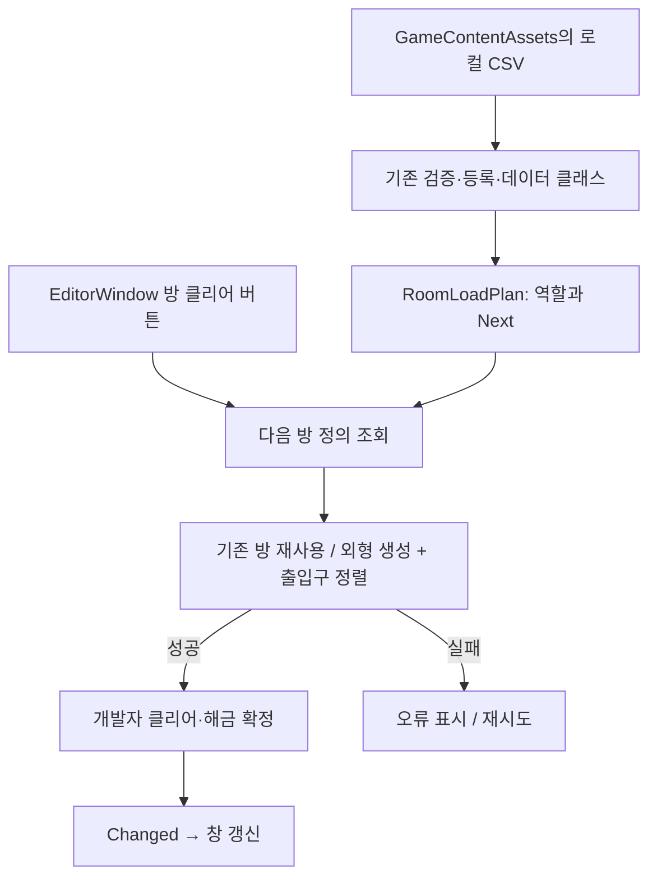

# 에디터 방 클리어 테스트

2026-10-20. 오브젝트 스폰 구조를 정리하기 전, 방 외형·순서·출입구 연결을 확인하는 개발자 도구입니다. `Assets/3.Script/Editor` 안에 있어 Development Build를 포함한 플레이어 빌드에는 들어가지 않습니다.

## 사용 순서

1. `Assets/1.Scene/Ingame.unity`를 열고 Play합니다. 이 도구는 Join·서버 입장을 요구하지 않습니다. 일반 게임의 Join → Ingame 흐름에서도 사용할 수 있으나 클리어 상태는 서버에 반영되지 않습니다.
2. Unity 메뉴 `Tools > Game > Room Clear Test`를 엽니다.
3. 미리보기 역할 A 또는 B를 고른 뒤 **미리보기 시작**을 누릅니다.
4. 첫 방과 같은 RoomNo의 RoomSceneView가 씬에 있으면 기존 방을 재사용합니다. 없으면 CSV의 RoomPrefabID로 외형 프리팹을 생성합니다.
5. R01의 **이 방 클리어 → 다음 방 자동 생성**을 누르면 ROOM_A/B의 Next 행을 찾아 R02 외형을 생성하고 R01 출구에 R02 입구를 맞춥니다. 이전 방은 유지합니다. 방 번호에 1을 더해 다음 방을 추측하지 않습니다.
6. **Scene 뷰에서 보기**로 해당 방을 선택·확대합니다. Game 카메라나 플레이어를 이동하는 기능은 아닙니다. 첫 방은 기존 배치를 사용하고, 후속 방은 출구·입구 연결점에 맞춰 전체 이동·회전합니다.
7. 개방된 다음 방에서도 같은 버튼을 누릅니다. 잠긴 방과 이미 클리어한 방은 누를 수 없습니다.
8. **미리보기 종료 / 상태 초기화**, 창 닫기, 씬 전환, Play 종료 시 도구가 생성한 루트와 방만 정리합니다. 원래 씬 오브젝트는 제거하지 않으며, 연결 때문에 이동한 기존 방은 원래 위치·회전으로 복원합니다. 역할을 바꾸려면 먼저 종료합니다.

## 범위와 오류 처리

- 문·정답 API, 실제 서버 클리어, LocalRoomProgression, GameEntryService의 해금 상태를 변경하지 않습니다.
- RoomSceneView.Load를 호출하지 않으므로 CSV 내부 오브젝트 생성·앵커 검증·WorldReady 보고를 수행하지 않습니다. 실제 게임 로더 누락이나 embedded 연결 문제를 고치는 기능도 아닙니다.
- 기존 GameContentAssets의 CSV 읽기 → CsvDataStore 검증·등록 → CsvGameData 변환, RoomLoadPlan의 역할·활성 행·프리팹 경로 선택을 재사용합니다.
- 다음 방 프리팹 생성과 연결점 정렬이 모두 성공한 뒤 개발자 클리어 상태를 확정합니다. 연결점이 없거나 중복되면 새 후보 방은 제거하고 미확정 상태로 남습니다. 실패 시 메시지를 표시하며 현재 방은 클리어되지 않아 재시도할 수 있습니다. 원래 방과 이미 생성한 방은 유지합니다.
- 현재 ROOM_A/B 7번 방 프리팹 경로는 미완성입니다. 6번 방 클리어로 7번 방 생성을 요청하면 누락 오류가 날 수 있습니다. 임의 프리팹으로 대체하지 않습니다.
- 데이터는 시작할 때 읽은 스냅샷입니다. CSV를 바꾸면 미리보기를 종료하고 다시 시작합니다.

## 코드와 책임

| 파일 | 책임 |
|---|---|
| Editor/DeveloperRoomProgression.cs | 순수 C# 개발자 상태. Room ID 정수 집합으로 해금·클리어를 분리하고 CSV Next를 따릅니다. 확정 후 Changed 이벤트를 보냅니다. |
| World/RoomConnectionAlignment.cs | 공통 Unity 배치 모듈. 방 번호로 연결점을 찾고 다음 방 전체의 위치·회전을 정렬합니다. 클리어 판정은 담당하지 않습니다. |
| Editor/RoomClearPreviewSession.cs | 생성·연결·소유권 어댑터. 생성물 제거와 빌려 쓴 방의 원래 배치 복원을 담당합니다. |
| Editor/RoomConnectionAlignmentChecks.cs | 임시 오브젝트로 방향별 정렬·중첩 연결점·누락·중복·재정렬·스케일 검사를 실행하는 에디터 메뉴입니다. |
| Editor/RoomClearTestWindow.cs | EditorWindow 입력·표시와 서비스 조립. 상태 이벤트를 구독하고 창 종료 시 해제합니다. |
| Tools/RoomClear.Tests | 현재 CSV로 역할별 순서·잠금·중복·마지막 방·이벤트 시점·초기화를 검사합니다. |

개발자 조작은 에디터 어댑터에 한정하고 실제 서버 권한과 구분합니다. 런타임 통신·진행 모듈에 우회 명령을 추가하지 않습니다.

## 연결점 작성 규칙

현재 연결점은 사용자님이 제작 중입니다. 코드는 위치를 추측하거나 새 연결점을 임의로 만들지 않습니다. Play를 끈 상태에서 다음과 같이 작성하고 씬/프리팹을 저장한 뒤 다시 Play합니다.

| 방 | 입구: 이전 방과 맞닿는 곳 | 출구: 다음 방으로 나가는 곳 |
|---|---|---|
| R01 | 첫 방이라 불필요 | R01_DoorPoint |
| R02 | R02_EntryPoint | R02_DoorPoint |
| R03 | R03_EntryPoint | R03_DoorPoint |
| R04 | R04_EntryPoint | R04_DoorPoint |
| R05 | R05_EntryPoint | R05_DoorPoint |
| R06 | R06_EntryPoint | R06_DoorPoint |
| R07 | R07_EntryPoint | 마지막 방이라 불필요 |

출구인 R02_DoorPoint를 R02의 입구로 재사용하지 않습니다. 입구와 출구를 구분해야 R01 → R02 → R03을 순서대로 이어 붙일 수 있습니다.

1. 기존 씬 R01_MAP_Basic 아래의 R01_DoorPoint를 확인합니다. 씬에 이미 있는 첫 방을 재사용하므로 실제 씬 안의 연결점을 읽습니다.
2. Room_02.prefab의 내부에 빈 GameObject `R02_EntryPoint`와 `R02_DoorPoint`를 만듭니다. 하위 그룹 안에 있어도 되지만 같은 이름은 정확히 하나여야 합니다. R03 이후도 같은 규칙입니다. Room_01 프리팹을 직접 생성할 때는 그 프리팹에도 R01_DoorPoint가 필요합니다.
3. 연결점은 문턱의 바닥 중앙에 둡니다. 이동 도구를 Local로 바꿔 파란색 Z+ 축이 **각 방의 바깥쪽**, 초록색 Y+ 축이 위를 향하게 회전합니다. 입구 Z+는 이전 방 쪽, 출구 Z+는 다음 방 쪽입니다.
4. 문턱을 기준으로 잡아야 바닥 높이가 이어집니다. 방 루트·부모는 양수의 균등 스케일을 사용합니다. 도구는 문 폭이나 모델 크기를 강제로 바꾸지 않습니다.
5. R01 클리어 시 다음 방을 통째로 회전하여 두 Z+를 반대로 맞추고, 연결점의 월드 위치를 일치시킵니다. R01은 이동하지 않습니다. R02의 출구는 R03 생성 때 사용합니다.
6. 빈 Transform은 문 애니메이션과 충돌체를 열어 주지 않습니다. 모델에 실제 통로가 있어야 하며, 문 개방·충돌체 처리는 별도 기능입니다. 기존 DoorPoint를 CSV 문 스폰에도 쓰는 경우 기준 위치를 바꾸면 문 배치에도 영향이 있으므로 함께 확인합니다.

`Tools > Game > Verify Room Connections` 메뉴는 임시 오브젝트로 23개 배치 검사를 실행하고 즉시 정리합니다. 실제 모델 없이 연결 수학을 확인하는 용도이며, 실제 통로의 벽·문·충돌체·시야 검증은 R01/R02 연결점 제작 후 별도로 해야 합니다.

방 ID·진행 상태는 정수입니다. 이 모듈의 Vector3/Quaternion은 Unity 모델의 위치·회전 배치용으로만 사용하며 시간·서버 진행 계산에는 사용하지 않습니다.
