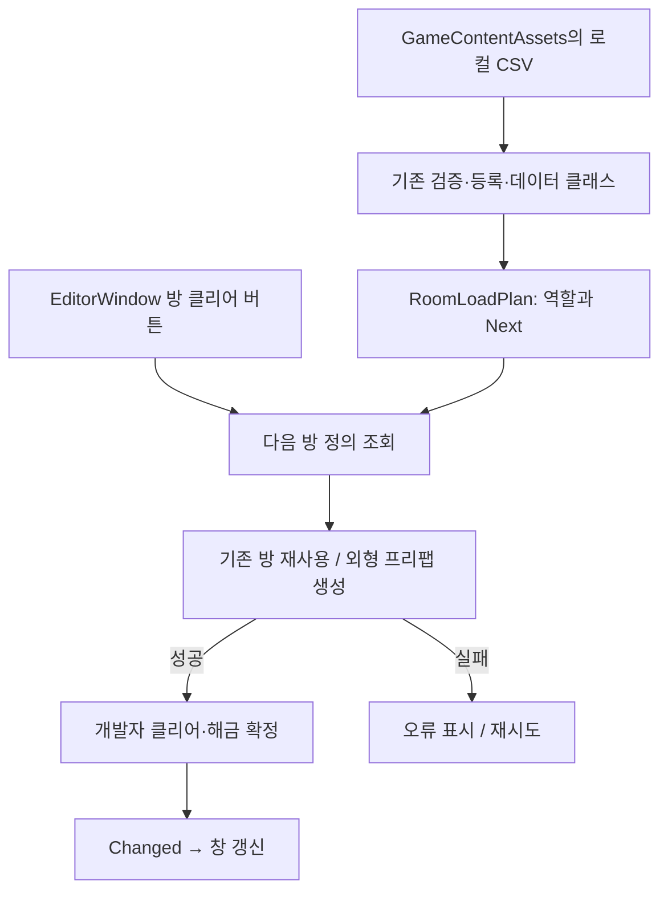

# 에디터 방 클리어 테스트

2026-10-20. 오브젝트 스폰 구조를 정리하기 전, 방 외형과 순서만 확인하는 개발자 도구입니다. `Assets/3.Script/Editor` 안에 있어 Development Build를 포함한 플레이어 빌드에는 들어가지 않습니다.

## 사용 순서

1. `Assets/1.Scene/Ingame.unity`를 열고 Play합니다. 이 도구는 Join·서버 입장을 요구하지 않습니다. 일반 게임의 Join → Ingame 흐름에서도 사용할 수 있으나 클리어 상태는 서버에 반영되지 않습니다.
2. Unity 메뉴 `Tools > Game > Room Clear Test`를 엽니다.
3. 미리보기 역할 A 또는 B를 고른 뒤 **미리보기 시작**을 누릅니다.
4. 첫 방과 같은 RoomNo의 RoomSceneView가 씬에 있으면 기존 방을 재사용합니다. 없으면 CSV의 RoomPrefabID로 외형 프리팹을 생성합니다.
5. R01의 **이 방 클리어 → 다음 방 자동 생성**을 누르면 ROOM_A/B의 Next 행을 찾아 R02 외형을 생성합니다. 이전 방은 유지합니다. 방 번호에 1을 더해 다음 방을 추측하지 않습니다.
6. **Scene 뷰에서 보기**로 해당 방을 선택·확대합니다. Game 카메라나 플레이어를 이동하는 기능은 아닙니다. 프리팹에 저장된 위치·회전으로 생성하므로 배치가 겹치면 프리팹 좌표를 별도 확인합니다.
7. 개방된 다음 방에서도 같은 버튼을 누릅니다. 잠긴 방과 이미 클리어한 방은 누를 수 없습니다.
8. **미리보기 종료 / 상태 초기화**, 창 닫기, 씬 전환, Play 종료 시 도구가 생성한 루트와 방만 정리합니다. 원래 씬 오브젝트는 제거하지 않습니다. 역할을 바꾸려면 먼저 종료합니다.

## 범위와 오류 처리

- 문·정답 API, 실제 서버 클리어, LocalRoomProgression, GameEntryService의 해금 상태를 변경하지 않습니다.
- RoomSceneView.Load를 호출하지 않으므로 CSV 내부 오브젝트 생성·앵커 검증·WorldReady 보고를 수행하지 않습니다. 실제 게임 로더 누락이나 embedded 연결 문제를 고치는 기능도 아닙니다.
- 기존 GameContentAssets의 CSV 읽기 → CsvDataStore 검증·등록 → CsvGameData 변환, RoomLoadPlan의 역할·활성 행·프리팹 경로 선택을 재사용합니다.
- 다음 방 프리팹 생성이 성공한 뒤 개발자 클리어 상태를 확정합니다. 실패 시 메시지를 표시하며 현재 방은 클리어되지 않아 재시도할 수 있습니다. 원래 방과 이미 생성한 방은 유지합니다.
- 현재 ROOM_A/B 7번 방 프리팹 경로는 미완성입니다. 6번 방 클리어로 7번 방 생성을 요청하면 누락 오류가 날 수 있습니다. 임의 프리팹으로 대체하지 않습니다.
- 데이터는 시작할 때 읽은 스냅샷입니다. CSV를 바꾸면 미리보기를 종료하고 다시 시작합니다.

## 코드와 책임

| 파일 | 책임 |
|---|---|
| Editor/DeveloperRoomProgression.cs | 순수 C# 개발자 상태. Room ID 정수 집합으로 해금·클리어를 분리하고 CSV Next를 따릅니다. 확정 후 Changed 이벤트를 보냅니다. |
| Editor/RoomClearPreviewSession.cs | Unity 생성 어댑터와 소유권. 기존 RoomSceneView를 재사용하고 생성한 미리보기만 Dispose로 제거합니다. |
| Editor/RoomClearTestWindow.cs | EditorWindow 입력·표시와 서비스 조립. 상태 이벤트를 구독하고 창 종료 시 해제합니다. |
| Tools/RoomClear.Tests | 현재 CSV로 역할별 순서·잠금·중복·마지막 방·이벤트 시점·초기화를 검사합니다. |

개발자 조작은 에디터 어댑터에 한정하고 실제 서버 권한과 구분합니다. 런타임 통신·진행 모듈에 우회 명령을 추가하지 않습니다.
