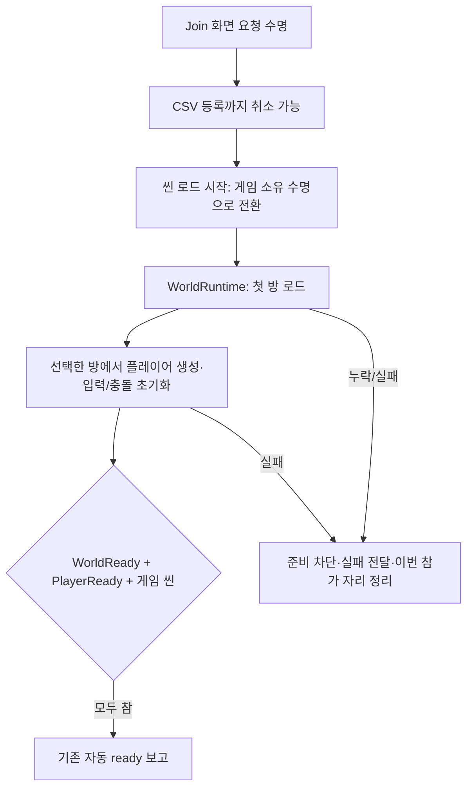

# 씬 진입·준비 조건·데이터 검증 정합성

2026-10-20. 이번 보완은 검토에서 발견한 수명 충돌, 씬 로더 누락, 준비 판정 누락, 캐릭터 검증 불일치, 고정 데이터 검사, 결과 코드 분산을 다룹니다. CSV 내용과 스폰 좌표는 바꾸지 않습니다.

## 이전 동작과 변경 의도

| 문제 | 이전 | 현재 |
|---|---|---|
| Join 화면 제거 | 화면 토큰 취소가 로드 완료 후 입장까지 취소하고 데이터를 지움 | 로드 시작 전까지 요청 취소 가능. 시작 후에는 지속 게임 수명을 사용 |
| Ingame 조립 | RoomSceneView만 있고 실제 로더가 없음 | 별도 WorldRuntime에 로더·첫 방 참조를 직렬화하고 Bootstrapper가 명시적으로 초기화 |
| 프리팹 참조 | 자식 Structure Transform을 프리팹 루트처럼 연결 | Room_01_Final의 실제 루트 Transform으로 수정 |
| 플레이어 실패 | 로그만 남기고 씬 입장 함수 성공 | 예외를 입장 서비스에 전달하여 데이터와 이번 참가 자리를 정리 |
| 준비 보고 | 첫 방 로드만 확인 | 첫 방 + 활성 플레이어·입력/충돌 초기화 + 현재 게임 씬 확인 |
| 캐릭터 검증 | CSV는 가속도 0 허용, 플레이어 생성은 거부 | 공통 CharacterStatUnits로 등록과 실제 사용 조건을 일치 |
| 데이터 검사 | 과거 셀 개수·앵커 개수·경고 0을 고정 | 실제 원본의 각 셀·선택 행을 비교하며 오류와 콘텐츠 경고를 구분 |
| 서버 결과 | 신규 방 API만 문자열을 직접 작성 | 기존 SessionErrorCodes를 사용 |

## 기능과 코드

### 1. 입장 작업의 소유권

`World/GameEntryService.cs`가 연결된 게임 소유 토큰을 보관하고 Dispose 때 취소합니다. CSV를 읽고 등록할 때는 화면 요청 토큰과 게임 토큰을 연결합니다. 씬 로드를 호출하기 직전에 요청 취소를 한 번 더 확인하고, 시작 후에는 게임 소유 토큰으로 넘깁니다.

따라서 씬 전환으로 Join UI의 OnDisable이 발생해도 정상 입장은 계속됩니다. 게임 소유 객체가 제거되거나 초기화가 실패하면 기존 실패 정리 경로가 동작합니다. 취소된 요청이 서버 자리를 확보했으면 그 자리도 정리합니다. 화면은 입력과 구독 수명만 소유하며 씬 전환 중인 게임 작업을 대신 소유하지 않습니다.

### 2. 씬과 첫 방의 조립

`GameFlowBootstrapper.EnterSceneAsync`는 로딩 후 현재 씬의 활성 IngameWorldDriver가 하나인지 확인합니다. `Initialize(this)`로 데이터를 주입하고, `RequireFirstRoom()`으로 실제 로드 성공을 확인한 뒤 그 RoomSceneView를 PlayerSpawnDriver에 전달합니다. Driver의 Start가 먼저/나중에 실행되는 경우 모두 중복 초기화하지 않습니다.

Ingame을 직접 Play한 경우에는 Join으로 강제 이동하지 않습니다. 게임 데이터가 없으면 자동 로드를 시작하지 않아 Room Clear Test의 개발자 미리보기를 사용할 수 있습니다. 정상 Join 흐름에서는 WorldRuntime을 명시적으로 조립합니다.

R01_Runtime의 embedded 설정은 카드·천장·문 외형·서랍을 기존 모델에 연결합니다. A 전용 카드의 hideWhenUnused를 켜서 해당 CSV 행을 사용하지 않는 역할에서는 숨깁니다. 이 바인딩을 쓰는 모델은 동일 프리팹을 다시 생성하지 않습니다. 로드 실패 시 생성물과 임시 가시성 변경을 되돌립니다.

### 3. 준비 조건

`GameFlowBootstrapper.IsGameplayReady`가 공통 판정입니다. 기존 GameplayReadinessCheck는 이 값을 준비 보고 모듈에 전달하는 Adapter입니다.

PlayerReady는 실제 플레이어와 활성 이동 Driver·CharacterController를 확인합니다. 창 포커스는 플레이 준비 완료와 구분합니다. 다른 창을 보고 있다는 이유로 서버 씬 준비를 취소하지 않습니다.

### 4. 캐릭터 공통 정수 정의

`Data/Tables/CharacterStatUnits.cs`는 Unity API가 없는 불변 정의입니다. CSV의 float32 원본을 정수 mm/millidegree 단위로 반올림하고 범위·관계를 검사합니다. PlayerCharacterSettings는 프로필 선택과 이 정의 전달을 맡습니다. CSV의 CharacterStatRule도 같은 정의를 사용하므로 조건을 두 군데에 복사하지 않습니다.

- 속도: 1..100000mm/s. 가감속: 1..1000000mm/s². 이 상한은 고정소수점 연산의 안전 범위입니다.
- 눈높이: 0보다 크고 캡슐 높이 미만.
- 캡슐 반지름 > 0, 높이 >= 2 × 반지름.
- 단차: 0 이상, 캡슐 높이 미만.
- FOV: 0보다 크고 179도 미만.

XML의 character-stat 태그와 서버 CsvSchema의 같은 태그가 전용 검사기를 선택합니다. TypeScript는 Math.fround로 Unity float32 변환을 맞춘 뒤 정수 단위로 검사하며, 양쪽에 동일한 실패 사례 검사를 추가했습니다. 시트 자체는 소수를 유지하고 시뮬레이션 상태는 정수로 사용합니다.

### 5. 서버 결과와 자동 검사

서버의 RoomNotFound/GameNotPlaying/SubmissionNotAllowed도 SessionErrorCodes에서 가져옵니다. HTTP 상태·Protobuf 숫자·정상 true/false 응답은 바꾸지 않습니다.

현재 서버 151개, 클라이언트 공통 198개, 스폰·정수 이동 45개가 통과했습니다. 공통 C# 검사에는 화면 제거 중 입장 유지(로컬/서버), 로드 전 취소, 게임 소유자 종료, 플레이어/방 초기화 실패 시 자리 정리가 포함됩니다. 캐릭터 속도/가감속 0, 안전 범위, 눈높이·캡슐·단차·FOV 및 float32 초과를 양쪽에서 검사합니다.

셀 3121개와 R01 A/B 활성 행 각각 6개는 현재 데이터 현황입니다. 향후 콘텐츠 행 수가 늘었다는 이유만으로 실패하지 않으며 원본 셀과 선택 ID의 의미를 검사합니다. 현재 비활성 앵커 참조 경고 52개는 기록하고 오류와 구분합니다.

## 사용자님 확인 순서

1. Unity 임포트/컴파일 완료 후 Play를 종료한 상태에서 Tools > Game > Verify Ingame Wiring 실행: 첫 방·로더·프리팹 루트·embedded 경로를 확인합니다.
2. Join을 열고 로컬 테스트 A로 입장합니다. 자동 서버 접속을 잠시 사용하지 않으려면 connection.json의 editor.autoConnect=false로 설정합니다. 씬 전환 뒤 데이터와 역할, 플레이어가 유지되어야 합니다.
3. Game 뷰에서 WASD 이동과 바닥/벽 충돌을 확인합니다. 정상 입장 뒤 Verify Gameplay Readiness를 실행하면 플레이어 비활성화 시 준비가 해제되는지 검사합니다.
4. B 모델/이동만 검토할 때는 Ingame 단독 Play > Room Clear Test를 사용합니다.
5. B 정상 입장과 두 PC Playing 검증은 R01_LEDPanelPoint를 실제 프리팹에 배치한 뒤 진행합니다. 임의 좌표를 만들거나 준비 완료로 대체하지 않습니다.

## 현재 남은 범위

- 서버 CSV와 로컬 CSV는 현재 일치합니다. 서버는 메모리 스냅샷을 사용하므로 수정 후 재시작/Docker 이미지 재빌드가 필요합니다.
- B는 활성 R01_LEDPanelPoint가 실제 프리팹에 없습니다. 정상 B 입장은 실패 원인을 표시하며 준비와 이번 서버 자리를 정리합니다. 이는 개발자 기본 방 미리보기와 다릅니다.
- 다음 방 공간 정렬은 개발자 미리보기 도구에만 연결되어 있습니다. 실제 문/입력 UI·마우스 시점·후속 방 콘텐츠와 런타임 이동 연결은 후속 작업입니다.
- Unity Play·메뉴·실제 물리·빌드 검증을 이 환경에서 실행하지 않았습니다. 참조 컴파일은 런타임(Editor 정의)/에디터 도구/Windows 런타임을 나눠 통과했습니다. 에디터 코드가 내부 런타임 구현에 잘못 의존하는 경우도 분리 컴파일에서 확인합니다.
- 격리 Play 도구는 Player/Input System/URP 의존성을 포함하도록 갱신했습니다. B 콘텐츠 미완성으로 시나리오가 중단되면 종료 코드 2이며 전체 통과가 아닙니다. 과거 27/33개 기록을 이번 버전의 결과로 사용하지 않습니다.
