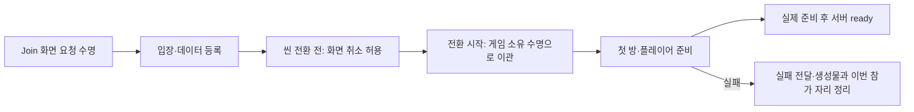

# 씬 진입·준비 판정·객체 수명

> 문서 대조일: **2026-10-26**. 현재 코드·설정을 기준으로 설명을 점검했습니다. 본문의 과거 검사 수치·실행 기록은 해당 날짜의 결과입니다. [현재 상태·문서 검토 범위](문서_현행화_점검표.md)를 함께 확인합니다.

## 1. 현재 진입 순서

JoinMenuScreen → GameEntryPresenter → GameEntryService.EnterAsync → 데이터 검증·역할별 계획 → 상대 참가 확인 → Ingame 로드 → IngameWorldDriver.Initialize → 첫 방 → PlayerSpawnDriver.Initialize → 이동·시점·상호작용 준비 → ready 보고 → 양쪽 준비 후 조작 허용입니다.

## 2. 소유권

`GameFlowBootstrapper`는 씬 전환 동안 유지되는 입장 서비스와 취소 수명을 소유합니다. Join 화면 제거가 이미 시작한 정상 씬 전환을 취소하지 않도록 요청 수명을 이관합니다. 서비스 종료 시 진행 중 요청을 취소하고 이벤트를 해제합니다.

`WorldReady`는 첫 방 준비, `PlayerReady`는 활성 플레이어·이동·충돌체·시점·상호작용 준비를 봅니다. 활성 Ingame 씬까지 맞아야 실제 ready를 보고합니다. 창 포커스는 준비 완료와 구별합니다.

온라인 실패를 로컬 데이터로 대체하지 않습니다. 생성 실패는 이번 생성물과 이번 입장 자리 정리로 이어지며, 기존 다른 참가자의 자리를 무조건 제거하지 않습니다.

## 3. 플레이어 생성 실패와 파괴 순서

[LocalPlayerFactory](../Assets/3.Script/Player/LocalPlayerFactory.cs)는 비활성 루트에서 조립하고 활성화 성공 전까지 입력 복제본을 직접 보관합니다. 실패하면 비활성화·명시적 입력 해제·루트 파괴 순서입니다. 활성화 성공 후 각 Driver로 소유권을 넘깁니다.

`InputActionLease.Dispose`는 반복 호출을 허용하고 해제 후 재활성화하지 않습니다. 손 어댑터는 비활성화 때 구독을 해제하며 이미 파괴된 애니메이터를 접근하지 않습니다. 클로즈업·정답 UI도 캔버스 선행 파괴와 늦은 표시 요청을 보호합니다.

프로브 어댑터는 역할별 원본을 복제하고 자신이 아직 전역 프로브 소유자일 때만 이전 상태를 복원합니다. 영상은 결과 UI 생성 성공 후 재생 포트·텍스처를 해제합니다. 상세는 [규격](RefactorConventions.md), [손](PlayerHandAnimation.md), [프로브](RoomProbeLighting.md), [엔딩](EndingVideo.md)을 봅니다.

## 4. 데이터와 방 배치

서버는 서버 CSV 번들, 서버 없는 검사는 클라이언트 CSV를 사용합니다. 두 폴더가 항상 일치한다고 가정하지 않습니다. 실제 방과 미리보기는 RoomSceneAssembler를 공유하며 Authored와 ConnectionPoints의 배치 정책을 구분합니다.

과거 R01_LEDPanelPoint·R2A_LOCK 등의 누락 기록을 현재 고정 실패 조건으로 사용하지 않습니다. 현재 CSV 검증 결과와 실제 생성 로그에서 해당 역할·방·AnchorID를 확인합니다.

## 5. 검토 순서와 한계

1. 시작·대기 UI 연결 검사와 Verify Ingame Wiring으로 저장 참조를 확인합니다.
2. Join의 로컬 A/B로 별도 입장하며 config.autoConnect는 변경하지 않습니다.
3. 방·플레이어·입력 준비와 종료 후 카메라·조명·이벤트 복원을 확인합니다.
4. 온라인은 두 실행으로 ready·만료·정답·문·마지막 공동 완료를 검사합니다.

이전 단위 검사 수와 누락 사례는 과거 기록입니다. 이번 작업은 문서 대조이며 유니티 실행·클라우드·전체 회귀를 새로 수행했다는 뜻은 아닙니다. 원본 검사 프로젝트의 알려진 구성 차이는 [현행화 점검표](문서_현행화_점검표.md)를 따릅니다.
