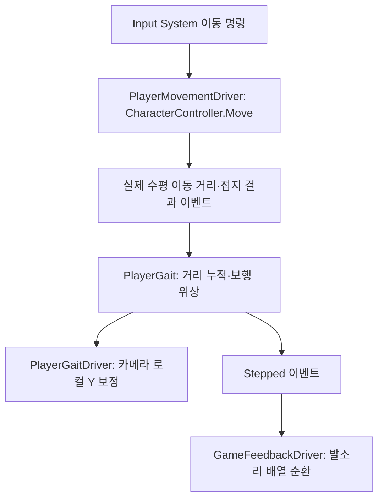
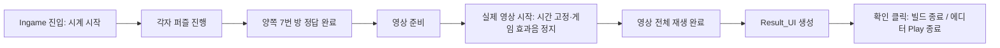

# 보행 연출·게임 사운드·엔딩 결과 화면

기준일: 2026-10-22. Unity 6000.2.8f1 / URP 17.2.0.

## 목차

1. 기능과 설정 원본
2. 보행과 카메라
3. Closeup 효과음
4. 문 경계와 방 배경음
5. 탈출 시간·영상·결과 UI
6. 코드 계층과 수명
7. 테스트 가이드와 확인 범위

## 1. 기능과 설정 원본

사운드는 `SOUND.csv`·`SOUND_LINK.csv`를 사용하지 않습니다. 두 시트는 REGISTRY에서 비활성화했고 기존 CSV 파일·범용 데이터 모델은 호환성 때문에 보존했습니다. 사운드 API나 서버 동기화는 추가하지 않았습니다.

설정 원본은 `Assets/Resources/GameFeedback.asset`입니다. Inspector에서 음원을 직접 연결합니다. 자동 생성기가 Inspector 값을 덮어쓰지 않습니다. Resources 참조로 음원이 빌드에 포함되며 실제 경로 문자열로 음원 폴더를 검색하지 않습니다.

| 설정 | 기본값과 의도 |
|---|---|
| Effects / cue | 동작 종류. 같은 종류를 중복 등록하지 않음 |
| Effects / clips | 배열 순서대로 순환. Footstep은 Silent_Footstep_1 → 2 → 3 → 1 |
| volume / cooldownMs | 0~1 볼륨·중복 재생 제한(ms) |
| closeupOnly | 추가 Closeup 제한. UI 큐 자체는 이 값을 꺼도 Closeup 밖에서 재생하지 않음 |
| spatial / minDistance / maxDistance | 문 효과음의 3D 감쇠. UI와 발소리는 기본 2D |
| Ambient | 방 번호별 Silent_ambi_1~7, 볼륨 0.4 |
| Ambient Fade Seconds | 3초. 원래 음 감소와 새 음 증가를 동시에 진행 |
| Step Distance Meters | 실제 수평 이동 0.75m마다 한 발. 체감 보폭은 플레이 테스트에서 조정 |
| Head Bob Return Seconds | 정지·Closeup·잠금 때 기준 눈높이로 복귀하는 감쇠 시간 0.12초 |
| Effect Voices | 동시 효과음 최대 12개. 모두 사용 중이면 다음 채널을 교체 |
| Doorway Margin Meters | 문턱 앞뒤 0.05m의 중립 구간으로 반복 판정 방지 |
| Maximum Crossing Segment Meters | 프레임 이동 2m 초과는 순간이동으로 보고 경계 기준만 초기화 |
| Result Prefab | Assets/2.Model/Prefabs/UI/Result_UI.prefab |

문 닫기 전용 음원은 제공되지 않았으므로 DoorClose는 미등록입니다. 문 열기 음을 임의로 재사용하지 않습니다. 음원을 받으면 Effects에 DoorClose를 추가하면 됩니다. Correct/Wrong도 필요한 경우 별도 음원을 직접 등록할 수 있습니다. R01_LEDPanel 전용 UI 소리는 이번 범위에서 제외했습니다.

긴 `Silent_ambi_*`는 Streaming으로, 짧은 효과음은 Decompress On Load + Preload Audio Data로 설정했습니다. 원본 WAV·샘플레이트·음질·스테레오는 변경하지 않았습니다. 172초인 6번 방 배경음을 모두 PCM으로 풀어 메모리에 유지하는 비용을 피하고, 짧은 클릭음은 첫 입력 시 로딩 지연을 줄이려는 의도입니다. 실제 메모리·디스크 비용은 Profiler에서 측정해야 합니다.

## 2. 보행과 카메라



`CHARACTER_STAT.HeadBob`는 미터 단위 진폭입니다. 현재 0.02이면 기준 눈높이에서 최대 ±2cm 움직입니다. 0이면 흔들림만 없애고 발소리는 유지합니다. 카메라 회전은 기존 LookDriver가 계속 소유하며 보행 Driver는 위치만 보정합니다. 플레이어 캡슐·실제 이동 속도를 카메라 연출로 변경하지 않습니다.

키를 눌렀어도 벽 때문에 실제 이동하지 않으면 보행 거리가 증가하지 않습니다. 공중에서는 발소리를 내지 않고, 정지·Closeup·포커스 상실·서버 대기·엔딩 조작 잠금 때 흔들림을 기준점으로 돌립니다. Disable 때도 카메라 위치와 미처리 거리를 초기화합니다.

## 3. Closeup 효과음

`PlayerInteractionDriver.FeedbackEmitted`를 GameFeedbackDriver가 구독합니다. HTTP 서비스나 정답 판정 코드에서 AudioSource를 직접 조작하지 않습니다. PuzzleAnswerView는 클릭으로 수행한 동작 종류만 전달합니다.

| 큐 | 현재 음원 | 재생 시점 |
|---|---|---|
| Click | Silent_click_open | Closeup 열기·화면 내부 슬롯 선택 |
| ClickClose | Silent_click_close | 실제 열린 Closeup의 닫기 전환 |
| CloseupOpen / CloseupClose | Silent_ui_open / close | Closeup 표시·종료 |
| DialTurn | Silent_dial | 이전·다음 다이얼 버튼 |
| Confirm / Button | Silent_click_open | 정답 제출·순서 선택 버튼 |
| Reset | Silent_click_close | 초기화 |
| DoorOpen / DoorLocked | Silent_door_open / lock | 실제 문 개폐 판정 결과. UI 전용 큐와 독립 |

일반 플레이 중 허공 좌클릭과 결과 화면 확인 버튼에는 UI 클릭음이 없습니다. Closeup 닫기는 화면 종료 이벤트의 마지막 피드백이므로 닫힌 직후 한 번 재생합니다. UI 쿨다운으로 무시된 입력은 클립 순환 순서를 소비하지 않습니다.

## 4. 문 경계와 방 배경음

다음 방 로드는 입장과 구분합니다. 방을 미리 생성해도 배경음은 바뀌지 않습니다.

```text
1번 방 ambi_1 재생
    ↓ 1번 방의 열린 문 경계를 실제로 통과
0초       ambi_1 100% / ambi_2 0%
1.5초     ambi_1  50% / ambi_2 50%
3초       ambi_1   0% / ambi_2 100% → ambi_1 정지
    ↑ 되돌아갈 때도 동일. 전환 중 복귀하면 현재 볼륨에서 이어서 보간
```

`WorldDoorView`가 닫힌 상태의 모델 Bounds를 문 앵커 좌표계에 저장합니다. 문짝이 회전한 후에도 경계는 원래 문턱에 남습니다. 얇은 수평축을 문 앞뒤 방향으로 사용하고, 문 폭·높이 안을 통과했는지 확인합니다. 경계의 방향 부호에 방 번호를 하드코딩하지 않고 ROOM의 Next 연결과 현재 방을 이용하므로 양방향 왕복이 가능합니다.

두 방이 실제로 로드되어 있고 문이 열린 경우만 전환합니다. 같은 방에서 문 근처를 서성일 때 중복 재생하지 않습니다. 경계가 너무 작거나 문 모델 구조가 바뀌면 실제 통과 위치를 Play에서 확인해야 합니다. 필요하다면 이후 명시적 문턱 폭·높이를 에셋으로 분리할 수 있습니다.

배경음 Source는 사용한 방에 한해서 만들고 최대 방 수만큼 보유합니다. 일반 전환은 두 음만 재생하며, 3초 안에 여러 방을 빠르게 이동한 경우 현재 재생 중인 음들을 함께 감쇠해 갑작스러운 끊김을 피합니다. 매 프레임 씬 전체 검색·프리팹 생성·LINQ 조회는 하지 않습니다.

## 5. 탈출 시간·영상·결과 UI

측정 시작은 Ingame 씬 로드 완료 직후입니다. 온라인에서는 두 사용자 준비 대기·최종 정답 후 상대 대기·영상 준비 시간을 포함합니다. `VideoPlayer.started`가 실제로 발생할 때 한 번 고정하고, 영상 재생 시간은 포함하지 않습니다. 영상 재시도 시 첫 실제 시작 기록을 덮어쓰지 않습니다.

개발자 Room Clear Test에서는 플레이어를 만든 시점을 시작으로 사용합니다. 클라이언트 단조 시계에 기반한 표시용 시간이며, A/B의 진입·조회 시점 차이로 약간 다를 수 있습니다. 동일한 팀 기록·랭킹·영구 저장에는 서버가 소유한 시작/종료 시각을 별도로 정의해야 합니다.



Result_UI는 런타임 복제본만 수정합니다. `Panel/Time_Text`에 **탈출 시간**, `Panel/Time_Space`에 **HH:mm:ss**, 제목에 **탈출 성공**, 버튼에 **확인**을 표시합니다. 원본 프리팹을 수정하지 않습니다. 기존 TMP_InputField는 읽기 전용으로 전환하며, 프로젝트의 한글 폰트를 주입합니다. 결과 화면에서는 플레이어 조작 잠금을 유지하고 포인터로 확인 버튼을 클릭할 수 있습니다.

영상은 VideoPlayer 출력, 게임 효과음은 GameFeedbackDriver 출력입니다. 엔딩 시작 때 게임 효과음과 배경음만 멈추며 AudioListener 전체 볼륨이나 Vivox 음성을 조작하지 않습니다. 새 서버 API는 없습니다.

## 6. 코드 계층과 수명

| 계층 | 파일 | 책임 |
|---|---|---|
| 설정 | Data/GameFeedbackAssets.cs | 음원·연출 값·결과 프리팹의 직접 참조와 검증 |
| 순수 상태 | Player/PlayerGait.cs | 거리 → 보행 위상·발소리 이벤트 |
| 순수 상태 | Audio/AudioCuePlaybackState.cs | UI 범위·쿨다운·클립 순서 |
| 순수 상태 | Audio/AmbientCrossfade.cs | 현재 게인에서 목표 게인으로 전환 |
| 순수 상태 | World/DoorwayCrossing.cs | 문 앞뒤 이동과 중립 구간 판정 |
| 순수 상태 | World/EscapeRunClock.cs | 시간 고정·표시 형식 |
| Unity Adapter | Player/PlayerGaitDriver.cs | 이동 이벤트 구독·카메라 Y 반영 |
| Unity Adapter | Audio/RoomDoorwayAudio.cs | 문 앵커 좌표와 순수 경계 규칙 연결 |
| Unity Adapter | Audio/GameFeedbackDriver.cs | 동작 이벤트 → 직접 참조 클립·AudioSource |
| View | World/EndingResultView.cs | Result_UI 복제·한글·시간·확인 이벤트 |
| 조립 | PlayerSpawnDriver / GameFlowBootstrapper | 의존성 주입·씬 진입 시각·방 로드 구독 |
| 빌드 검사 | Editor/GameFeedbackBuilder.cs | Inspector 설정·UI 경로 검사. 값을 자동 덮어쓰지 않음 |

Observer는 이동·상호작용 완료를 독립적인 연출 소비자에게 전달하는 데 사용합니다. Factory는 기존 플레이어 생성 경로를 재사용합니다. Adapter는 Unity 시간·Transform·AudioSource·VideoPlayer·UI 경계를 담당합니다. 단순 로컬 호출을 전역 이벤트 버스로 보내지 않습니다.

각 플레이어 생성 수명이 연출 상태를 소유합니다. 배경음 전환 완료 후에는 같은 볼륨을 반복 적용하지 않습니다. 첫 선택과 OnEnable은 dirty 갱신으로 재생을 재개합니다. BindWorld는 같은 월드에 중복 구독하지 않으며 다른 입장에는 새 Driver를 사용합니다. GameAudioCue의 0~13 번호는 에셋 직렬화 계약입니다. 결과 UI 생성 성공 후 영상 포트와 RenderTexture는 해제하고 결과 UI만 유지합니다. 파괴할 때 이동·UI·방 로드 이벤트 구독을 해제하고 출력 GameObject를 제거합니다. 게임 판정이나 서버 권한을 오디오 모듈로 넘기지 않습니다. 보행 연출은 로컬 표시이며 재현 가능한 게임 시뮬레이션의 일부가 아닙니다.

## 7. 테스트 가이드와 확인 범위

자동 검사:

```powershell
dotnet run --project Tools/GameFeedback.Tests/GameFeedback.Tests.csproj
dotnet run --project Tools/Ending.Tests/Ending.Tests.csproj
```

Unity에서 `Tools → Game → 사운드·결과 UI 설정 검사`를 실행합니다. 빌드 전에도 같은 검사가 적용됩니다.

1. Join의 클라이언트 테스트 A/B 또는 정상 온라인 입장으로 첫 방과 플레이어를 만듭니다.
2. 이동·정지·벽 밀기·창 포커스 변경·Closeup 열기를 반복해 Y 흔들림과 발소리가 실제 이동에만 반응하는지 확인합니다.
3. Closeup에서 다이얼 이전/다음·입력·초기화·제출·닫기를 확인합니다. 월드 좌클릭·결과 확인에는 UI 클릭음이 없어야 합니다.
4. 열린 문을 넘어 1→2→1, 2→3으로 이동해 3초 전환을 확인합니다. 문만 열기·다음 방 생성·닫힌 문 앞 대기는 전환 조건이 아닙니다.
5. 전환 1초 만에 뒤로 돌아가거나 다음 문을 통과해 볼륨이 튀지 않는지 확인합니다.
6. 7번 방에서 한 명만 정답을 맞히면 기다리고, 양쪽 완료 후 영상이 끝까지 재생되는지 확인합니다.
7. 결과가 영상 끝에만 표시되고 영상 길이가 탈출 시간에 더해지지 않는지 확인합니다. 확인은 빌드에서 앱 종료, 에디터에서는 Play 종료입니다.

2026-10-23 순수 기능 검사 48개, 엔딩 수명 검사 41개와 실제 Unity DLL 참조의 전체 런타임/에디터 C# 컴파일을 사용합니다. 컴파일 통과는 Unity Play·실제 스피커 청취·전체 7개 문턱의 모델 배치 검증을 대체하지 않습니다.

조명과 R01_LEDPanel UI 소리는 보류입니다. 활성 조명 CSV 행에 해당하는 앵커가 방 프리팹에 아직 없으면 기존 로더의 앵커 검증이 입장을 중단합니다. 조명 작업자가 이를 마무리하거나 해당 행을 명시적으로 비활성화한 데이터로 테스트해야 합니다. 이 작업에서 조명 행·방 프리팹을 임의 수정하지 않았습니다.
