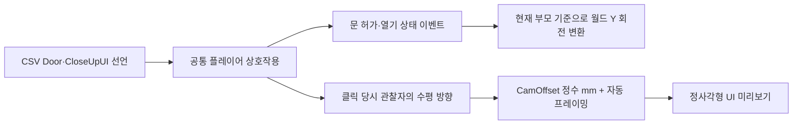
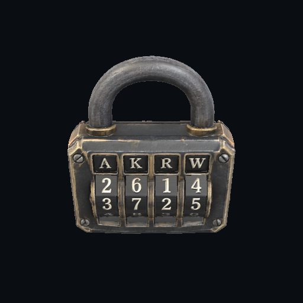

# 문 회전축·Closeup 정면·임시 모델 재질 수정

> 문서 대조일: **2026-10-26**. 현재 코드·설정을 기준으로 설명을 점검했습니다. 본문의 과거 검사 수치·실행 기록은 해당 날짜의 결과입니다. [현재 상태·문서 검토 범위](문서_현행화_점검표.md)를 함께 확인합니다.

2026-10-21 / Unity 6000.2.8f1 / Windows64 Stable 기준입니다.

## 문제가 생긴 이유와 변경 의도

### 문이 옆으로 누운 이유

현재 Door 프리팹과 문 앵커에는 모델 임포트 과정에서 생긴 X축 -90도 등의 회전이 있습니다. 기존 코드는 닫힌 로컬 회전 뒤에 로컬 Y축 회전을 곱했으므로, 모델의 로컬 Y가 실제 방의 위쪽과 다르면 문이 옆으로 누웠습니다.

새 코드는 **프리팹의 DoorHinge를 지나는 월드 Y축**으로 회전합니다. 닫힌 로컬 회전은 저장해 두고, 부모의 현재 월드 회전을 사용해 월드 Y 회전을 다시 로컬 회전으로 변환합니다. 방이 연결 과정에서 돌아가도 현재 부모 좌표계를 사용합니다. 닫을 때는 저장한 로컬 회전으로 복원합니다.

`localOpen = inverse(parentWorld) × worldYTurn × parentWorld × localClosed`

문 허가와 표현 책임은 유지합니다. `DoorInteractionController`가 기존 서비스에서 허가를 받고 상태 변경 이벤트를 보내면 `WorldDoorView`가 회전·충돌체 위치를 반영합니다. 허가된 문의 이후 열기·닫기는 추가 서버 요청 없이 처리합니다. 문 각도는 기존 정수 밀리도 설정을 사용하며 기본값은 90000, 즉 90도입니다. 실제 애니메이션은 현재 즉시 회전하는 기본 표현입니다.

### Closeup이 자물쇠 옆면을 보여준 이유

기존 미리보기는 CSV의 CamOffset을 월드 좌표 벡터로 그대로 사용했습니다. 플레이어가 X 방향에서 자물쇠를 보더라도 미리보기는 항상 월드 Z 방향에서 보므로, 플레이 중 바라보던 앞면이 UI에서는 옆면으로 바뀔 수 있었습니다.

이제 **클릭 당시 플레이어가 바라보는 수평 방향**으로 미리보기 좌표계를 잡습니다. 위아래로 고개를 들어도 수평 기준을 유지하고, 위쪽은 월드 Y를 사용합니다. 표시용 조명도 미리보기 카메라 방향에 맞춥니다.

| CamOffset 성분 | 기준 |
|---|---|
| X | 관찰자 기준 오른쪽 |
| Y | 월드 위쪽 |
| Z | 관찰자가 대상을 보는 수평 방향. 음수는 관찰자 쪽 |

현재 `CamOffset=0,0.3,-0.5`는 관찰자 쪽·위쪽에서 보도록 정수 mm `(0,300,-500)`로 변환합니다. 메시 전체가 화면에 들어오도록 거리를 자동으로 늘릴 수 있어, 최종 카메라 위치가 이 mm 값과 정확히 일치하는 것은 아닙니다. **선택 당시 보고 있던 면을 유지하는 방식**이므로 다른 면에서 선택하면 그 면이 표시됩니다.

메시와 머티리얼만 복사하는 기존 방식은 유지합니다. 원본의 물리·입력·통신 스크립트를 복제하지 않습니다. 미리보기 RenderTexture는 정사각형이고, RawImage도 480×480으로 맞춰 종횡비가 늘어나지 않도록 했습니다.

### 분홍색 큐브 대응

기존 임시 모델은 런타임의 렌더 파이프라인 기본 머티리얼 조회에 의존했습니다. 이제 `PlayerPresentation` 에셋의 `PlaceholderMaterial`에 URP Runtime의 Lit 머티리얼을 직렬화하여 연결합니다. 이 참조를 통해 머티리얼과 셰이더가 빌드 의존성에 포함됩니다.

실제 A/B 모델 프리팹을 연결하면 그 프리팹의 머티리얼을 사용합니다. 이 필드는 큐브·실린더 대체 모델에만 적용합니다. 전역 셰이더 목록을 늘리거나 씬의 다른 재질을 교체하지 않았습니다.

## 기능별 코드 연결

| 파일 | 책임 |
|---|---|
| `Interaction/InteractionPresentationGeometry.cs` | 모델·부모·관찰자 좌표를 구분하는 Unity 표현 경계 |
| `Interaction/WorldDoorView.cs` | 문 상태 이벤트를 월드 Y축 회전에 반영 |
| `Interaction/CloseupPreview.cs` | CSV 오프셋·관찰자 방향·자동 프레이밍·조명 |
| `Interaction/CloseupPanelView.cs` | 정사각형 미리보기 영역 |
| `Player/PlayerPresentationSettings.cs` | 임시 모델 머티리얼 참조와 필수값 검증 |
| `Player/LocalPlayerFactory.cs` | 큐브·실린더에 명시한 머티리얼 연결 |
| `Resources/PlayerPresentation.asset` | 실제 빌드용 머티리얼 참조 |
| `Editor/InteractionPresentationChecks.cs` | 축·시점·머티리얼 자동 검사 |

방 번호·프리팹 ID별 예외를 코드에 넣지 않았습니다. CSV·서버 API·정답 판정은 이번 작업에서 바꾸지 않았으며, 숫자 계산 중 Quaternion·Vector3·float는 Unity 표현 경계에서만 사용합니다.

## 확인한 결과

- 기존 순수 C# 회귀 검사 **295개** 통과. 당시 로컬 CSV 23개·3384개 셀 기준의 과거 검사 기록입니다.
- 새 표현 검사 **22개** 통과. 임포트 축·부모 회전·양/음수 문 각도, 4개 관찰자 방향, 수직 시점 예외, 머티리얼 의존성을 검사합니다.
- 실제 A/B R01에서 같은 플레이어 상호작용 명령으로 문 열기·닫기를 실행했습니다. 월드 Y 회전 오차 0도, 닫힘/열림 메시 높이 약 **2.402m**로 유지됐습니다.
- 실제 B R01 자물쇠를 월드 +X 쪽에서 선택하고, 옆면이 아닌 넓은 앞면이 보이는 미리보기 화면을 캡처해 확인했습니다.
- RenderTexture 512×512, UI 480×480을 확인했습니다. 이미지 캡처를 위한 강제 URP 렌더 요청은 검사에서만 사용했습니다.

개발자 Room Clear Test에서는 정답 서비스 없이 모델 미리보기를 검사했습니다. 실제 온라인 정답 제출과 두 PC의 최종 빌드 화면 검사는 별도로 확인해야 합니다. 프리팹과 CSV를 편집 중인 다른 작업자의 내용을 덮어쓰지 않았습니다.

## 수정본 Stable 빌드

Windows64 Stable 클린 빌드가 성공했습니다. 출력 위치는 **`build/Stable-InteractionPoseFix/`**이며 실행 파일 이름은 `listen.exe`입니다. 출력 보고서 용량은 **2,162,480,347바이트(약 2.16GB)**입니다. 앞서 적용한 텍스처 압축 설정을 유지했습니다.

빌드 오류 0개, 경고 2개입니다. 기존과 같은 Unity 서비스 프로젝트 연결·네이티브 심볼 업로드 관련 경고가 남아 있습니다. 빌드 보고서에서 지정한 URP Runtime Lit 머티리얼과 Lit 셰이더가 포함된 것도 확인했습니다. 실제 Windows 플레이어에서의 최종 분홍색 모델 해소와 온라인 입력·문 API 흐름은 사용자 테스트 항목입니다.

## 사용자 테스트

1. 새 Stable 빌드 폴더 전체로 두 PC를 실행합니다. 기존 실행 파일은 코드 변경이 자동 반영되지 않습니다.
2. 문 허가를 받은 뒤 열고 닫습니다. 문 높이가 그대로이며 세로 경첩 방향으로 회전하는지 확인합니다.
3. 자물쇠의 넓은 면을 바라보고 좌클릭합니다. 화면에 보던 면이 유지되고 AKRW·숫자 등 모델의 표식이 보이는지 확인합니다.
4. 미리보기를 닫고 다른 방향에서도 열어 관찰자 기준이 따라오는지 확인합니다. 고개를 위·아래로 움직여도 불필요한 좌우 기울어짐이 없어야 합니다.
5. 큐브·실린더가 분홍색이 아닌 정상 URP 머티리얼로 표시되는지 확인합니다. 정답 제출·문 허가 API 흐름도 함께 확인합니다.

에디터의 자동 검사는 `Tools → Game → 문 회전·클로즈업 방향 검사`에서 실행합니다. Room Clear Test의 플레이어는 문과 모델 미리보기를 확인하는 경로이며 정답 입력 서비스 검사는 Join의 로컬 테스트 또는 온라인 접속을 사용합니다.

로컬 변경 전 백업은 server 작업 폴더의 `client-refactor/interaction-pose/backup/20261021-162639/`에 있습니다. 문·자물쇠 프리팹의 피벗 자체를 다시 만드는 작업은 하지 않았습니다. 다른 메시나 피벗 구조의 프리팹을 추가하면 해당 프리팹에서도 회전·통로·앞면을 확인해야 합니다.

## 후속 경첩 위치 보완

문 중심을 고정하던 표현을 보완했습니다. 현재는 DoorHinge가 고정되도록 문 위치도 함께 계산합니다. 앞서 설명한 방향 변환에 위치 공전을 더한 것으로, [왼쪽 경첩 기준 개폐](DoorHingeFix.md)의 프리팹 규칙과 최신 빌드를 사용합니다.
