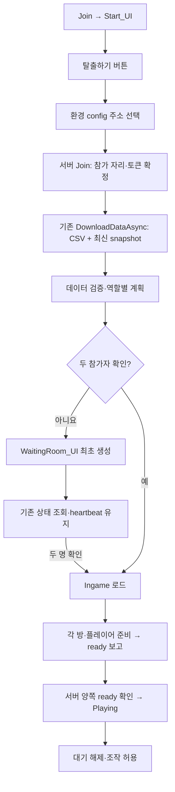

# Join 시작 메뉴·참가자 대기 UI

기준일: 2026-10-23. `Start_UI`와 `WaitingRoom_UI`를 실제 Join 입장 흐름에 연결했습니다.

## 1. 동작과 두 가지 준비 조건

1. Join을 실행하면 `Start_UI`가 표시됩니다. **탈출하기**를 눌러야 입장을 요청합니다.
2. 접속 주소는 기존 connection.json의 Editor/TestBuild/StableBuild 프로필을 사용합니다. 주소 입력창은 만들지 않습니다.
3. 서버 Join → CSV 다운로드·최신 상태 조회 → 데이터 검증/등록까지 기존 서비스를 사용합니다.
4. 서버 상태에 참가자가 한 명이면 `WaitingRoom_UI`를 생성합니다. 플레이어 A/B 접속 표시와 대기 문구를 갱신합니다.
5. 이미 두 명이면 **WaitingRoom_UI 실행 오브젝트를 한 번도 생성하지 않고 Ingame 로딩**을 시작합니다. 역할 A/B가 아니라 실제 참가자 상태로 결정하므로 동시에 들어와 둘 다 두 명을 확인하면 양쪽 모두 대기 UI를 생략할 수 있습니다.
6. 먼저 입장한 사람은 상대가 들어온 뒤 씬 전환이 완료될 때까지 같은 대기 UI를 유지합니다. Start_UI로 다시 깜빡이지 않습니다.
7. Ingame의 방·플레이어 준비 → 양쪽 ready → 서버 Playing 확인 → 조작 허용은 유지합니다.

**참가자 두 명 = 씬 로드 허용**, **두 사람 ready = 플레이 조작 허용**입니다. 두 번째 사용자가 Join 대기를 생략해도 준비 전 플레이를 허용하지 않습니다. Ingame에서 준비를 가리는 기존 SessionWaitingView는 Join의 WaitingRoom_UI와 별개의 화면입니다.

## 2. 연결 도식

입장 전에 인원을 추측하는 별도 공개 API는 추가하지 않았습니다. Join 응답에는 전체 인원이 없지만 기존 데이터 다운로드가 같은 요청 수명에서 최신 snapshot을 이미 조회합니다. 이 결과를 사용하여 추가 조회·폴링 타이머·프로토콜 변경을 피했습니다.

## 3. 코드의 책임과 의도

| 코드 | 변경/추가 내용 | 분리 이유 |
|---|---|---|
| [JoinMenuScreen](../Assets/3.Script/Session/Presentation/JoinMenuScreen.cs) | 세션·Flow·config·View·Presenter 조립, 화면 취소 수명 | Unity OnEnable/OnDisable만 담당. 자동 StartAsync는 호출하지 않음 |
| [JoinMenuView](../Assets/3.Script/Session/Presentation/JoinMenuView.cs) | 프리팹 복제·탈출하기 이벤트·대기 표시·한글 텍스트·오브젝트 정리 | HTTP/인원 판정을 표현 코드에 넣지 않음 |
| [GameEntryPresenter](../Assets/3.Script/World/GameEntryPresenter.cs) | 버튼 명령 → 기존 config 연결, 대기 UI 표시 여부 전달 | `IGameEntryView` 다형성으로 기존 테스트 화면과 새 메뉴를 연결 |
| [SessionConnectionPresentation](../Assets/3.Script/Session/Presentation/SessionConnectionPresentation.cs) | ShowWaitingRoom 표시 값 추가, 기존 호출은 false 기본값 | Unity 오브젝트 대신 읽기 전용 표시 값 전달 |
| [GameEntryService](../Assets/3.Script/World/GameEntryService.cs) | 실제 참가자 대기 여부 공개, 이미 두 명이면 대기 알림 생략 | 입장·검증·씬 진입 사용 사례와 상태 소유권 유지 |
| [SessionStartGate](../Assets/3.Script/World/SessionStartGate.cs) | 표시용 ParticipantCount 제공, 기존 입장/조작 조건 유지 | 서버 상태 해석을 View와 분리 |
| [JoinMenuChecks](../Assets/3.Script/Editor/JoinMenuChecks.cs) | 씬/프리팹 참조 검사, Play 표시 검사, 빌드 전 연결 검사 | 잘못된 UI 경로·활성 구형 접속 화면·이벤트 시스템 중복을 조기 확인 |

Facade와 Observer 구조는 유지합니다. 별도 전역 상태나 이벤트 버스를 추가하지 않았습니다. Presenter의 대기 표시 값은 한 입장 시도에 종속되며 성공/실패/재시도에서 초기화됩니다. 같은 입장 중 반복 렌더는 WaitingRoom_UI를 다시 생성하지 않습니다.

## 4. 씬·프리팹 구성과 편집 규격

- `Assets/1.Scene/Join.unity`에 **JoinMenu** 루트와 새 Screen/View를 연결했습니다. 실행 시 그 아래에 Start_UI가 생성됩니다.
- 기존 개발용 Canvas는 비활성화했습니다. 기존 자동 접속 Screen과 입장 버튼은 작동하지 않습니다. 세션·GameFlow·Vivox 수명 객체와 EventSystem은 유지합니다.
- View의 `startPrefab`, `waitingRoomPrefab`, `font`는 씬의 직접 참조입니다. UI는 콘텐츠 CSV에서 찾지 않습니다.
- Start 프리팹: `Assets/2.Model/Prefabs/UI/Start_UI.prefab`, 버튼 계약은 **Start_Button**입니다.
- 대기 프리팹: `Assets/2.Model/Prefabs/UI/WaitingRoom_UI.prefab`입니다.

| 대기 UI 상대 경로 | 연결 기능 |
|---|---|
| Panel/Message_Box/Message_Text | 상대 대기·씬 로딩 안내 |
| Panel/Player_Box/Player1_Row/Name_Text | A 접속 상태·나 표시 |
| Panel/Player_Box/Player2_Row/Name_Text | B 접속 상태·나 표시 |
| 각 Player 행의 Status_Dot | 접속/대기 색상 |

위 경로가 UI 연결 계약입니다. 이름·구조를 변경하면 View와 연결 검사를 함께 갱신합니다. 프리팹 원본의 디자인·이미지·버튼 배치는 유지합니다. 원본 Canvas 루트가 0 스케일이라 런타임 복제본만 scale=1, ScreenSpaceOverlay, 1920×1080 기준 CanvasScaler로 정상화합니다.

WaitingRoom 프리팹 에셋 참조는 존재하지만 두 번째 사용자에게 실행 오브젝트를 만들지는 않습니다. 별도의 Addressables/지연 에셋 로드 시스템을 구현한 것은 아닙니다.

## 5. 에디터·빌드·실패 수명

에디터의 클라이언트 테스트 A/B 버튼은 Start_UI 아래에 기존 EditorOnly 버튼을 복제해 연결합니다. **빌드에서는 생성하지 않습니다.** 서버 없이 로컬 데이터로 입장할 수 있으며 새 Join 메뉴에서는 autoConnect=false로 바꿀 필요가 없습니다.

새 Join 메뉴는 config.autoConnect 값과 관계없이 탈출하기를 기다립니다. 이 값과 ConfiguredServerConnection.StartAsync는 기존 개발/호환 화면의 동작을 위해 남겨 두었습니다. 접속 주소의 환경 선택은 계속 config를 따릅니다.

중복 버튼 입력은 기존 요청 가드가 막습니다. 입장/다운로드/검증 실패는 시작 화면의 안내·재시도로 돌아갑니다. 대기 중 연결 종료는 오래된 허가로 Ingame을 열지 않습니다. 화면 제거 전에 진행 중인 참가자 대기를 취소하고, 씬 로딩을 시작한 이후에는 기존 게임 소유 토큰으로 이관하여 Join 제거가 정상 입장을 취소하지 않게 합니다.

## 6. 검사 결과와 수동 확인

| 검사 | 결과 |
|---|---|
| 신규 순수 메뉴 검사 | 17개 통과: 첫/두 번째, 중복, 대기 유지, 취소, 실패, 재시도, 로컬 |
| 기존 포함 클라 핵심 전체 | 329개 통과 |
| 실제 C# ↔ Node HTTP/Protobuf | 24개 통과. 실제 첫/두 번째 참가자 표시 분기 포함 |
| 전체 소스 Editor/런타임 분리 컴파일 | 각각 오류 0. SerializeField/호환 DTO 정적 경고 64개 |
| Join YAML·프리팹 상대 경로·EditorOnly 참조 | 정적 연결 확인 |
| Unity 실제 임포트·Play·화면 클릭·빌드 | 이번 실행에서 확인하지 못함 |

1. Unity 임포트/컴파일 후 Play를 종료한 상태에서 **Tools → Game → 시작·대기 UI 연결 검사**를 실행합니다. 빌드 전에도 같은 연결을 검사합니다.
2. Join Play 직후 Start_UI만 보이고 탈출하기를 누르기 전 서버 입장 로그가 생기지 않는지 확인합니다.
3. 첫 PC에서 탈출하기를 누릅니다. JoinMenu 아래 WaitingRoom_UI가 한 개 생성되고 내 역할만 접속됨으로 표시되어야 합니다.
4. 두 번째 PC에서 탈출하기를 누릅니다. 두 번째에는 WaitingRoom_UI가 생성되지 않고 Ingame이 로드되어야 합니다. 첫 번째는 기존 대기 화면에서 Ingame으로 넘어가야 합니다.
5. 한쪽의 씬 준비가 늦어도 양쪽 ready 전에는 조작이 차단되고, Playing 후 해제되는지 확인합니다.
6. 대기 중 서버 종료/Play 종료, 접속 실패 후 재시도, 빠른 연속 클릭을 확인합니다.
7. 에디터 Start_UI에서 로컬 A/B를 실행하고, 빌드에서는 해당 버튼이 없는지 확인합니다.
8. Join Play에서 **Tools → Game → 시작·대기 UI 표시 검사**로 격리 복제본의 두 번째 생성 생략·첫 번째 생성·재시도 정리를 검사할 수 있습니다. 원본 프리팹을 수정하지 않습니다.

서버 API·Protobuf·게임 콘텐츠 판정은 변경하지 않았으므로 이 메뉴 변경만으로 서버 이미지를 다시 배포할 필요는 없습니다. 새 클라이언트 빌드에는 변경된 Join 씬과 스크립트를 포함해야 합니다.
