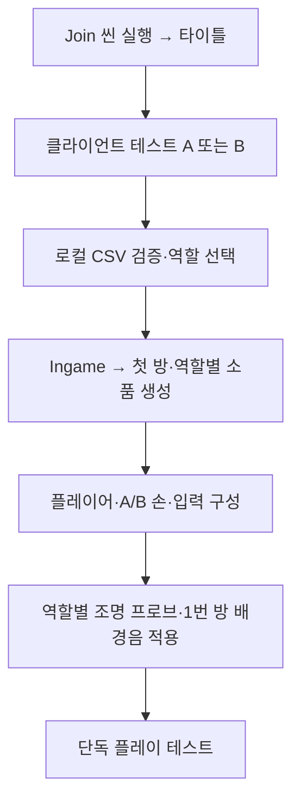

# 서버 없이 타이틀부터 시작하는 로컬 플레이 테스트

기준일: 2026-10-23. Unity 6000.2.8f1에서 현재 코드·CSV·메뉴를 기준으로 작성했습니다.

## 목차

1. [가장 빠른 실행 순서](#1-가장-빠른-실행-순서)
2. [실행 전 준비](#2-실행-전-준비)
3. [타이틀에서 로컬 입장](#3-타이틀에서-로컬-입장)
4. [B: 1번 방 정답부터 2번 방 왕복까지](#4-b-1번-방-정답부터-2번-방-왕복까지)
5. [A: 탐색·손·조명·소리 확인](#5-a-탐색손조명소리-확인)
6. [확인 범위와 협동 진행의 제한](#6-확인-범위와-협동-진행의-제한)
7. [문제 발생 시 확인](#7-문제-발생-시-확인)
8. [검사 기록](#8-검사-기록)

## 1. 가장 빠른 실행 순서

**서버·도커를 켜지 않아도 됩니다. Unity 에디터에서 진행합니다.**

1. `Assets/1.Scene/Join.unity`를 엽니다.
2. Unity 상단의 ▶ 실행 버튼을 누릅니다.
3. 타이틀 왼쪽 아래의 **클라이언트 테스트 B**를 누릅니다.
4. 첫 방이 생성되면 게임 화면을 한 번 클릭해 마우스를 잡습니다.
5. 자물쇠를 화면 중앙에 맞추고 좌클릭해 조작 화면을 엽니다.
6. 슬롯 A·K·R·W를 순서대로 **3·7·2·5**로 맞추고 **정답 제출**을 누릅니다.
7. **돌아가기** → 게임 화면 클릭 → 문을 화면 중앙에 맞춰 좌클릭합니다.
8. 열린 문을 통과해 2번 방으로 들어갔다가 다시 돌아옵니다. 방 배경음이 양방향으로 약 3초 동안 전환되는지 확인합니다.
9. Unity의 ▶ 버튼을 다시 눌러 실행을 종료합니다.

타이틀의 **탈출하기**는 설정된 서버로 접속하는 일반 입장 버튼입니다. 서버 없는 테스트는 **클라이언트 테스트 A/B** 버튼을 사용합니다. 로컬 테스트 버튼은 빌드에서 생성하지 않습니다.

## 2. 실행 전 준비

### 2.1 콘텐츠와 설정

실행이 꺼진 상태에서 다음 메뉴를 확인합니다. 메뉴 이름은 현재 Unity에 표시되는 이름을 그대로 적었습니다.

| 메뉴 | 확인할 내용 |
|---|---|
| `Tools → Game → Rebuild Content References` | 최신 로컬 CSV·프리팹 참조 갱신 |
| `Tools → CSV → 검사기` | 데이터 형식·중복 ID·참조 오류 확인 |
| `Tools → Game → 사운드·결과 UI 설정 검사` | 음원·결과 UI 설정의 참조 확인 |
| `Tools → Game → 조명 프로브 → 저장된 결과 검사` | A/B 베이크 결과 확인 |

검사에서 오류가 발생하면 해당 오류를 먼저 해결합니다. 데이터 오류를 피하려고 CSV 행을 임의로 끄거나, 서버 접속 실패를 로컬 접속으로 자동 대체하지 않습니다.

이 가이드를 따라 단순 실행할 때는 이미 저장된 조명 결과를 사용하므로 매번 베이크할 필요가 없습니다. 조명·앵커·방/소품 배치를 수정한 경우 [프로브 조명 가이드](RoomProbeLighting.md)를 따라 해당 역할을 다시 베이크합니다.

### 2.2 사용할 파일

| 종류 | 위치 |
|---|---|
| 시작 씬 | `Assets/1.Scene/Join.unity` |
| 실제 플레이 씬 | `Assets/1.Scene/Ingame.unity` |
| 로컬 콘텐츠 | `Assets/11.CSV` |
| 수집된 콘텐츠 참조 | `Assets/Resources/GameContent.asset` |
| 사운드 설정 | `Assets/Resources/GameFeedback.asset` |
| 조명 설정 | `Assets/Resources/RoomProbeLighting.asset` |
| 역할별 베이크 결과 | `Assets/Resources/RoomProbes_A.asset`, `RoomProbes_B.asset` |

로컬 입장은 게임 서버에서 CSV를 내려받지 않고 위 로컬 참조의 CSV를 검증·등록합니다. 파일을 바꾸면 참조를 갱신하고 실행을 새로 시작합니다. 실행 중 데이터가 자동 교체된다고 가정하지 않습니다.

접속 주소를 바꾸거나 `autoConnect=false`로 수정할 필요는 없습니다. 다만 타이틀 초기화 과정에서 접속 설정 파일 자체를 읽으므로 설정 파일이 손상되면 로컬 테스트 버튼도 사용할 수 없습니다.

## 3. 타이틀에서 로컬 입장



### 3.1 타이틀 확인

1. Join 씬에서 ▶ 실행을 누릅니다.
2. 시작 화면·**탈출하기**·**클라이언트 테스트 A/B**가 보이는지 확인합니다.
3. 로고나 왼쪽 아래 버튼이 잘리면 게임 창의 상단 표시 배율을 낮춰 전체 화면이 들어오게 합니다. 창이 좁은 상태에서 화면을 확대하면 버튼이 창 밖으로 잘려 보일 수 있습니다.
4. **클라이언트 테스트 B** 또는 **클라이언트 테스트 A**를 한 번 누릅니다.

### 3.2 입장 후 정상 상태

- 상대방 접속이나 서버 준비를 기다리지 않고 Ingame으로 진입합니다. 로컬 모드에서는 정상입니다.
- 1번 방과 선택한 역할의 내부 오브젝트가 구성됩니다.
- 역할에 맞는 손·무전기 모델이 표시됩니다.
- 조명 적용 로그가 표시되고 1번 방 배경음이 재생됩니다.

최근 베이크 기준 조명 로그의 프로브 수는 A 453개, B 432개입니다. 다시 베이크하면 수는 달라질 수 있습니다.

```text
[방 조명] B 역할 프로브 432개 적용
[방 배경음] 1번 방 / 전환 3초
```

실행 전 편집 화면에서 프로브가 0개이거나 방향광이 켜져 있는 것과, 게임 입장 후 적용되는 것은 구분합니다. 저장된 프로브는 입장 후 역할에 맞게 복원하고, 유효한 결과가 적용되면 기존 씬 방향광을 끕니다. 실행 종료 후에는 원래 편집 상태로 돌아갑니다.

### 3.3 조작

| 입력 | 동작 |
|---|---|
| 게임 화면 좌클릭 | 마우스 포인터 잡기. 포인터를 잡는 첫 클릭은 대상 상호작용을 실행하지 않음 |
| W·A·S·D | 이동 |
| 마우스 이동 | 시점 회전 |
| 화면 중앙 대상 좌클릭 | 가까운 상호작용 대상 열기 또는 문 개폐 |
| 조작 화면 내부 좌클릭 | 이전·다음·선택·제출·초기화·돌아가기 |
| Esc | 조작 화면 취소 또는 포인터 해제 |
| Unity ▶ 버튼 | 실행 종료·로컬 진행 초기화 |

다른 창을 클릭했다가 돌아왔다면 게임 화면을 먼저 클릭해 포인터를 다시 잡습니다. 이어서 대상에 다시 좌클릭합니다. 마우스 포인터를 잡는 클릭과 실제 상호작용 클릭을 구분합니다.

## 4. B: 1번 방 정답부터 2번 방 왕복까지

현재 데이터에서 1번 방의 정답 입력 역할은 **B**입니다. 타이틀부터 정답·문·다음 방·앰비언스를 확인할 때 이 경로를 기본으로 사용합니다.

### 4.1 이동·발소리·시점

1. 게임 화면을 클릭한 뒤 W·A·S·D로 걷고 마우스를 움직입니다.
2. 움직이는 동안 시점 높이가 작게 오르내리고 발소리 1→2→3이 순환하는지 확인합니다.
3. 정지하거나 벽에 막혀 실제로 이동하지 않을 때 발소리가 계속 나오지 않는지 확인합니다.
4. 시점 흔들림은 캐릭터 표의 진폭을 사용합니다. 현재 `HeadBob=0.02`는 기준 높이에서 최대 ±2cm입니다.

### 4.2 정답 전 문 확인

문 가까이 가서 화면 중앙에 맞춘 뒤 좌클릭합니다. 아직 1번 방 정답을 맞히지 않았다면 문이 열리지 않아야 합니다. 이 경로에서는 개발자 도구의 강제 문 허가를 사용하지 않습니다.

### 4.3 자물쇠와 정답 입력

1. 1번 방의 자물쇠 가까이 가서 화면 중앙에 맞춥니다. 상호작용 거리는 현재 캐릭터 설정상 약 2m입니다.
2. 좌클릭해 조작 화면을 엽니다. 열린 동안 이동·시점 조작이 잠겨야 합니다.
3. 먼저 오답으로 제출해 오답 표시를 확인합니다. 문 허가나 다음 방이 생기면 안 됩니다.
4. 각 슬롯의 **이전/다음** 버튼으로 아래 값을 설정합니다.

| 표시 슬롯 | A | K | R | W |
|---|---|---|---|---|
| 현재 테스트 정답 | 3 | 7 | 2 | 5 |

5. **정답 제출**을 누르고 정답 표시를 확인합니다.
6. **돌아가기**를 눌러 일반 화면으로 복귀합니다.

정답은 현재 `PUZZLE_SLOT.csv`의 퍼즐 5001, 슬롯 1~4에 있는 개발 테스트 값입니다. 표가 바뀌면 최신 `Answer` 값을 기준으로 확인합니다. 이 문서의 값으로 운영 정답을 고정하지 않습니다.

정답에 성공하면 로컬 진행이 2번 방을 해금해 미리 생성합니다. 실제 문 열기는 별도 클릭입니다. 정답만 맞혔을 때 문이 자동으로 열려야 하는 것은 아닙니다.

### 4.4 문과 다음 방

1. 게임 화면을 클릭해 포인터를 잡습니다.
2. 문에 가까이 가서 화면 중앙에 맞추고 다시 좌클릭합니다.
3. 문이 왼쪽 경첩을 중심으로 열리는지 확인합니다.
4. 문 너머에 2번 방이 이어져 있고 문턱·바닥이 어긋나지 않는지 확인합니다.
5. 문을 열고 닫는 동작을 반복합니다. 허가를 얻은 문은 로컬 개폐 상태를 재사용합니다.
6. 문을 열어 둔 채 걸어서 2번 방으로 넘어갑니다.

### 4.5 앰비언스와 조명

| 조작 | 기대 결과 |
|---|---|
| 1번 방 정답만 맞히거나 문만 열기 | 1번 방 배경음 유지 |
| 열린 문 경계를 통과해 2번 방 진입 | 약 3초 동안 1번 음 감소·2번 음 증가 |
| 전환 완료 | 1번 음 정지, 2번 음 재생 |
| 다시 1번 방으로 복귀 | 같은 방식으로 2번→1번 전환 |
| 방을 왕복 | 이전 방과 내부 오브젝트가 유지됨 |
| 게임 플레이 중 기존 씬 방향광 확인 | 프로브 적용이 성공했다면 비활성 |

문 앞에서 서성이는 것과 실제 문 경계를 통과하는 것을 구분합니다. 배경음은 방이 생성되는 순간이 아니라 열린 문을 실제로 통과할 때 바뀝니다.

조명은 미리 구운 결과를 각 방·모델이 위치에 따라 받아 표현합니다. 소리처럼 3초 동안 조명을 켜고 끄는 구조는 아닙니다. 현재 결과는 어두운 분위기이므로 밝기 품질은 별도 확인합니다. 조명의 색·강도·범위·배치를 바꿨다면 재베이크합니다.

### 4.6 조작 화면 효과음

- 조작 화면 열기·닫기, 다이얼 이전·다음, 정답 제출·초기화 때 해당 효과음을 확인합니다.
- 일반 플레이 중 허공 좌클릭에는 조작 화면 클릭음이 없어야 합니다.
- 문 효과음과 발소리는 조작 화면 전용 효과음과 독립입니다.

## 5. A: 탐색·손·조명·소리 확인

1. B 테스트를 마쳤다면 실행을 종료합니다.
2. Join 씬을 열고 다시 ▶ 실행합니다.
3. 타이틀에서 **클라이언트 테스트 A**를 누릅니다.
4. A의 1번 방 소품·손·무전기·이동·보행·배경음·조명 적용을 확인합니다.

현재 A의 1번 방은 단서 역할입니다. B가 정답을 맞혔다는 정보를 자동으로 만들어 주지 않으므로 **A가 혼자 문을 못 열었다고 즉시 오류로 판단하지 않습니다.** 역할을 바꿀 때마다 실행을 종료하고 새로 시작합니다.

## 6. 확인 범위와 협동 진행의 제한

### 6.1 현재 역할 배정

| 방 | A | B |
|---|---|---|
| 1 | 단서 | 정답 입력 |
| 2 | 정답 입력 | 단서 |
| 3 | 단서 | 정답 입력 |
| 4 | 정답 입력 | 단서 |
| 5 | 단서 | 정답 입력 |
| 6 | 정답 입력 | 단서 |
| 7 | 정답 입력 | 정답 입력 |

### 6.2 타이틀 로컬 테스트의 범위

현재 `LocalRoomProgression`은 각 실행이 자기 진행 상태를 별도로 소유합니다. 상대 역할의 정답을 자동으로 맞혀 주거나, 다른 에디터의 로컬 상태를 받아 오지 않습니다.

- **B:** 1번 정답→2번 진입까지 확인할 수 있습니다. 2번은 A가 입력하는 방이라 B 혼자 다음 단계까지 정상 협동 진행할 수 없습니다.
- **A:** 1번의 탐색·표현·조작을 확인할 수 있습니다. B의 정답을 공유받지 못해 첫 방에서 진행이 막힐 수 있습니다.
- A와 B를 별도로 실행해도 두 로컬 진행이 합쳐지지 않습니다.
- 두 사람 준비 대기, 온라인 문·정답 API, 음성 연결은 이 경로의 검증 대상이 아닙니다.
- 마지막 방의 양쪽 정답 완료를 만들 수 없으므로 **협동 엔딩 영상→결과 UI까지의 전체 검증도 이 경로만으로 완료할 수 없습니다.** 결과 UI 설정 검사는 연결 참조 검사이며 영상 완주 확인을 대신하지 않습니다.

타이틀 로컬 입장은 온라인 입장의 방·플레이어·상호작용 조립 경로를 공유하고, 데이터 원본과 정답/문 판정만 로컬 어댑터로 선택합니다. 서버 요청이 실패했을 때 자동으로 선택되는 대체 모드는 아닙니다.

### 6.3 3~7번 방을 서버 없이 보고 싶을 때

전체 방의 배치·문·조명·소리를 확인하려면 별도의 [개발자 방 클리어 도구](DeveloperRoomClear.md)를 사용합니다. 이 도구는 타이틀 입장과 목적·진행 권한이 다릅니다.

**타이틀 로컬 테스트를 종료 → Ingame 씬 직접 실행 → `Tools → Game → Room Clear Test` → 역할 선택 → 미리보기 시작 → 플레이어 생성 → 방별 클리어** 순서입니다.

Join으로 이미 입장한 상태에 이 미리보기를 겹쳐 시작하지 않습니다. 개발자 방 클리어는 실제 협동 정답 완료나 엔딩 판정을 증명하지 않습니다.

## 7. 문제 발생 시 확인

| 증상 | 먼저 확인할 사항 |
|---|---|
| 서버 연결 오류가 뜸 | 타이틀에서 일반 탈출하기가 아니라 클라이언트 테스트 A/B를 선택했는지 |
| 테스트 버튼이 안 보임 | 에디터인지, Join 씬인지, 게임 창 배율 때문에 왼쪽 아래가 잘린 것은 아닌지 |
| 테스트 버튼이 비활성 | 타이틀 안내와 콘솔의 설정 파일·프리팹·한글 폰트 오류 |
| 방이나 플레이어가 안 생김 | 콘솔의 첫 CSV/앵커/프리팹/오디오 참조 오류. 뒤의 입장 실패는 그 결과일 수 있음 |
| 클릭해도 처음에는 반응 없음 | 첫 클릭이 포인터 잡기였는지, 2m 안인지, 화면 중앙에 실제 대상이 있는지 |
| 자물쇠에 정답 입력 UI가 없음 | 선택 역할·활성 입력 앵커·프리팹 기능·퍼즐의 입력 앵커 연결 |
| 문이 안 열림 | 정답 표시 여부, A/B 역할, 로컬 협동 상태의 제한 |
| 2번 방이 안 보임 | B 1번 정답 성공 여부와 다음 방 로드 오류. 정답 성공과 방 구성 성공은 따로 확인 |
| 배경음이 안 바뀜 | 다음 방 생성 완료·문 열림·경계 실제 통과 여부와 `[방 배경음]` 로그 |
| 프로브가 적용되지 않음 | 선택 역할의 저장 결과, `[방 조명]` 로그. 필요하면 실행 종료 후 베이크 |
| 라이트는 있는데 화면이 어두움 | Baked 모드·프로브 적용·현재 광원 방향/범위/강도·큰 메시의 수신 특성 |
| 효과음 참조가 비었다고 뜸 | GameFeedback 설정과 음원의 `.meta` 연결. 음원 교체 시 기존 `.meta` 유지 |
| 실행 종료 중 파괴된 오브젝트 접근 오류 | 최신 Closeup 수명 수정 반영 여부와 오류의 전체 호출 경로 |

실행 중 조정은 종료하면 사라질 수 있습니다. 지속 반영할 값은 실행을 끈 뒤 원본 설정/프리팹에서 변경하고 필요한 참조 갱신·재베이크를 수행합니다.

## 8. 검사 기록

```text
검사 날짜 / 코드·데이터 버전:
선택 역할: A / B
시작 경로: Join 타이틀 → 클라이언트 테스트
타이틀·입장·첫 방·손 모델:
이동·시점·보행·발소리:
정답 전 문 잠김:
B 1번 오답 / 정답 3·7·2·5:
문 열기·닫기 / 2번 방 연결:
배경음 1→2 / 2→1 / 약 3초 전환:
역할별 프로브·방 조명:
조작 화면 잠금·효과음·복귀:
실행 종료·재실행 / 새 콘솔 오류:
이번 경로에서 확인하지 못한 항목:
```

문서 작성 시 실제 코드에서 타이틀 버튼의 로컬 분기·로컬 CSV 선택·정답 역할·1번 테스트 정답·협동 상태 제한을 대조했습니다. 앞선 작업에서는 A/B 로컬 입장·프로브 적용과 B의 1→2→1 배경음 전환을 실행으로 확인했습니다. 이번 문서 작성은 추가 게임 기능 구현이나 전체 7개 방 플레이 통과 선언이 아닙니다.
