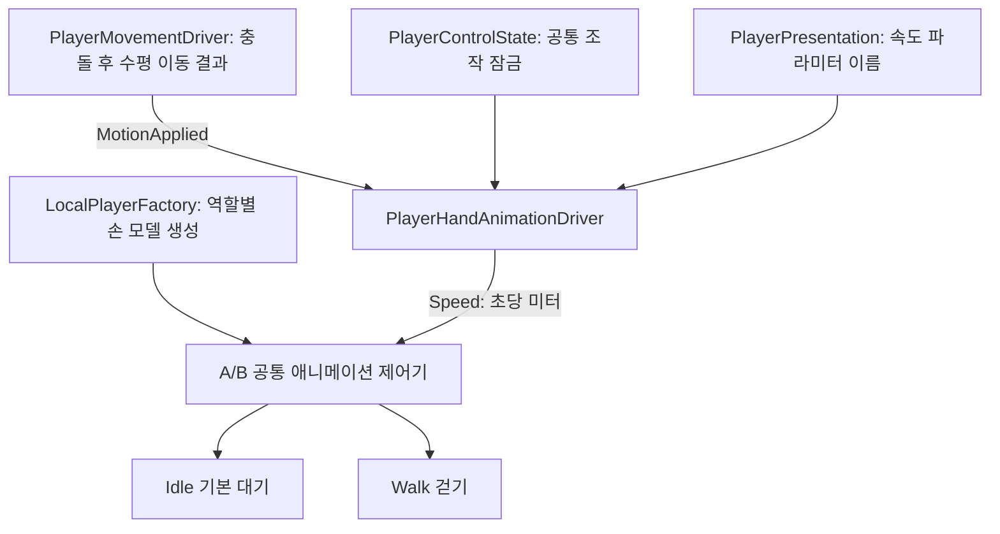

# 손 모델 대기·걷기 애니메이션

> 문서 대조일: **2026-10-26**. 현재 코드·설정을 기준으로 설명을 점검했습니다. 본문의 과거 검사 수치·실행 기록은 해당 날짜의 결과입니다. [현재 상태·문서 검토 범위](문서_현행화_점검표.md)를 함께 확인합니다.

적용일: 2026-10-23.

## 1. 동작과 의도

A/B 손 모델 모두 기존 `Arms_FP_Controller`를 사용합니다. 기본 상태는 `Idle`이며 실제 지면 이동이 발생하면 `Walk`, 멈추면 `Idle`로 돌아옵니다. 앞·뒤·옆 이동에 공통으로 적용합니다.

키를 누른 상태만으로 걷기를 판단하지 않습니다. `CharacterController`가 충돌을 처리한 뒤 통지한 수평 이동 거리를 사용하므로, 벽에 막혀 제자리인 경우에는 대기합니다. 멈출 때 감속으로 실제 이동이 남아 있으면 그동안은 걷고, 이동이 멈추면 대기로 전환합니다. 공중 이동·조작 잠금·클로즈업 UI·포커스 상실·일시 정지에서는 걷기 속도를 0으로 전달합니다.

## 2. 연결 구조

이동은 위치·충돌을 소유하고, 손 어댑터는 이미 완료된 이동 결과만 관찰합니다. 애니메이션이 게임 위치를 이동시키지 않도록 기존 루트 모션 비활성화를 유지합니다. 새 전역 이벤트 버스나 서버 통신은 추가하지 않았습니다. 카메라 흔들림·발소리는 기존 구독자를 그대로 사용합니다.

## 3. 작업자가 조정할 위치

| 위치 | 설정 |
|---|---|
| `Assets/Resources/PlayerPresentation.asset` | A/B 모델과 `Hand Animation Speed Parameter=Speed` |
| `Assets/2.Model/Prefabs/Player/Animation/Arms_FP_Controller.controller` | 기본 Idle, Speed 실수형 파라미터, 전환 조건·전환 시간 |
| 같은 폴더의 `Arms_Sway_Idle.anim`, `Arms_Sway_Walk.anim` | 반복 대기·걷기 동작 |
| `Assets/3.Script/Player/PlayerHandAnimationDriver.cs` | 이동 결과 구독·속도 전달·잠금·비활성화 정리 |

기존 제어기는 `Speed > 0.1`이면 걷기, `Speed < 0.1`이면 대기로 전환하며 전환 시간은 0.2초입니다. 코드가 문턱값이나 동작 이름을 중복 소유하지 않습니다. 기존 애니메이션은 A/B 리그의 `ROOT/Sway` 경로를 모두 포함하고 두 프리팹에 각각 유효한 바인딩이 있습니다. 제어기와 클립 원본은 수정하지 않았습니다.

프리팹 제어기의 속도 파라미터 이름을 바꾸면 위 설정 에셋의 이름도 같이 변경합니다. 실제로 연결한 애니메이터에 해당 실수형 파라미터가 없으면 오류로 알려 줍니다. 애니메이터가 없는 기존 임시 도형 경로는 유지됩니다.

## 4. 수명·비용·검사

생성 시 애니메이터·파라미터 해시를 한 번 준비하고 이동 완료와 조작 변경을 구독합니다. 매 프레임 모델 계층이나 파라미터 목록을 다시 검색하지 않습니다. 비활성화 시 구독을 해제하고 속도를 초기화하며 재활성화 시 중복 구독하지 않습니다. 런타임 복제본만 제어하고 프리팹 원본은 변경하지 않습니다.

서버 없이 Join의 클라이언트 테스트 A/B에서 각각 대기 → 걷기 → 멈춤을 확인합니다. 벽을 계속 밀 때, 클로즈업 UI를 열 때, 창 포커스를 잃을 때에도 손이 걷기를 지속하지 않아야 합니다. 걷기 중 뼈대가 움직이되 플레이어·카메라의 이동 권한은 기존 이동 코드에 남습니다. 새 동작을 실행 파일에서 사용하려면 클라이언트를 다시 빌드합니다.

## 5. 수명·정합성 점검에서 보완한 부분

- 손 애니메이션은 지면 이동 거리만 누적하므로 별도 접지 상태 저장은 제거했습니다. 이동 결과를 중복 판정하거나 입력 장치를 다시 읽지 않습니다.
- 이동 컴포넌트가 먼저 파괴된 경우 속도 0으로 정리하고, 애니메이터가 먼저 사라진 경우 유니티 객체의 실제 생존 여부를 검사해 접근하지 않습니다.
- 손 어댑터는 모델을 소유하거나 직접 파괴하지 않습니다. Factory가 만든 플레이어 루트가 모델을 소유하고, 어댑터는 활성화 동안만 이벤트를 구독합니다. 비활성화는 구독 해제·상태 초기화이며 다시 활성화할 수 있습니다.
- 비활성 루트의 생성 도중 실패하면 `OnDestroy`가 실행된다고 가정할 수 없습니다. Factory가 정상 활성화 전의 이동·포인터 입력 복제본을 보관하고, 실패 시 직접 해제하도록 보완했습니다. 활성화 성공 후에는 각 Driver가 소유합니다.
- Factory의 실패 정리와 유니티 파괴 콜백이 모두 실행되어도 안전하도록 `InputActionLease.Dispose`를 반복 호출에 안전하게 했습니다. 해제한 입력은 다시 활성화하지 않습니다.
- 정상 생성, 이동, 멈춤, 벽 충돌, UI 잠금, 일시 정지, 재활성화, 잘못된 파라미터로 인한 생성 실패와 반복 정리를 검사합니다. 검사하지 않은 수명 경로까지 무조건 안전하다고 단정하지 않습니다.

## 6. 실제 검사 결과

2026-10-23 유니티 실행 모드에서 서버 없이 타이틀의 A/B 테스트로 입장해 각각 12개 검사를 통과했습니다. 대기·실제 이동 속도·걷기 전환·역할별 뼈대 움직임·감속 후 대기·화면 잠금·일시 정지·벽 충돌·벽 밀기·비활성화 초기화·재활성화 구독·입력 반복 해제를 확인했습니다.

별도 임시 씬에서 수명 검사 7개를 통과했습니다. 잘못된 애니메이션 설정의 생성 거절, 실패 루트의 즉시 비활성화, 아직 활성화하지 않은 객체의 입력 직접 해제, 추가 파괴 후 해제 상태 유지, 손 모델 선행 파괴, 이동 컴포넌트 선행 파괴와 구독 해제, 재활성화 후 루트 파괴를 확인했습니다. 임시 객체·씬·검사 중 변경한 설정은 정리했습니다.

현재 코드의 플레이어 이동·조작 상태 검사 78개와 소리·보행 검사 48개도 통과했습니다. 윈도우 플레이어용 전체 참조 컴파일도 통과했습니다. 이번 작업 후 실행 파일을 새로 묶는 빌드는 수행하지 않았으므로 기존 실행 파일에는 새 기능이 포함되지 않습니다.

유니티 콘솔에는 별도의 서비스 인증 오류(HTTP 401)가 있었습니다. 이번 이동·손 애니메이션·객체 수명 검사에서는 참조 누락 예외가 발생하지 않았습니다. 서비스 인증 문제와 전체 게임 수명 경로까지 해결됐다는 의미는 아닙니다.

2026-10-26 빌드 보완: 비활성 조립 시 파라미터 목록을 검사하던 순서를 수정했습니다. Initialize는 참조·설정만 연결하고, LocalPlayerFactory가 루트 활성화 후 ValidateRuntimeBinding을 호출합니다. 같은 실패 정리 범위에서 실제 초기화와 Float Speed를 검증하며, 검증 전 속도 적용은 보류합니다. [원인·실행 파일 재현·수정 검증](빌드_입장_중단_원인과_수정.md)을 봅니다.
