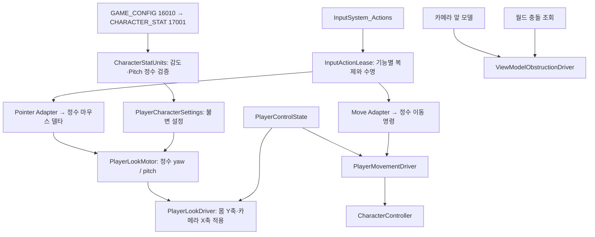

# 마우스 시점과 충돌 표현 — 첫 기능 검토 단위

> 문서 대조일: **2026-10-26**. 현재 코드·설정을 기준으로 설명을 점검했습니다. 본문의 과거 검사 수치·실행 기록은 해당 날짜의 결과입니다. [현재 상태·문서 검토 범위](문서_현행화_점검표.md)를 함께 확인합니다.

> 후속 충돌 검토에서 실제 문·가구 Collider 누락과 단면 메시 감지 누락을 확인해 보완했습니다. 현재 충돌 구현·검사 방법은 [CollisionFixes.md](CollisionFixes.md)를 우선합니다. 아래 Collider 미작성·실제 물리 미검사 설명은 마우스 기능을 추가한 당시 기록입니다.

기준: 2026-10-20, 클라이언트 `f9078a3`의 R01/CSV 재배치와 R02 MeshCollider, A/B 손 모델 파일 추가를 다시 읽은 뒤 작업했습니다. 방·모델·CSV 원본은 변경하지 않았습니다. 현재 PlayerPresentation에 A/B 손 프리팹이 연결되어 있으며 공통 대기·걷기 제어기를 사용합니다.

## 1. 이번 범위와 다음 범위

이번 단위는 마우스 시점, 이동/시점 공통 조작 잠금, 캡슐 skin 설정, 손 대체 모델의 벽 끼임 보정, 최신 Ingame 참조 보완입니다. 사용자님이 이 단위를 확인한 뒤 전용 Closeup 패널 → 문/정답 UI → 실제 다음 방 연결을 각각 검토합니다. 서버 퍼즐 권한이나 문 개방/애니메이션은 이번 코드에서 바꾸지 않았습니다.

화면의 큐브는 몸통이 아니라 카메라 앞 손·무전기 대체물입니다. 기존 캡슐 반경은 CSV의 300mm, 큐브 중심은 카메라 앞 500mm입니다. 따라서 몸이 멈춰도 큐브는 벽을 뚫을 수 있습니다. 이것과 실제 캡슐 충돌은 다른 문제이므로 분리합니다.

현재 R01 구조물은 표시 MeshFilter와 같은 메시를 비볼록 MeshCollider로 사용합니다. 공유 Door.prefab에는 Collider가 없습니다. 스크린샷만으로 문 앞 조기 충돌의 정확한 접촉 삼각형은 확인할 수 없습니다. 캡슐 반경은 유지하며, 아래 진단 메뉴로 실제 접촉 물체를 확인합니다. SkinWidth를 줄이는 것은 침투 여유를 줄이는 조치이며 문에 더 가까이 가게 만드는 조치는 아닙니다. 문 모양과 다른 벽 면이 통로를 막는다면 메시/연결 콘텐츠 보정이 별도로 필요합니다.

## 2. 데이터에서 회전까지

`MouseSensitivity=1`은 고정소수점 배율 1000으로 정규화합니다. 표현 설정 `lookMilliDegreesPerPixelAtUnitSensitivity=100`은 감도 1일 때 1px당 0.1도를 뜻합니다. 감도 2라면 0.2도/px입니다. `PitchLimit=80`은 ±80000 millidegrees로 상하 회전을 제한합니다. yaw는 0..359999 범위에서 순환합니다. 감도는 정규화 후 1..100000, Pitch는 0..89999 범위입니다. Pitch 0은 수평 회전만 허용합니다.

마우스 델타는 이미 이번 입력 갱신의 이동량이므로 deltaTime을 다시 곱하지 않습니다. 입력 어댑터는 1/1000px, 각도 상태는 1/1000도 정수이며 곱셈 중간값은 long을 사용합니다. 나눗셈 나머지를 보존해 작은 입력도 누적하고, 포커스/조작 해제 시 남은 입력만 비웁니다. 최종 Quaternion, Unity 충돌 조회 및 모델 bounds는 엔진 경계이므로 float를 사용합니다. 정수 각도만으로 플랫폼 간 물리 결정성을 보장하지 않습니다.

## 3. 기능별 파일과 의도

### 입력 어댑터와 소유권

`InputActionLease.cs`는 원본 액션의 복제·Keyboard&Mouse 바인딩·Enable/Disable·Dispose를 공통화합니다. 기존 `InputSystemMoveInput`도 이 모듈을 사용합니다. 원본 액션 에셋이나 다른 UI의 액션 활성 상태를 바꾸지 않습니다.

`InputSystemPointerInput.cs`는 `Player/Look`, `Player/Attack`, `UI/Cancel`을 복제하고 `IPlayerPointerInput`으로 제공합니다. Look은 Pointer delta, Attack은 좌클릭 복귀, Cancel은 ESC 용도입니다. 키 입력과 Unity Vector2를 순수 회전 계산에 직접 전달하지 않습니다. 앞으로의 좌클릭 상호작용은 별도 명령으로 연결해야 합니다. 이번 클릭은 커서 복귀 동작까지만 처리합니다.

### 상태와 각도 계산

`PlayerLookMotor.cs`는 입력 명령과 정수 yaw/pitch 상태만 소유합니다. 오른쪽 이동은 몸 yaw 증가, 위쪽 이동은 카메라 pitch 감소로 변환합니다. Pitch 제한에서 초과분을 버려 반대 방향 입력이 즉시 반응하도록 합니다. 프레임 시간·카메라·네트워크·커서를 참조하지 않아 자동 검사할 수 있습니다.

`PlayerControlState.cs`는 활성/포커스/일시 정지/커서 포획/UI 잠금을 합성합니다. `Changed`는 상태 반영 뒤 이동·시점 어댑터에 알리는 Observer 방식입니다. 키 요청 자체를 전역 이벤트 버스로 전송하지 않습니다. Closeup은 향후 `BlockForUi()`의 IDisposable 토큰을 열 때 확보하고 닫을 때 해제할 수 있습니다. 중첩 UI가 하나 닫혀도 다른 UI의 잠금은 남으며 같은 토큰을 두 번 해제해도 안전합니다. 마지막 UI가 닫힌 뒤 포획은 명시적인 좌클릭으로 복귀합니다.

### Unity 적용과 수명

`PlayerLookDriver.cs`는 포커스·일시 정지·커서와 Transform 적용을 담당합니다. 이동 Update보다 먼저 회전하도록 실행 순서 -100을 사용해 WASD 기준 방향이 직전 프레임으로 밀리지 않게 합니다. 몸은 Y축만, 카메라는 로컬 X축만 회전합니다. 생성 앵커의 초기 yaw는 유지합니다. 포획/복귀 직후 한 프레임의 델타를 버려 커서 잠금 전 이동이 시점 급회전으로 이어지지 않게 합니다. ESC/포커스 상실 후 자동 재포획하지 않고 좌클릭을 기다립니다. 포인터 위 UI가 있으면 복귀 클릭을 가로채지 않습니다. 비활성 시 구독·액션·커서 소유 상태를 돌려주고 파괴 시 액션을 해제합니다.

`PlayerMovementDriver.cs`는 같은 `PlayerControlState`를 주입받아 조작 잠금 시 입력과 잔여 속도를 지웁니다. 기존 이동 전용 검사/수동 차단 메서드는 유지합니다. `LocalPlayerFactory.cs`가 상태 한 개를 만들고 이동·시점 어댑터에 주입합니다. GameFlowBootstrapper의 PlayerReady에는 시점 어댑터 초기화도 포함합니다. 커서를 풀었다고 서버의 준비 상태를 취소하지는 않습니다.

### 충돌과 모델 표시

`PlayerBodyConfiguration.cs`는 캡슐 높이·반경·중심·단차·skin 적용을 공통화합니다. 기존 Unity 기본 skin 80mm에 기대던 부분을 `PlayerPresentation.skinWidthMm=30`으로 명시했습니다. 물리 크기는 계속 CHARACTER_STAT을 따릅니다. 지나갈 수 있는 통로 폭을 임의로 늘리지 않습니다.

`ViewModelObstructionDriver.cs`는 LateUpdate에서 모델 전체 bounds를 감싼 구로 카메라에서 원래 표시 위치까지 SphereCast합니다. 막히면 즉시 모델을 당기고, 눈 위치가 이미 막혔거나 near plane 앞에 모델이 들어갈 공간이 없으면 렌더러만 숨깁니다. 떨어지면 원래 위치와 렌더러 상태를 복구합니다. 모델 콜라이더는 기존대로 제거하며 몸체 충돌과 섞지 않습니다. 트리거와 자기 플레이어는 무시합니다. 고정 버퍼를 재사용하고 버퍼가 가득 찬 경우 안전하게 숨깁니다. 충돌체 없는 장식 메시는 이 보정으로 감지하지 못합니다. 매우 큰 손 모델은 숨겨질 수 있으므로 교체 시 모델의 크기/피벗을 맞춰야 합니다.

`PlayerCollisionProbe.cs`는 CharacterController의 최근 측면 접촉 collider/점/법선만 기록합니다. `PlayerLookAndCollisionChecks.cs`의 Inspect 메뉴는 해당 계층 경로와 캡슐 설정, 표시 메시와 충돌 메시 일치 여부를 보여줍니다. 기록은 최근 접촉이며 현재 거리 측정이 아닙니다. 큰 방 Renderer.bounds를 문 전체 BoxCollider로 바꾸는 처리는 하지 않았습니다.

### 최신 Git 구조 대응

Ingame의 `RoomSceneView.embedded`에서 삭제된 카드/서랍 모델 경로 2개만 제거했습니다. 최신 CSV가 활성화한 `R01A_PropsPoint → PREFAB 13075`를 기존 공통 로더로 생성합니다. 유효한 천장·입구 문 바인딩은 유지했습니다. R01/R02 프리팹, Test 씬, 손 FBX, CSV는 보존합니다. WorldPlayVerification의 과거 카드 경로 고정 검사도 CSV 역할 바인딩 검사로 바꿨습니다.

## 4. 검증 결과와 사용자님 검토 순서

자동 실행: 순수 플레이어 72개(기존 스폰/이동 45개 + 시점/조작 상태 27개), 공통 C# 201개, 서버 154개가 통과했습니다. C# 실행은 설치된 net10 임시 프로젝트에서 같은 소스를 검사했으며 저장소의 net8 대상은 바꾸지 않았습니다. Unity 6.2 런타임(UNITY_EDITOR), 별도 Editor 도구, Windows 런타임 참조 컴파일도 통과했습니다. 실제 Unity Play/커서/방 물리 검사는 이번 실행 환경에서 수행하지 않았습니다.

1. **Play 종료 후 컴파일 완료** → Tools > Game > Verify Ingame Wiring. 삭제된 모델 경로 오류가 없어야 합니다.
2. 최신 클라이언트 CSV를 사용하려면 **로컬 테스트 A**로 입장합니다. 현재 Join에서는 autoConnect를 바꾸지 않고 Start_UI의 클라이언트 테스트 A/B를 선택합니다. 설정 변경은 이번 작업에서 자동 수행하지 않았습니다.
3. Game 화면을 좌클릭하고 마우스를 움직입니다. 좌우는 몸/이동 방향, 위아래는 카메라만 바뀌며 ±80도에서 멈춰야 합니다. WASD는 보고 있는 수평 방향으로 움직입니다.
4. ESC로 커서를 풀면 이동/회전이 멈추고 커서가 보입니다. Game 화면 좌클릭으로 복귀합니다. Alt+Tab 후 복귀, Time Scale=0→1, 오브젝트 비활성/재활성도 확인합니다. Play 종료 뒤 커서가 잠기지 않아야 합니다.
5. 벽에 정면/대각선으로 다가가고 위/아래를 봅니다. 손 모델이 벽을 뚫는 대신 당겨지거나 숨고, 떨어지면 돌아와야 합니다. 몸이 벽을 통과하거나 바닥에서 떨리는지도 별도 확인합니다.
6. 문에서 막히는 위치에 접근한 직후 **Tools > Game > Inspect Player Collision**을 실행합니다. 이 로그로 실제로 막는 물체를 구분합니다. 반경 300mm 때문에 카메라 중심은 표면까지 닿지 않는 것이 정상입니다. 시각적으로 훨씬 멀리 막히면 로그의 실제 collider를 기준으로 후속 보정합니다.
7. **Tools > Game > Verify Player Look And Collision**은 임시 큐브/벽으로 액션 수명·모델 당김/숨김/복원 9개를 검사합니다. **Verify Player Movement / Verify Player Spawn**도 사용할 수 있습니다. 메뉴 검사 실행 결과는 자동 참조 컴파일 통과와 구분합니다.

현재 클라이언트 CSV는 원본·활성 14개입니다. 과거 23개·3151개 셀·4개 차이와 B LED 앵커 누락은 당시 기록이며 현재의 고정 실패 조건이 아닙니다. 온라인은 서버 번들, 서버 없는 검사는 로컬 CSV를 사용합니다. 이번 비교에서는 활성 14개 표가 문자열 행 기준으로 일치했습니다. 실제 프리팹 배치·충돌은 별도로 검사합니다.
