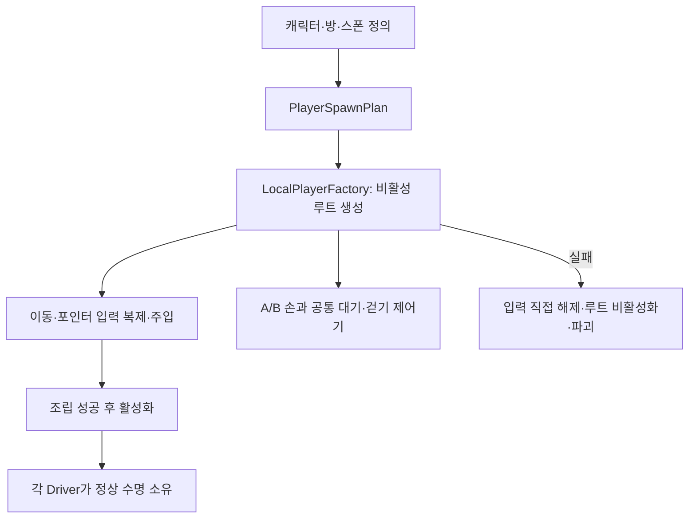

# 플레이어 생성·손 모델·입력 수명

> 문서 대조일: **2026-10-26**. 현재 코드·설정을 기준으로 설명을 점검했습니다. 본문의 과거 검사 수치·실행 기록은 해당 날짜의 결과입니다. [현재 상태·문서 검토 범위](문서_현행화_점검표.md)를 함께 확인합니다.

## 1. 현재 동작

`PlayerSpawnPlan`이 역할별 첫 방과 `GAME_CONFIG`가 선택한 캐릭터 정의를 찾습니다. 활성 스폰 행은 RoomNo·ALL/현재 역할·SpawnPrefabID 조건에 정확히 하나여야 합니다. 실제 AnchorID의 위치·회전을 사용하고 바닥으로 임의 보정하지 않습니다.

현재 [PlayerPresentation](../Assets/Resources/PlayerPresentation.asset)에 A/B 손 프리팹이 직접 연결되어 있습니다. 기본 모델은 큐브·실린더가 아닙니다. 참조가 없는 경우의 기존 대체 도형 경로만 코드에 남아 있습니다.

## 2. 코드의 책임

| 코드 | 책임 |
|---|---|
| [PlayerSpawnPlan](../Assets/3.Script/Player/PlayerSpawnPlan.cs) | 첫 방·역할·스폰 행·캐릭터 정의 선택 |
| [LocalPlayerFactory](../Assets/3.Script/Player/LocalPlayerFactory.cs) | 캡슐·카메라·손·이동·시점·표현 조립 |
| [PlayerPresentationSettings](../Assets/3.Script/Player/PlayerPresentationSettings.cs) | 모델·입력·클리핑·표시 위치·애니메이션 파라미터 설정 |
| [PlayerSpawnDriver](../Assets/3.Script/Player/PlayerSpawnDriver.cs) | 첫 방 주입·상호작용·조명·소리 연결과 플레이어 정리 |
| [FirstPersonPlayerRig](../Assets/3.Script/Player/FirstPersonPlayerRig.cs) | 같은 씬의 기존 출력 카메라·오디오 상태 보관·복원 |
| [InputActionLease](../Assets/3.Script/Player/InputActionLease.cs) | 원본을 건드리지 않는 입력 복제·반복 해제·해제 후 재활성화 방지 |
| [PlayerHandAnimationDriver](../Assets/3.Script/Player/PlayerHandAnimationDriver.cs) | 충돌 후 이동 결과를 관찰해 손의 Speed 전달 |

ModelPositionMm·ModelEulerMilliDegrees는 카메라 기준 표현 위치·회전입니다. 프리팹 원본 크기는 유지합니다. ModelSizeMm은 대체 도형에만 사용합니다. 스폰 마커는 일반 오브젝트 생성에서 제외하여 중복 생성하지 않습니다.

## 3. 정상 입장과 개발자 검사

정상 흐름은 Join의 탈출하기 → 서버/로컬 데이터 검증 → 첫 방 구성 → 플레이어 생성 → 실제 준비 확인입니다. 온라인은 양쪽 ready 이후 조작을 허용합니다. 특정 과거 앵커 누락을 이유로 B 입장이 항상 실패한다고 설명하지 않습니다.

서버 없이 확인하려면 Join의 **클라이언트 테스트 A/B**를 사용합니다. 별도 방 검사는 Ingame Play → Tools → Game → Room Clear Test → 역할 선택 → 미리보기 시작 → 플레이어 생성입니다. 두 경로의 서비스·협동 진행 제한은 [로컬 테스트](LocalPlayTestGuide.md), [개발자 방 검사](DeveloperRoomClear.md)를 봅니다.

## 4. 수명 규격과 확인

- 생성자는 정상 활성화 전 입력을 소유하며 실패 시 직접 해제합니다. 한 번도 활성화되지 않은 객체의 OnDestroy에 의존하지 않습니다.
- 활성화 후 이동·포인터 Driver가 입력 수명을 소유합니다. 비활성화는 입력 차단·구독 해제, 파괴는 자원 해제입니다.
- 손 어댑터는 모델을 직접 파괴하지 않고 플레이어 루트가 자식을 소유합니다. 이동·애니메이터 선행 파괴를 검사합니다.
- 재활성화는 중복 구독 없이 초기 상태로 연결합니다. 같은 씬의 중복 로컬 플레이어는 거절합니다.

[손 애니메이션과 당시 31개 유니티 검사](PlayerHandAnimation.md), [이동](PlayerMovement.md), [조작·충돌](PlayerLookAndCollision.md), [진입 수명](EntryConsistency.md)을 함께 봅니다. 이번 문서 검토가 새 유니티 실행 검사라는 뜻은 아닙니다.
