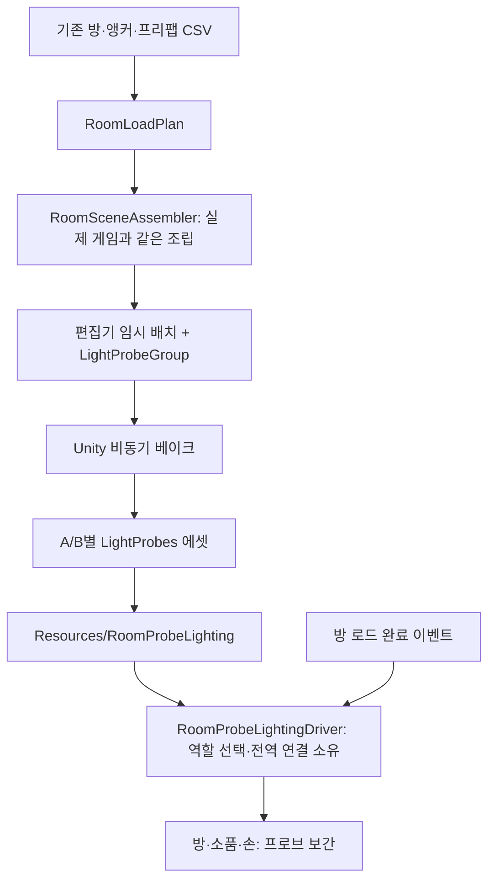

# 방 프로브 조명: 설정·베이크·실행 연결

> 문서 대조일: **2026-10-26**. 현재 코드·설정을 기준으로 설명을 점검했습니다. 본문의 과거 검사 수치·실행 기록은 해당 날짜의 결과입니다. [현재 상태·문서 검토 범위](문서_현행화_점검표.md)를 함께 확인합니다.

기준일: 2026-10-23. Unity 6000.2.8f1 / URP 17.2.0.

## 1. 기능과 설계 의도

게임은 기존 Join/Ingame 씬과 누적 방 생성을 유지합니다. 조명 위치와 프리팹 선택은 기존 `ANCHOR_NONINTERACT → PREFAB` 계약을 따르며 별도 조명 CSV는 추가하지 않습니다. 지정된 앵커 좌표를 임의 보정하지 않습니다.

편집기에서 A/B 각자의 최종 방·소품·조명을 조립한 뒤 Unity가 빛을 프로브에 굽습니다. 실행 중에는 역할별 결과 하나를 복제해 Unity 프로브 시스템에 연결합니다. 방을 추가할 때마다 다시 베이크하거나 프로브를 다시 생성하지 않습니다. 직접 비추는 실시간 Point/Spot으로 자동 변경하지 않습니다.

프로브는 위치별 빛을 저주파로 근사합니다. 원뿔 모양의 선명한 조명·벽의 정교한 명암·실시간 그림자와 동등하지 않으며, 큰 메시 하나가 방 전체를 구성하면 조명 차이가 부드럽거나 균일하게 보일 수 있습니다. 조명 모양(Point/Spot)과 계산 모드(Baked)는 별개이며 현재 1번 조명은 Spot, 2~7번은 Point입니다.

## 2. 데이터와 계층

| 파일 | 책임 |
|---|---|
| Data/RoomProbeLightingSettings.cs | A/B 결과 참조·기존 씬 방향광 처리 설정 |
| Editor/RoomProbeBakeTools.cs | CSV 검증·공통 조립·프로브 배치·Unity 베이크·결과 저장·임시 자원 정리 |
| World/RoomProbeLightingDriver.cs | 역할 결과 복제·프로브 연결·수신 설정·이전 전역 상태 복원 |
| Player/PlayerSpawnDriver.cs | 플레이어 수명에 맞춘 조명 어댑터 생성 |
| World/GameFlowBootstrapper.cs | 실제 방 로더의 완료 이벤트 연결 |
| Editor/RoomClearPreviewSession.cs | 개발자 방 테스트에도 같은 수신 설정 적용 |

설정/베이크 데이터와 실행 중 복제본을 분리합니다. 방 추가는 독립 완료 이벤트를 구독하는 관찰자 방식이며, 광원·프로브·Unity 전역 상태는 조명 어댑터가 소유합니다. 서버 권한·정답 판정·소리와 결합하지 않습니다.

## 3. 작업 순서

1. Play를 종료하고 열린 씬을 저장합니다. 도구는 미저장 씬이 있으면 진행하지 않습니다.
2. `Tools → Game → Rebuild Content References`로 현재 CSV·프리팹 참조를 갱신합니다.
3. `Tools → Game → 조명 프로브 → A 배치 준비`를 실행합니다.
4. A 역할의 1~7번 방과 CSV 내부 오브젝트·조명이 임시 편집 씬에 구성됩니다. 현재 앵커·원본 프리팹 위치를 유지합니다.
5. `현재 배치 베이크·저장`을 실행합니다. 완료되면 결과를 저장하고 원래 씬으로 돌아옵니다.
6. B도 `B 배치 준비 → 현재 배치 베이크·저장`을 실행합니다.
7. `저장된 결과 검사`로 양쪽 데이터의 존재·프로브 수를 검사합니다.
8. Join에서 A/B 각각 테스트하고, 완료 후 기존 stable 출력 폴더에 다시 빌드합니다.

결과는 `Assets/Resources/RoomProbes_A.asset`, `RoomProbes_B.asset`, `RoomProbeLighting.asset`입니다. 이 파일들과 `.meta`를 함께 공유합니다. Resources 직접 참조로 빌드에 포함됩니다. 게임 빌드 씬 목록에 새 씬을 추가하지 않습니다.

베이크 동안만 전용 임시 편집 씬을 생성하고 종료 시 정리합니다. 원래 씬은 미저장 작업이 없는 상태에서 닫았다가 다시 열며 원본 CSV·방/조명 프리팹을 저장하지 않습니다. 중단은 `임시 배치 종료`입니다. 임시 배치에서 조정한 값을 원본으로 자동 반영하지 않으므로 지속 조정은 원본 프리팹에서 하고 다시 준비합니다.

## 4. 비용과 자원 소유권

프로브는 방 메시 범위의 3m 간격과 3개 높이, 광원 주변 표본으로 생성합니다. 한 축은 최대 12개 표본으로 제한합니다. 같은 위치는 중복 제거합니다. 세부 조명 품질은 실제 화면을 보고 간격을 조정한 뒤 재베이크합니다.

실행 중에는 프로브 복제본 하나를 사용하고 입장 때 한 번 보간 공간을 구성합니다. 새 방은 메시의 프로브 수신 설정만 적용합니다. 자체 매 프레임 프로브 검색·계수 복사·베이크는 하지 않습니다. Unity의 메시/스킨 렌더링 시 보간 비용은 남습니다.

저장 결과가 있는 역할에 한해 기존 씬의 방향광을 끄며 종료 시 이전 상태를 복원합니다. 결과가 없으면 경고하고 기존 조명을 유지합니다. 새 입장이 이전 조명 소유권을 가져간 경우 이전 어댑터가 새 상태를 덮어쓰지 않습니다. 원본 베이크 에셋은 실행 중 수정하지 않습니다.

## 5. 조정 후 확인

- 앵커·방 배치·색·강도·범위·소품을 바꿨다면 양쪽 역할에 맞게 다시 베이크합니다.
- 계층에서 라이트가 생성됐다는 사실과 베이크된 조명이 보인다는 사실을 구분합니다. Baked 라이트를 실행 중 생성하는 것만으로 빛이 새로 계산되지는 않습니다.
- 실제 광원 영향은 범위·방향·가림·머티리얼·프로브 수신점에 좌우됩니다. 배치 좌표는 기획자가 정한 값을 그대로 사용합니다.
- 프로브 적용 로그와 A/B 결과를 확인하고, 1→2→1 이동에서 방 조명·배경음을 각각 확인합니다. 소리는 3초 크로스페이드이며 조명은 소리 전환 이벤트로 켜고 끄지 않습니다.

Unity 동작 근거: [라이트 프로브 설명](https://docs.unity3d.com/6000.2/Documentation/Manual/LightProbes.html), [실제 Unity 6.2 프로브 연결 API](https://github.com/Unity-Technologies/UnityCsReference/blob/6000.2/Runtime/Export/Graphics/Graphics.bindings.cs).

## 6. 이번 작업의 실제 확인 결과

| 검사 | 결과 |
|---|---|
| 런타임·편집기 전체 C# 컴파일 | 각각 오류 0개. 직렬화 필드 관련 경고 66개 |
| 순수 보행·사운드·문 경계·시간 검사 | 48개 통과 |
| Unity 문 회전·왕복·눈높이·전환 검사 | 42개 통과 |
| A 역할 실제 베이크·저장 | 프로브 453개 |
| B 역할 실제 베이크·저장 | 프로브 432개 |
| A/B Join → 로컬 입장 → Ingame | 준비 완료, 역할별 프로브 적용 확인 |
| 기존 방향광 | 프로브 적용 후 비활성 확인 |
| 손·무전기 | 프로브 보간 수신 확인 |
| B 1→2→1 | 정답·문·다음 방 생성 후 경계 통과에 따른 배경음 전환·이전 음 정지 확인 |
| 임시 베이크 씬 | 작업 후 삭제·원래 씬 복귀 확인 |

첫 방 플레이어 위치에서 실제 프로브 조명 값이 반환됐고 A 역할 화면도 캡처했습니다. 현재 앵커·색·강도 값으로 구운 결과이며 밝은 전등 연출의 품질 확정은 아닙니다. 현재 실내는 어둡게 보이므로 기획 의도에 맞는 밝기·색 조정 후 다시 베이크합니다. 앵커 위치는 이번 작업에서 변경하지 않았습니다.

검사 중 생성한 플레이 상태·위치 이동·정답은 로컬 임시 상태이며 종료 시 정리했습니다. 온라인 두 참가자 검사·새 stable 빌드·실제 스피커 청취·전체 7개 방 보행 통과는 이번 확인 범위에 포함하지 않습니다.

## 플레이어 빌드 호환성 수정 — 2026-10-23

`MeshRenderer.receiveGI`는 편집기 전용 속성입니다. 실행 코드에서 이 속성을 직접 호출하면 편집기 플레이는 가능해도 Windows 플레이어 빌드에서 CS1061 오류가 발생합니다. `RoomProbeLightingDriver.ApplyReceivers`의 해당 호출을 `UNITY_EDITOR` 조건 안으로 제한했습니다. 실행 파일은 `Renderer.lightProbeUsage = LightProbeUsage.BlendProbes`로 기존 역할별 프로브를 사용합니다. 베이크 준비 도구는 원래 편집기 코드이므로 유지합니다.

기존 외부 실행 코드 컴파일 검사도 편집기용 엔진 참조를 사용해 이 차이를 검출하지 못했습니다. 편집기 컴파일·플레이 검사와 실제 플레이어 빌드의 성공을 구분하고, 플레이어용 엔진 참조 검사와 실제 빌드 결과를 함께 확인해야 합니다. 라이트 위치·프리팹·CSV·저장된 베이크 데이터는 이 수정에서 변경하지 않습니다.

공식 기준: [MeshRenderer.receiveGI](https://docs.unity3d.com/6000.2/Documentation/ScriptReference/MeshRenderer-receiveGI.html), [Renderer.lightProbeUsage](https://docs.unity3d.com/6000.2/Documentation/ScriptReference/Renderer-lightProbeUsage.html).
