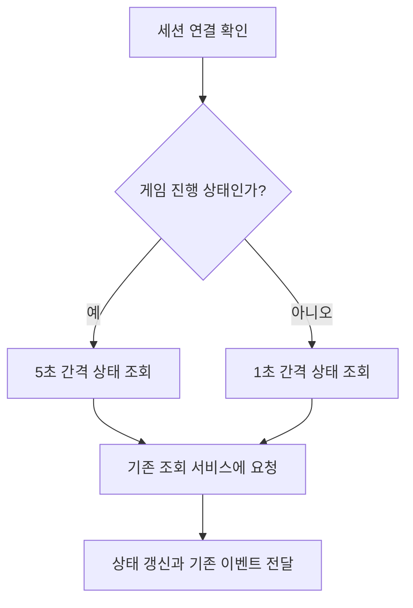

# 세션 상태 조회 간격

> 문서 대조일: **2026-10-26**. 현재 코드·설정을 기준으로 설명을 점검했습니다. 본문의 과거 검사 수치·실행 기록은 해당 날짜의 결과입니다. [현재 상태·문서 검토 범위](문서_현행화_점검표.md)를 함께 확인합니다.

갱신일: 2026-10-23

## 1. 적용한 간격과 의도

| 기능 | 간격 | 이유 |
|---|---|---|
| 입장·씬 준비 대기 중 상태 조회 | 1초 | 상대 입장과 양쪽 준비 완료를 빠르게 표시 |
| 게임 진행 중 상태 조회 | 5초 | 같은 상태를 반복 조회하는 통신·로그량 감소 |
| 접속 유지 요청 | 3초 | 기존 서버의 10초 미수신 만료 정책 유지 |
| 마지막 방 정답 후 상대 완료 확인 | 1초 | 양쪽 완료 후 엔딩 반응 유지 |

상태 조회는 `GET /sessions/{sessionId}`, 접속 유지는 `POST /sessions/{sessionId}/heartbeat`입니다. `/health`는 이 자동 조회에 사용하지 않습니다. 게임 중 상대 퇴장·방 해금 등 조회로 전달되는 상태는 통신 지연 외에 최대 약 5초 늦게 반영될 수 있습니다. 자기 정답 제출의 직접 응답까지 5초 기다리게 하는 변경은 아닙니다.

두 명이 게임 중이면 상태 조회는 분당 약 120회에서 24회로 감소합니다. 접속 유지 약 40회를 더하면 기본 반복 요청은 약 160회에서 64회로 줄어듭니다. 마지막 방 대기 조회와 사용자 조작 요청은 별도입니다. 실제 횟수는 요청 처리 시간과 다른 요청 수행 여부에 따라 달라집니다.

## 2. 설정 위치와 책임

- `Assets/3.Script/Session/SessionPollingDriver.cs`: 유니티 수명 관리와 조회 간격 설정. `pollingIntervalMs=1000`, `playingPollingIntervalMs=5000`을 일반 C# 제어기에 주입합니다.
- `Assets/3.Script/Session/SessionPollingController.cs`: 공개 세션 상태가 게임 진행이면 5초 주기, 그 외에는 1초 주기를 선택합니다. 통신 주소·인증 처리와 분리합니다.
- `Assets/1.Scene/Join.unity`: 기존 조회 구성 2곳에 게임 중 5000ms를 명시해 저장했습니다.
- `SessionHeartbeatDriver`와 `EndingCompletionController`: 기존 접속 유지·엔딩 완료 확인 책임과 간격을 유지합니다.

같은 상태의 응답을 받을 때마다 주기를 초기화하지 않습니다. 대기와 게임 사이에 전환되면 선택한 간격을 처음부터 세며, 신규 참가자는 기존처럼 최초 조회를 즉시 시도합니다. 장시간 멈췄던 프레임의 누락 요청을 몰아서 보내지 않습니다. 요청 중 중복 조회 방지와 연결 실패 처리도 유지합니다.

## 3. 적용과 확인

유니티에서 플레이를 종료한 뒤 다시 시작합니다. 기존 실행 파일에는 반영되지 않으므로 배포용 클라이언트는 다시 빌드합니다. 서버 통신 계약·도커 이미지는 변경하지 않았으므로 이 변경만을 위한 서버 재배포는 필요 없습니다.

서버 접근 로그의 `QuerySession`을 같은 사용자 기준으로 비교합니다. 입장·준비 대기는 약 1초, 게임 진행은 약 5초여야 합니다. `Heartbeat`는 약 3초이고, 마지막 방에서 먼저 정답을 맞힌 경우 `CheckRoomDoor`는 약 1초입니다. 서로 다른 두 사용자의 로그를 합쳐 간격을 판단하지 않습니다.

순수 C# 간격 검사는 `Tools/SessionPolling.Tests`에서 가짜 시계와 통신 대역으로 대기·게임·상태 전환·재입장·요청 중 보류·프레임 지연을 확인합니다. 실제 두 클라이언트 왕복과 빌드 검증은 별도입니다.
