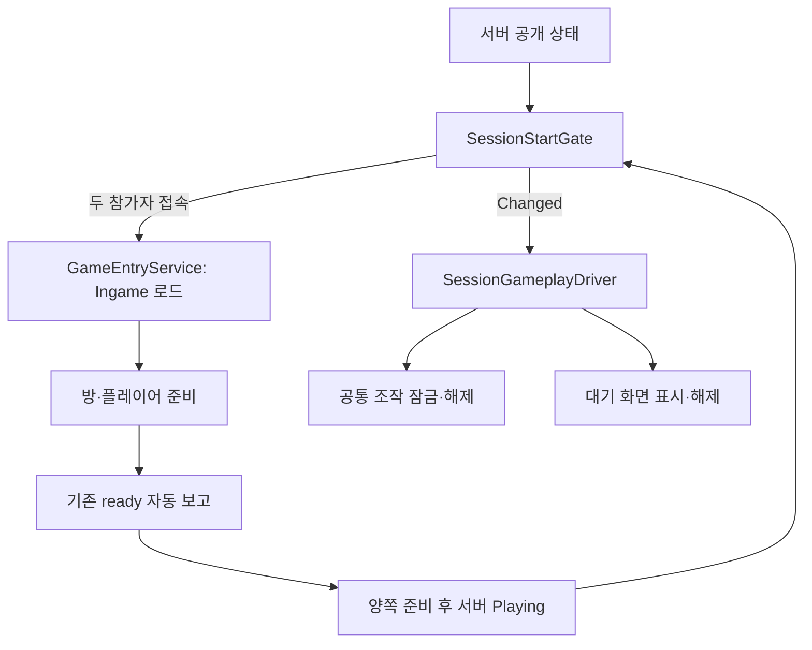

# 온라인 시작 대기와 CSV 방 미리보기

기준: 2026-10-21. 온라인 게임 시작과 에디터 콘텐츠 미리보기를 별도 수명으로 관리합니다.

## 온라인 시작 흐름

1. Join은 config 주소로 서버에 입장하고 서버 CSV를 받아 검증·등록합니다.
2. 참가자가 한 명이면 Join에 머물며 상대방을 기다립니다. 이때도 기존 자동 조회와 heartbeat는 계속됩니다.
3. 두 명이 모여 서버가 Loading을 알리면 각 클라이언트가 Ingame을 로드합니다.
4. 방·플레이어·필수 컴포넌트가 준비되면 기존 자동 보고기가 ready를 전송합니다. ready의 뜻은 씬 준비 완료입니다.
5. 양쪽 ready가 반영되어 서버가 Playing을 알리면 대기 화면이 사라지고 조작을 허용합니다. 게임 화면을 클릭해 커서를 잡습니다.
6. 상대방이 나가거나 서버 연결이 끊겨 Playing 조건이 깨지면 공통 조작 잠금과 대기 안내를 다시 적용합니다. 열려 있던 Closeup도 닫습니다.

Playing 이후에 씬 로드를 시작하면 ready를 보고할 수 없어 서로 기다리므로, 씬 로드 조건과 조작 시작 조건을 분리했습니다. 로컬 테스트 A/B는 온라인 대기를 적용하지 않습니다.

| 파일 | 책임과 의도 |
|---|---|
| World/SessionStartGate.cs | 공개 SessionInfo를 관찰하여 씬 진입·조작 허용·안내를 계산하는 순수 C# 모듈입니다. 동일 조건의 반복 조회는 변경 이벤트를 중복 발행하지 않습니다. |
| World/GameEntryService.cs | 서버 데이터 등록 후 참가자 대기를 거쳐 씬 전환을 호출합니다. 취소·연결 종료 시 기존 실패 경로로 참가 자리를 정리합니다. |
| World/SessionGameplayDriver.cs | Gate의 Changed 이벤트를 구독하고 Unity 조작 상태·Closeup·대기 화면을 조정합니다. 컴포넌트 비활성 시 구독 해제와 조작 잠금을 수행합니다. |
| World/SessionWaitingView.cs | 로딩된 월드를 가리는 한글 대기 화면을 소유하고 종료 시 제거합니다. HTTP·토큰·Protobuf를 참조하지 않습니다. |
| Player/PlayerControlState.cs | 이동·시점·상호작용이 공유하는 시작 허용 조건을 추가했습니다. 일시정지·포커스·UI 잠금과 독립적이므로 한 조건 해제가 다른 잠금을 우회하지 않습니다. |
| World/GameFlowBootstrapper.cs | 기존 준비 검사 이후 Gate와 플레이어·표현을 명시적으로 주입합니다. 준비 여부는 입력 잠금 여부와 분리하여 ready 보고를 막지 않습니다. |

Observer는 완료된 상태 변화를 전달하고, 기존 입장 Facade는 흐름을 조정합니다. Unity 수명 어댑터는 네트워크 계약을 입력 코드 안에 넣지 않고 공통 조작 허용 메서드로 연결합니다. 별도 타이머·코루틴·부동소수 시간은 추가하지 않았습니다.



## 온라인 수동 검사

서버를 실행하고 두 클라이언트가 같은 서버 주소를 사용하도록 설정합니다. 두 번째 PC 대신 에디터와 새 빌드를 사용할 수도 있습니다.

1. 첫 번째만 Join에서 실행합니다. CSV 등록 뒤에도 Join에서 상대방 입장 대기 문구가 나와야 합니다.
2. 두 번째를 실행합니다. 두 명이 모이면 양쪽 Ingame 로드가 시작되어야 합니다.
3. 한쪽 로드가 끝나도 다른 쪽 ready 전에는 불투명 대기 화면이 보이고 WASD·마우스 시점·좌클릭 상호작용이 차단되어야 합니다.
4. 두 번째의 준비가 끝나면 양쪽이 Playing을 조회하여 대기 화면이 사라져야 합니다. 게임 화면을 클릭하면 이동·시점·상호작용이 가능해야 합니다.
5. 한쪽 종료 후 남은 쪽은 정상 퇴장 응답 또는 기존 10000ms 생존 만료 후 다시 잠겨야 합니다. 같은 로딩/대기 화면이 중복 생성되지 않아야 합니다.
6. Join 대기 중 Play를 종료하면 씬을 뒤늦게 로드하거나 이전 요청이 새 입장에 적용되지 않아야 합니다.
7. 로컬 테스트는 editor.autoConnect=false로 실행하여 상대방 없이 즉시 Ingame을 구성하는지 확인합니다.

## 개발자 방·내부 오브젝트 검사

Play 종료 → Tools/Game/Rebuild Content References → Ingame 씬 직접 열기 → Play → Tools/Game/Room Clear Test 순서입니다.

- 역할 선택 후 미리보기 시작을 누르면 복제한 방에 실제 RoomSceneView.Load를 호출합니다.
- 활성 상태·방 번호·A/B/ALL 필터, PREFAB 경로, 앵커 위치, 기능 구성·데이터 주입은 실제 게임 로더와 같습니다.
- 플레이어 스폰 행은 내부 소품에서 제외하고 별도 플레이어 생성 버튼이 PlayerSpawnDriver를 재사용합니다. 개발자 도구에는 정답 서버 서비스를 연결하지 않습니다.
- 클리어 버튼은 다음 방의 소품 생성과 출입구 정렬이 성공한 다음 개발자 클리어 상태를 확정합니다. 이전 방과 소품은 유지합니다.
- 원본 방은 숨기고 복제본을 사용합니다. 종료·창 닫기·Play 종료 시 생성물 제거와 원본 활성 상태 복원을 수행합니다.
- 실제 게임 입장 세션과 동시에 사용하지 않습니다. Join 로컬 테스트에서 만들어진 실제 방·플레이어가 필요하면 해당 모드를 그대로 사용합니다.
- CSV와 프리팹 누락은 우회하지 않습니다. 오류에 표시된 CSV 행·앵커·경로를 수정하고 콘텐츠 참조를 다시 만든 뒤 재시도합니다.

Tools/Game/방 스폰 미리보기 자동 검사는 Play에서 CSV 폴더를 선택합니다. 해당 CSV와 임시 큐브로 역할별 내부 생성·중복 방지·누락 실패·재시도·정렬·정리를 검사합니다. 실제 모델의 문 폭·Collider·전체 방 완성도를 대신 검사하지 않습니다.

## 검사 명령과 범위

클라이언트 프로젝트 루트에서 .NET 8 SDK를 사용합니다.

```powershell
dotnet run --project Tools/CsvValidation.Tests -- --session-start
dotnet run --project Tools/CsvValidation.Tests -- .
dotnet run --project Tools/PlayerSpawn.Tests -- .
```

실제 HTTP 검사는 서버의 npm.cmd run api:verify -- --client 클라이언트전체경로로 수행합니다. 첫 참가자의 대기 중 두 번째 참가자를 입장시키고 첫 참가자가 조회하여 대기를 해제하는 순서도 포함합니다. 운영 서버 대신 임시 포트를 사용합니다.

코드 검사와 Unity Play·두 PC 검사는 별개입니다. 프로젝트에 맞는 SDK가 없으면 별도 검사 산출물에서 net10으로 같은 C# 소스를 컴파일할 수 있으며 원본 대상 프레임워크는 변경하지 않습니다.


## 2026-10-21 실제 검증 결과

| 검사 | 결과 |
|---|---|
| 현재 클라이언트 CSV 기준 전체 순수 C# 회귀 | 277개 통과 |
| 시작 대기·취소·연결 종료·구독 수명 | 12개 통과 |
| 플레이어 스폰·이동·시점·공통 조작 잠금 | 77개 통과 |
| 실제 Node 임시 서버와 C# Protobuf HTTP | 22개 통과 |
| Unity Play: 서버 CSV와 임시 모델을 사용한 스폰·재시도·정리·플레이어·대기 UI | 38개 통과 |
| Unity 런타임 에디터·에디터 도구·Windows 런타임 분리 컴파일 | 모두 통과 |

SDK 환경 때문에 .NET 검사는 별도 net10 산출물에서 동일 C# 소스를 사용했습니다. 프로젝트의 net8 대상은 유지했습니다. 이 검증에서 실제 두 PC의 Unity 게임 전체를 동시에 실행한 것은 아닙니다.

현재 GameContent 로컬 CSV와 실제 씬·프리팹을 사용한 별도 검사에서는 A/B 1번 방의 내부 생성과 플레이어 생성을 확인했습니다. B는 1번 방 클리어 후 2번 방 내부 생성과 연결도 성공했습니다.

A의 2번 방은 다음 콘텐츠 참조가 누락되어 중단됩니다.

- 테이블: ANCHOR_INTERACT
- ID: 2034 (파일의 물리적인 2034번째 행이 아닙니다)
- RoomNo: 2, PlayerType: A
- AnchorID: R2A_LOCK, PrefabID: 13005, Active: Y
- 현재 2번 방에 해당 이름의 앵커가 없어 실제 게임 로더가 오류를 냅니다. 앵커와 CSV 명칭을 기획 의도에 맞춰 일치시켜야 합니다.

해당 CSV나 프리팹을 임의로 수정하지 않았습니다. 실패 시 A의 1번 방·소품은 유지하며 개발자 클리어 상태는 확정하지 않습니다. 실제 콘텐츠 검증 시 경고는 82개였으며 콘텐츠 변경에 따라 달라집니다. 각 경고의 원인을 확인해야 하며 개수 자체를 허용 기준으로 삼지 않습니다.

Unity 검사는 씬·프리팹을 저장하지 않고 생성물을 정리했습니다. 종료 후 원래의 Join 씬·Play 종료·미저장 변경 없음 상태로 복원했습니다.
