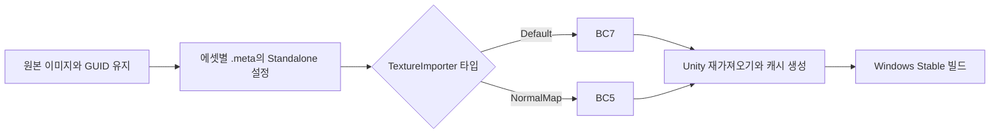

# Stable 빌드 텍스처 압축 적용 안내

> 문서 대조일: **2026-10-26**. 현재 코드·설정을 기준으로 설명을 점검했습니다. 본문의 과거 검사 수치·실행 기록은 해당 날짜의 결과입니다. [현재 상태·문서 검토 범위](문서_현행화_점검표.md)를 함께 확인합니다.

작성일: 2026-10-21. Unity 6000.2.8f1, Windows 64비트 Stable 빌드를 기준으로 합니다.

## 1. 목적과 확인한 원인

기존 Stable 빌드 보고서의 전체 출력 용량은 **4,560,218,043바이트(약 4.56GB)**였습니다. PNG·JPG 원본에서 생성된 빌드 리소스가 약 3.92GB를 차지했고, 큰 텍스처는 한 장에 약 67~89MB씩 들어갔습니다. 상위 텍스처의 기본 Compression이 Uncompressed였으며, 빌드 임포트 강제 설정도 없었습니다.

ZIP 압축은 배포 폴더를 포장하는 압축입니다. 이번 작업은 Unity가 게임에서 사용하는 텍스처의 저장·GPU 형식을 바꾸는 작업입니다. 우선 해상도를 낮추지 않고 압축 형식만 바꿔 용량을 줄이는 것을 목표로 했습니다. 같은 해상도라도 BC7·BC5는 손실 압축이므로 압축 전후 픽셀이 완전히 같다고 보장하지는 않습니다.

## 2. 적용 범위와 기준

최근 성공한 Stable 빌드 보고서에서 실제로 포함된 프로젝트 에셋 경로를 추출하고, TextureImporter가 있는 **271개**를 분류했습니다. 프로젝트 전체에 일괄 규칙을 강제하거나 새 파일을 자동 변경하는 AssetPostprocessor를 추가하지 않았습니다.

| 구분 | 수 | 적용 |
|---|---:|---|
| Default 일반 텍스처 | 170 | Standalone 형식을 BC7로 지정 |
| NormalMap 노멀맵 | 94 | Standalone 형식을 BC5로 지정 |
| UI Sprite | 5 | 기존 설정 유지 |
| EXR 노멀 원본 | 2 | 별도 검토 대상으로 기존 설정 유지 |

대상은 **264개**이며, 각 파일의 GUID·형식·설정은 [적용 목록](TextureCompressionApplied.json)에 기록했습니다. 이 JSON은 작업 기록으로, 게임이 로드하는 데이터 테이블이 아닙니다. 개별 플랫폼 오버라이드가 이미 활성화된 파일은 보존하는 기준으로 검사했으며, 이번 대상에는 기존 활성 오버라이드가 없었습니다.

EXR 제외 대상은 다음 두 파일입니다. EXR 확장자를 보고 일반 색상 맵으로 취급하거나 BC7로 일괄 변환하지 않았습니다.

- `Assets/2.Model/Prefabs/R05/SILENT_Room_05/Textures/wood_floor_Normal.exr`
- `Assets/4.Sprite/Texture/047a5b1e10859a88_Normal.exr`

### 압축 형식을 나눈 이유

- **BC7:** 일반 색상·금속성/매끄러움 등 텍스처의 채널을 유지하면서 압축합니다. 색상 맵과 알파가 있는 맵에 같은 데스크톱 압축 기준을 적용했습니다.
- **BC5:** 표면의 방향 정보를 담는 노멀맵에 사용합니다. 기존 NormalMap 타입과 선형 색 공간 설정을 보존했습니다. 텍스처 이름만 보고 판단하지 않고 TextureImporter의 타입으로 분류했습니다.
- **UI·EXR 예외:** UI 스프라이트와 EXR 원본은 별도 품질 판단을 위해 그대로 뒀습니다. 글자가 들어 있는 일반 3D 재질 텍스처까지 자동으로 예외가 되는 것은 아니므로 카드·다이얼 글자는 화면 검사가 필요합니다.

Unity API의 `IsPlatformTextureFormatValid`로 각 타입과 Windows64 대상의 형식 조합을 확인한 뒤 적용했습니다.

## 3. 실제로 바꾼 설정

원본 PNG·JPG를 다시 저장한 것이 아니라 각 에셋의 **`.meta` 파일 안 Standalone 플랫폼 설정**만 변경했습니다.

| 설정 | 적용값 / 의미 |
|---|---|
| Override for Standalone | 활성화 |
| Format | 일반 BC7 / 노멀 BC5 |
| Compression | CompressedHQ |
| Compressor Quality | 50 |
| Crunch | 비활성화. BC7·BC5에 별도의 Crunch 적용을 섞지 않음 |
| Max Size | 오버라이드 적용 전 실제 기본 최대 크기를 그대로 복사 |

기존에 비활성화된 Standalone 설정의 Max Size가 2048이어도, 실제 사용 중이던 기본값이 8192라면 새 오버라이드에도 8192를 넣었습니다. 단순히 비활성 오버라이드를 켜서 해상도가 2048로 함께 줄어드는 것을 방지하기 위한 처리입니다. **8192는 상한이며 모든 원본을 8192로 확대한다는 뜻이 아닙니다.** 기존 NPOT 처리 규칙도 보존했습니다.

다음 설정은 변경하지 않았습니다: 기본 플랫폼 설정, 원본 이미지, GUID, sRGB/선형 구분, Texture Type, 밉맵, Read/Write, 필터·반복, 프리팹·머티리얼 참조, Android·WebGL·iOS 설정. 이미지 264개의 원본 해시를 적용 전후 비교했습니다.

Standalone은 Unity에서 **Windows·Linux·macOS가 공유하는 플랫폼 설정 이름**입니다. 이번 빌드·호환성 확인 대상은 Windows64입니다. 다른 데스크톱 대상으로 배포할 때는 해당 플랫폼에서 형식 지원과 화면 품질을 따로 확인해야 합니다.

## 4. 데이터가 빌드로 들어가는 흐름



런타임 게임 코드·CSV·서버 API에 압축 분기를 넣지 않았습니다. 재질은 같은 GUID의 텍스처를 계속 참조하고, Unity의 임포트·빌드 단계가 압축된 데이터를 만듭니다. 이번 작업은 에셋 인프라 설정이며 서버 Docker를 재배포할 필요는 없습니다.

## 5. 검증 결과

264개 원본 이미지의 해시와 의도한 Standalone 설정을 확인했습니다. Unity에서 불러온 표본은 실제 포맷이 다음과 같이 바뀌었습니다.

| 표본 | 확인 결과 |
|---|---|
| `M094_tripo_mat_075bce52_003_MetallicSmoothness.png` | 4096×4096, BC7 |
| `11105ce774032916_Normal.png` | 4096×4096, BC5 |
| `07b0d85e0ec0f094_BaseColor.jpg` | 4096×4096, BC7 |
| Vivox `icon_speaker.png` | 기존 RGBA32, 22×22 유지 |

Windows64 Stable 클린 빌드가 성공했습니다. 같은 Join·Ingame·Vivox 샘플 3개 씬을 유지하고 Development Build를 해제했습니다. 비교에는 ZIP 압축을 사용하지 않았습니다.

| 항목 | 적용 전 | 적용 후 |
|---|---:|---:|
| BuildReport 전체 출력 | 4,560,218,043바이트 | 2,162,477,227바이트 |
| 표시 용량(십진 GB) | 4.56GB | 2.16GB |
| 최대 공용 리소스 파일 | 4,315,545,536바이트 | 1,917,804,720바이트 |

약 **52.6%**, **2.40GB** 감소했습니다. 원래 폴더는 `build/Stable/`, 새 빌드는 **`build/Stable-TextureCompressed/`**입니다. BuildReport 집계와 ZIP 파일 크기, 백업·디버그 폴더까지 포함한 탐색기 용량은 구분해야 합니다.

빌드 오류 0개, 경고 2개였습니다. 경고는 Unity 서비스 프로젝트 연결 안내와 네이티브 심볼 업로드의 HTTP 403입니다. 텍스처 형식 오류로 빌드가 실패한 것은 아니지만, Unity 서비스와 실제 음성 연결은 두 PC에서 따로 확인해야 합니다.

264개 `.meta`에서 Standalone 블록 이외의 내용이 원래 백업과 같은지 비교해 모두 일치했습니다. 이 검사는 원본 이미지 해시·GUID 보존 검사와 함께 수행했습니다. 표본의 실제 BC7·BC5 형식은 확인했으며 전체 카드의 글자 판독성·모든 방의 최종 화면 품질은 수동 검사 항목으로 남깁니다.

원래 빌드의 FBX 연결 리소스 중 메시만 약 **451MB**였습니다. 텍스처를 압축해도 메시 용량은 줄지 않습니다. 전체 용량을 더 줄일 경우 메시 최적화는 별도 작업으로 판단해야 합니다.

## 6. 기획·아트 작업자 적용 방법

1. 이번 변경을 공유할 때 원본 이미지와 연결되는 **`.meta` 변경도 함께 Git에 반영**합니다. 기존 GUID는 유지해야 합니다.
2. 동료는 변경을 받은 뒤 Unity의 재가져오기가 끝날 때까지 기다립니다. ZIP 파일만 다시 만드는 것으로 기존 실행 파일이 갱신되지는 않습니다.
3. 새 텍스처를 추가할 때 Project에서 해당 텍스처를 선택하고 Inspector의 PC/Standalone 플랫폼 탭을 확인합니다.
4. 일반 텍스처는 BC7, 올바르게 NormalMap으로 등록한 노멀맵은 BC5를 사용합니다. Max Size는 의도한 실제 해상도 상한을 입력합니다. UI·정밀 데이터·EXR은 별도로 판단합니다.
5. Apply 후 아래 화면 품질을 확인하고 새 Windows Stable 빌드를 만듭니다. 새 텍스처에는 이번 설정이 자동으로 적용되지 않습니다.

이름에 Normal이 붙어 있어도 Texture Type이 Default라면 이번 기준에서는 일반 텍스처입니다. 타입·색 공간을 정정하는 작업은 압축 설정 변경과 구분해서 검토해야 합니다.

## 7. 테스트 순서

1. 새 빌드 폴더 전체로 실행합니다. Stable 주소와 두 참가자 시작 대기 동작을 확인합니다.
2. A/B의 1번 방에서 벽·바닥·금속·투명 재질을 확인합니다. 노멀맵의 방향, 반짝임, 검은 블록·깨진 재질이 없는지 봅니다.
3. Closeup에서 카드 문자·숫자·다이얼·버튼을 가까이 읽습니다. 글자 판독이 나빠졌다면 해당 에셋만 압축 예외 또는 다른 형식으로 조정합니다.
4. 개발자 Room Clear Test로 준비된 다음 방을 생성해 방별 재질도 확인합니다. 기존 콘텐츠 누락 때문에 방 생성이 실패하는 경우 텍스처 오류와 구분합니다.
5. Windows 플레이어 로그의 텍스처 형식·셰이더 오류를 확인합니다. 온라인 정답·문 API 요청도 정상 흐름으로 검사합니다.

빌드 성공과 포맷 검증은 실제 두 PC에서 모든 퍼즐 글자의 판독성과 게임 기능이 검증됐다는 뜻은 아닙니다.

## 8. 백업과 복구

적용 전에 264개 `.meta`와 기존 BuildReport를 로컬에 백업했습니다. 적용 전 해시·GUID를 모두 확인한 후 변경했으며, 다른 작업자의 설정이 바뀌면 일괄 적용을 중단하도록 했습니다.

로컬 작업 기록 위치:

`C:/Users/m/Documents/Codex/2026-10-07/4-x20-2-x20/outputs/server/client-refactor/texture-compression/`

- `backup/20261021-155112/`: 원래 `.meta`와 `Before.buildreport`
- `plan.json`, `applied.json`: 대상과 적용 전후 해시
- `apply.py`: 설정 검증과 복구 도구

복구는 Unity에서 Play·빌드를 멈춘 뒤 이 작업 폴더에서 아래 명령으로 수행합니다. 현재 `.meta`가 적용 직후와 달라졌으면 자동으로 덮어쓰지 않고 중단합니다.

```powershell
& 'C:\Users\m\.cache\codex-runtimes\codex-primary-runtime\dependencies\python\python.exe' .\client-refactor\texture-compression\apply.py restore
```

명령의 실행 위치는 위 server 작업 폴더입니다. 복구 후 Unity에서 재가져오기를 마치고 다시 빌드해야 실행 파일에도 복구가 반영됩니다. 동료 PC에는 이 로컬 백업이 없으므로, 공유된 변경의 Git 이력 또는 해당 PC의 별도 백업을 사용합니다.

## 공식 참고 자료

- [플랫폼별 텍스처 설정과 압축 형식](https://docs.unity3d.com/kr/current/Manual/class-TextureImporter-type-specific.html)
- [TextureImporterFormat](https://docs.unity3d.com/cn/current/ScriptReference/TextureImporterFormat.html)
- [Max Texture Size](https://docs.unity3d.com/cn/current/ScriptReference/TextureImporter-maxTextureSize.html)
