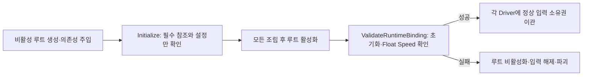

# 빌드 입장 중단 원인과 수정

작성일: 2026-10-26. 대상은 사용자가 전달한 Build_10_26.zip과 같은 Stable 실행 파일입니다.

## 1. 증상과 실제 진행 위치

서버 로그는 두 사람의 입장·CSV 수신·Loading 상태 조회 성공 뒤 양쪽 LeaveSession을 보여줍니다. 접속 자체가 실패한 것이 아니라 로컬 게임 준비 실패 후 클라이언트가 이번 참가 자리를 정리한 흐름입니다. 정상 ready까지 가지 못하므로 서버는 Playing으로 바뀌지 않습니다.

이 PC의 Player.log와 Player-prev.log에는 각각 다음 오류가 있습니다.

```text
[Game Entry] 손 애니메이터 Arms_B_Model에 실수형 Speed 파라미터가 필요합니다.
[Game Entry] 손 애니메이터 Arms_A_Model에 실수형 Speed 파라미터가 필요합니다.
```

현재 오류의 직접 원인은 조명 앵커가 아닙니다. 조명 앵커를 되돌려 우회할 근거가 없으며 이번 수정에서 위치·CSV·라이트 프리팹·베이크 데이터를 바꾸지 않습니다. 이전에 잘됐던 빌드가 왜 달랐는지는 해당 이전 파일을 대조하기 전에는 단정하지 않습니다.

## 2. 코드의 잘못된 순서


LocalPlayerFactory가 비활성 플레이어에 입력·모델을 조립하는 동안 PlayerHandAnimationDriver.Initialize가 Animator.parameters를 읽었습니다. 전달받은 실행 파일에서 이 시점의 active=False, isInitialized=False, parameterCount=0을 확인했습니다. 제어기 원본에는 Float Speed가 있지만 초기화 전 런타임 인스턴스에서 아직 조회되지 않았습니다.

단순 Rebind를 비활성 상태에서 호출해도 같은 실행 파일에서는 초기화가 완료되지 않았습니다. 파라미터 이름을 임의 변경하거나 검사를 삭제하는 대신 검증 시점을 바꿉니다.

## 3. 현재 수정 규격



| 파일 | 수정 |
|---|---|
| [PlayerHandAnimationDriver](../Assets/3.Script/Player/PlayerHandAnimationDriver.cs) | 비활성 조립과 네이티브 바인딩 검증을 분리. 초기화 성공 후 실제 Float 파라미터를 확인하고 첫 속도를 적용 |
| [LocalPlayerFactory](../Assets/3.Script/Player/LocalPlayerFactory.cs) | SetActive(true) 직후 같은 try/catch 안에서 명시적으로 검증. 성공 후에만 입력 소유권 이관 |

OnEnable 예외만으로 생성 실패를 전달하지 않습니다. 유니티의 생명주기 콜백 밖에서 Factory가 검증 결과를 직접 받으므로 실패 정리가 일관되게 실행됩니다. 검증 전에는 애니메이터에 속도 값을 쓰지 않으며 매 프레임 파라미터 목록을 검색하지 않습니다.

검사를 생략한 것은 아닙니다. 잘못된 이름·자료형과 실제 초기화 실패는 여전히 거절합니다. 비활성화·재활성화의 기존 이벤트 수명, 입력 반복 해제 보호, 모델 선행 파괴 보호는 유지합니다.

## 4. 실행 파일을 이용한 확인

압축 파일의 Assembly-CSharp.dll·globalgamemanagers·boot.config·connection.json이 당시 Stable 폴더와 바이트 단위로 일치함을 확인했습니다. 진단 도중 원본 ZIP 경로가 없어져, 이미 동일성을 확인한 Stable에서 별도 진단 사본을 구성했습니다.

원본 프로젝트와 배포용 실행 파일을 직접 바꿔 검사하지 않았습니다. 진단 사본에만 로컬 입장·상태 기록 코드를 연결했습니다. 실패 재현은 원본 게임 코드를 유지한 사본, 수정 비교는 현재 소스의 두 파일 수정안을 플레이어용 참조로 컴파일해 연결한 사본입니다. 둘 다 같은 게임 자원을 사용합니다.

| 검사 | 결과 |
|---|---|
| 원본 코드의 A 로컬 입장 | 실패 재현. 비활성·미초기화·파라미터 0개 |
| 비활성 상태에서 Rebind만 호출 | 실패 재현. 여전히 미초기화·0개 |
| 수정안 A | 게임 준비 성공. 활성·초기화·파라미터 1개·Float Speed 확인 |
| 수정안 B | 게임 준비 성공. 활성·초기화·파라미터 1개·Float Speed 확인 |
| 존재하지 않는 파라미터 | 정상 거절·입장 실패. 실패 객체 비활성화·입력 해제 확인 |
| 윈도우 플레이어용 전체 참조 컴파일 | 통과 |

실행 검사는 -batchmode -nographics 로컬 모드입니다. 서버·음성·GPU 화면·프로브 밝기·두 PC 온라인·새 전체 빌드 패키징 검사를 대신하지 않습니다. 이 실행 방식의 셰이더·영상 장치 경고는 일반 그래픽 실행의 품질 결과가 아닙니다.

## 5. 적용 후 확인 순서

1. 변경 소스를 유니티에 반영하고 컴파일을 완료합니다.
2. 기존 build/Stable 폴더에 다시 빌드합니다. 수정 전 Assembly-CSharp.dll을 수동 복사하는 방식으로 배포하지 않습니다.
3. 새 빌드 결과 전체를 두 PC에 동일하게 전달합니다.
4. 서버 입장·데이터 수신 뒤 ready가 양쪽에서 기록되고 Playing으로 바뀌는지 확인합니다.
5. Player.log에서 위 Speed 오류가 사라졌는지, 손 대기·걷기·정지가 되는지 확인합니다.

이번 수정은 클라이언트의 초기화 순서입니다. 서버 컨테이너 재배포나 조명 위치 되돌리기는 필요하지 않습니다. 실제 온라인 두 참가자 확인은 새 빌드에서 별도로 수행합니다.

관련: [손 동작·수명](PlayerHandAnimation.md), [진입 수명](EntryConsistency.md), [프로브](RoomProbeLighting.md). 엔진 정의: [Animator 초기화 상태](https://docs.unity3d.com/6000.2/Documentation/ScriptReference/Animator-isInitialized.html), [파라미터 목록](https://docs.unity3d.com/6000.2/Documentation/ScriptReference/Animator-parameters.html). 비활성 상태의 실제 조회 결과는 이 프로젝트의 실행 파일 재현으로 확인한 사실입니다.
