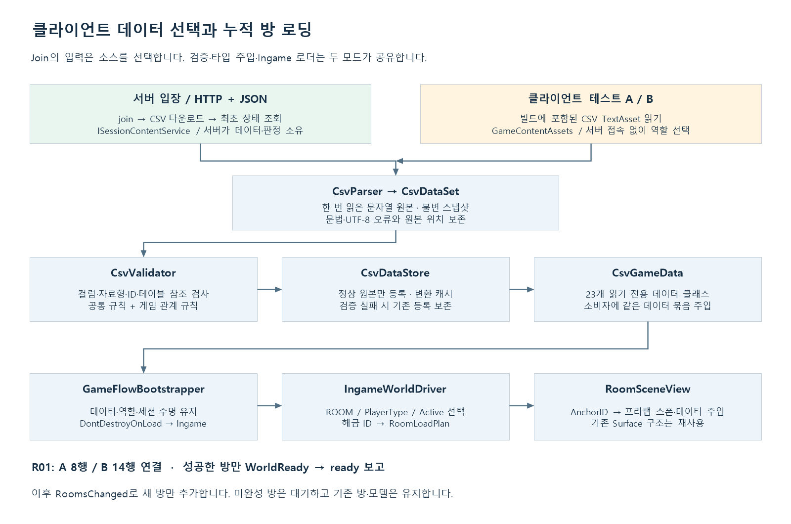
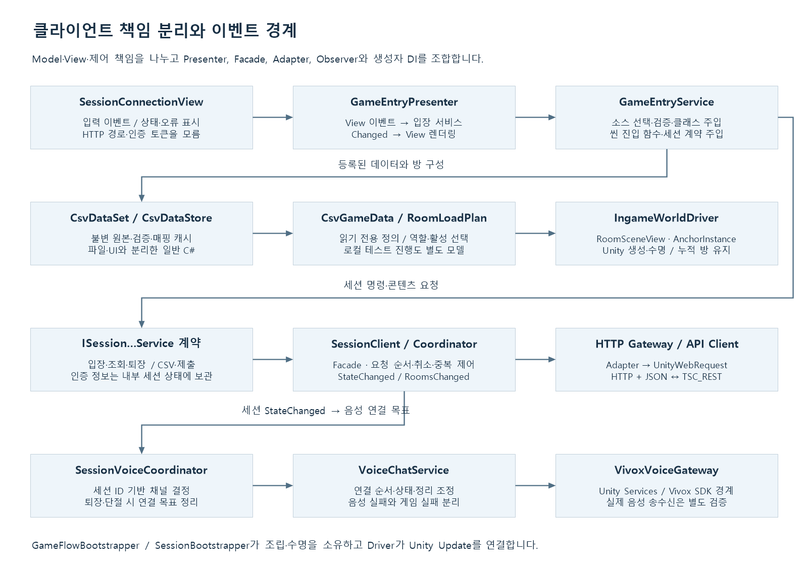

# 2인 협동 방탈출 Unity 클라이언트

기준일: **2026-10-19**. 현재 코드와 검증 결과를 기준으로 설명합니다. 이전 기획서와 차이가 있으면 현재 요구사항과 데이터 테이블을 우선합니다.

두 클라이언트가 음성으로 단서를 주고받으며 퍼즐을 해결하는 Unity 6 프로젝트입니다. Join에서 환경 config에 등록한 서버로 자동 입장하거나 **클라이언트 테스트 A/B**를 선택하고, 검증한 CSV를 데이터 클래스로 주입한 뒤 Ingame에서 방을 구성합니다. 현재 콘텐츠 구현 범위는 **R01**이며, 다음 공간을 열어도 이미 로드한 공간은 유지합니다.

## 1. 실행과 현재 범위

| 항목 | 구성 |
|---|---|
| Unity | 6000.2.8f1 / Unity 6.2 |
| 시작 / 게임 씬 | [Join](Assets/1.Scene/Join.unity) / [Ingame](Assets/1.Scene/Ingame.unity) |
| 게임 통신 | UnityWebRequest, HTTP + Google Protobuf 바이너리 |
| 음성 | Vivox 16.12.1, Unity Authentication 3.4.1 |
| UI / 렌더링 | uGUI·TextMeshPro / URP 17.2.0 |
| 로컬 데이터 | [Assets/11.CSV](Assets/11.CSV), 23개 CSV |
| 서버 | 별도 저장소 TSC_REST, Node.js 24 이상 |

1. Unity Hub에서 프로젝트를 열고 패키지 복원·컴파일을 마칩니다.
2. Join을 열어 Play 모드로 들어갑니다.
3. Join 활성화 시 config의 현재 환경 주소로 자동 입장합니다. 에디터는 `http://127.0.0.1:3000`, Development Build는 `http://192.168.1.34:3001`입니다. 주소 입력창은 없으며, 입장 버튼은 같은 config 설정으로 재시도합니다.
4. 서버 없이 확인할 때는 `Assets/StreamingAssets/Configuration/connection.json`의 editor 환경 `autoConnect`를 false로 설정하고 **클라이언트 테스트 A/B**를 누릅니다. 로컬 버튼은 에디터에서만 표시하며 Development Build를 포함한 모든 빌드에서 제외합니다.
5. CSV 검증과 클래스 주입이 끝나면 Ingame으로 이동하고 해당 역할의 R01을 로드합니다.

접속 설정은 [환경별 접속 설정 안내](Docs/ConnectionConfiguration.md)를 따릅니다. **Development Build 체크 = 테스트 주소, 체크 해제 = 안정화 주소**입니다. 안정화 주소는 아직 비어 있으므로 클라우드 주소 등록 전 일반 빌드는 검증에서 중단됩니다.

현재 빌드 목록은 Join, Vivox 수동 샘플, Ingame이며 **첫 씬은 Join**입니다. Windows 빌드는 Build Profiles에서 생성하고 출력 폴더 전체를 공유합니다. 소스·CSV·프리팹 변경은 새 빌드에 반영해야 합니다.

| 완료한 기능 | 후속 범위 |
|---|---|
| 서버 입장·A/B 역할·조회·ready·heartbeat·퇴장 | 기존 참가자 신분 복구, 다중 세션·영구 저장 |
| CSV 메모리 등록·검증·23개 데이터 클래스·주입 | 새 시트 추가 시 스키마·모델 정의 |
| 서버/로컬 소스 선택, Join → Ingame 수명 유지 | 완성된 메뉴와 Ingame 연결 종료 UI |
| R01 역할별 스폰, 누적 해금 로더 | R02~R07 실제 프리팹·앵커·배치 완성 |
| 서버 슬롯 정답 비교와 해금 상태 반영 | 입력 UI·문 연출·오답 잠금·승패 규칙 |
| Vivox 자동 연결 코드 | 두 PC 실제 음성 송수신·장치 검증 |

## 2. 데이터 선택부터 방 로드까지



[확대 가능한 SVG](Docs/Images/client-data-flow.svg)

| 단계 | 코드와 동작 |
|---|---|
| 입력 | `SessionConnectionView`가 서버 입장 또는 로컬 역할 선택 이벤트를 보냅니다. |
| 조정 | `GameEntryPresenter`가 `GameEntryService.EnterAsync`를 호출하고 상태·오류를 표시합니다. |
| 서버 소스 | join으로 참가 토큰을 받은 뒤 `/data`에서 CSV를 받습니다. `SessionCoordinator`가 최초 상태 조회까지 같은 요청 경로에서 순차 처리해 자동 조회와의 경합을 방지합니다. |
| 로컬 소스 | `GameContentAssets.ReadLocalData`가 빌드에 포함된 CSV TextAsset을 읽습니다. 기존 서버 참가 중이면 먼저 퇴장합니다. |
| 공통 등록 | `CsvParser` → `CsvDataSet` → `CsvValidator` → `CsvDataStore.TryRegister` → `CsvGameData` 순서입니다. |
| 수명 | `GameFlowBootstrapper`가 세션·음성 소유 객체와 함께 `DontDestroyOnLoad`로 유지됩니다. 등록한 정의와 역할을 씬 사이에 전달합니다. |
| 방 구성 | `IngameWorldDriver`가 `RoomLoadPlan`과 `RoomSceneView`로 해금된 자기 역할의 방을 로드합니다. |
| 준비 보고 | R01 로드로 `WorldReady`가 참이 된 뒤 `GameplayReadinessCheck`를 통과해야 ready를 보고합니다. |

서버 동기화 실패 시 Join에서 오류를 표시하고 이번 입장에서 확보한 자리를 정리합니다. 서버 실패를 로컬 CSV로 대체하지 않습니다. 데이터 소스를 바꾸는 동안 이전 씬이 준비 완료를 보고하거나 이전 계획으로 새 스냅샷을 적용하지 않도록 구분합니다.

## 3. 코드 구조와 디자인패턴



[확대 가능한 SVG](Docs/Images/client-architecture.svg)

MVC의 데이터·표현·제어 책임을 Unity 수명에 맞춰 나누고, 화면은 View/Presenter로 구성합니다. 모든 기능을 하나의 패턴으로 강제하지 않고 책임에 맞게 조합합니다.

| 모듈 | 책임 / 적용 방식 |
|---|---|
| `Configuration` | 환경별 불변 설정 선택과 공통 자동 입장 명령. Unity 파일 입력과 빌드 검사 어댑터를 분리합니다. |
| `World/GameEntryService` | 소스 선택·검증·씬 진입 조정. 세션 계약, 로컬 읽기 함수, 검증기, 씬 전환 함수를 생성자로 주입합니다. |
| `World/GameFlowBootstrapper` | Unity 조립과 수명 소유자. 별도의 전역 데이터 Singleton 없이 서비스를 보유합니다. |
| `Data/CsvDataStore`, `Tables/CsvGameData` | 불변 원본, 타입별 변환 캐시, 소비자에 주입하는 데이터 묶음입니다. |
| `RoomLoadPlan`, `LocalRoomProgression` | Unity 오브젝트와 독립적인 선택·로컬 진행 규칙입니다. |
| `RoomSceneView`, `IngameWorldDriver` | 프리팹 생성·앵커 탐색·로드 이벤트·기존 방 유지입니다. |
| `SessionClient` | `ISessionConnectionService`, `ISessionContentService`를 구현하는 Facade입니다. 인증 정보는 내부에 유지합니다. |
| `SessionCoordinator`, `SessionRequestRunner` | 요청 순서·취소·중복·연결 수명과 결과 반영을 조정합니다. |
| `HttpSessionGateway`, `SessionApiClient` | Adapter와 Protobuf HTTP 경계입니다. View는 HTTP 경로·토큰·Wire DTO를 다루지 않습니다. |
| `CsvTableMapping<T>`, 검증 규칙 | 시트와 변환 함수를 묶은 매핑, 설정과 규칙 객체의 조합을 재사용합니다. |
| `StateChanged`, `PhaseChanged`, `RoomsChanged`, `Registered` | 반영 완료 후 통지하는 Observer 방식입니다. Driver는 Unity Update·활성/비활성 수명을 담당합니다. |
| Voice 모듈 | 세션 이벤트를 음성 연결 목표로 바꾸는 Coordinator, 서비스, Vivox Gateway Adapter입니다. |

```text
Assets/3.Script/
  Common/Csv/                 CSV 파서·입력 포트·문서/행
  Common/Timing/, Readiness/   정수 시계·간격·준비 조건
  Data/                       원본·등록소·매핑·GameContentAssets
    Tables/                   23개 행 모델·공통 Room/Anchor·CsvGameData
    CsvValidation/            설정·규칙·결과·한국어 메시지
    Infrastructure/           파일·TextAsset 어댑터
  World/                      입장 조정·방 계획·스폰·로컬 진행
  Session/                    계약·코어·자동 Driver·화면
  Networking/                 HTTP·Protobuf·Gateway
  Voice/                      음성 계약·서비스·Vivox·화면
  Editor/                     CSV 검사 창·콘텐츠 참조 생성
  Generated/Protocol/         Protobuf 생성물
Tools/                        .NET·Unity Play 검사·도식 생성
```

## 4. CSV 읽기·검증·클래스 주입

CSV는 **UTF-8, 쉼표 구분, 첫 번째 비어 있지 않은 레코드가 헤더**입니다. 예전 기획서처럼 앞 4행을 건너뛰지 않습니다. BOM·인용부호 안 쉼표/줄바꿈·따옴표 이스케이프를 지원하며, 문자열 공백과 앞자리 0은 보존합니다.

| 구성 | 역할 |
|---|---|
| `CsvParser` / `CsvLoader` | 문법 해석과 입력 어댑터 연결. 파서는 Unity에 의존하지 않습니다. |
| `CsvDataSet` | 읽은 원본 문서와 읽기/해석 오류를 보존하는 불변 스냅샷입니다. |
| `CsvValidator` | 파일을 다시 열지 않고 메모리 원본을 검사합니다. |
| `CsvDataStore` | 정상 원본만 등록합니다. 잘못된 재등록은 기존 정상 원본·캐시를 바꾸지 않습니다. |
| `CsvTableMapping<T>` | 시트 이름과 변환 함수를 한 번 정의하고 동일 시트/타입의 변환 캐시를 재사용합니다. |
| `CsvGameData` | 전체 테이블을 읽기 전용 모델 목록으로 제공합니다. 새 스냅샷 등록 후에는 새 묶음을 주입합니다. |

스키마 원본은 [CsvValidationRules.xml](Assets/3.Script/Data/CsvValidation/Configuration/CsvValidationRules.xml)입니다. 공통 방·앵커 profile을 재사용하고 시트 이름·컬럼 형식·참조 대상과 게임 관계 검사를 분리합니다. 서버는 대응 규칙을 `CsvSchema.ts`로 정의하므로 규칙 변경 시 양쪽을 맞춰 검사해야 합니다.

검사 범위는 CSV 문법·UTF-8, 필수/미등록 컬럼, 자료형·범위·Y/N, 키 중복, REGISTRY·테이블 참조, Next 순환·활성 방 시작점 1개·전체 활성 방 연결, ExitRule 허용값(SolvedEach/BothSolved), ROOM/ANCHOR 공통 ID 영역, Solver/Clue·입력 앵커 관계, 슬롯 수·순서, 사운드·설정값 관계입니다. 선택적인 Unity 리소스 경로 검사는 Editor 어댑터가 수행하며 미발견을 경고합니다. 런타임은 필요한 앵커·프리팹이 없으면 해당 방 로드를 완료하지 않습니다.

23개 모델은 `AnchorInteractData`, `AnchorNonInteractData`, `RoomAData`, `RoomBData`, `ArrowData`, `CardData`, `CharacterStatData`, `ColorLetterData`, `ComponentData`, `ConsoleData`, `FormulaData`, `FrameData`, `GameConfigData`, `LockData`, `PaperData`, `PrefabData`, `PuzzleData`, `PuzzleSlotData`, `RegistryData`, `SoundData`, `SoundLinkData`, `TvData`, `WireData`입니다. 공통 필드와 변환은 `RoomData`, `AnchorData`, `CsvRowReader`로 재사용합니다.

ID·순서·ms는 정수, Y/N은 bool로 변환합니다. 정답·표시값은 숫자처럼 보여도 문자열로 유지합니다. `EyeHeight`, `CapsuleRadius`, `LengthM`, `Volume` 같은 Unity 표현·물리·오디오 수치는 float로 보존합니다. `GAME_CONFIG`는 선언된 Type에 맞는 접근자만 허용합니다.

```csharp
// 검증·등록한 데이터 묶음을 필요한 소비자에 전달합니다.
CsvGameData data = flow.Service.Data;
var anchors = data.InteractAnchors;

// using EscapeGame.Session.Contracts;
// 퍼즐 입력 기능이 연결할 공통 진입점입니다.
PuzzleSubmissionResult result = await flow.Service.SubmitPuzzleAsync(puzzleId, answers, token);
// result.Outcome: Rejected=0(제출 거절), Incorrect=1(오답), Correct=2(정답)
// 통신 실패·취소는 예외 경로로 전달됩니다.
```

**Tools → CSV → 검사기**는 처음 검사할 때 파일을 읽습니다. **메모리 데이터 검사**는 같은 원본을 재검사하며, 파일 수정 후에는 **CSV 다시 읽고 검사**를 사용합니다. 결과의 파일·행·컬럼·원인을 검색·복사할 수 있습니다.

## 5. R01 스폰과 이후 공간 추가

1. 역할에 맞는 ROOM_A 또는 ROOM_B에서 활성 방과 Next 연결을 읽습니다.
2. 두 ANCHOR 테이블을 합쳐 RoomNo 일치, Active=Y, PlayerType=내 역할 또는 ALL인 행만 선택합니다.
3. AnchorID와 이름이 정확히 일치하는 Transform을 찾고 `PrefabID → PREFAB.Path → GameContentAssets`로 프리팹을 찾습니다. 앵커 이름에 특정 접미사를 강제하지 않습니다.
4. 필요한 참조를 먼저 확인한 뒤 생성합니다. 앵커 아래 로컬 위치 0·회전 identity를 적용하고 프리팹 로컬 스케일을 유지합니다.
5. `AnchorInstance`가 `AnchorData`와 `CsvGameData`를 보유하며, 기능 컴포넌트는 `IAnchorDataReceiver.Initialize`로 주입받습니다.
6. 성공한 방만 등록하고 반복 스냅샷으로 방·프리팹을 중복 생성하지 않습니다.

Ingame의 R01_Surface 아래 **R01_모델_Anchor**에 기존 앵커를 묶고, 다이얼 테이블 이름을 CSV의 `R01_Dial_table_Anchor`와 맞췄습니다. 바닥·벽·기본 구조는 이미 Surface에 들어 있어 `RoomSceneView`의 명시적인 embedded 바인딩으로 재사용합니다. R01 연결 행은 **A 8개 / B 14개**이며 재사용한 구조도 포함합니다.

서버 모드는 서버 `RoomProgression`의 정답·Solver·해금·Playing 검사를 거친 `unlockedRoomIds`를 조회해 `RoomsChanged`로 반영합니다. 로컬 모드는 `LocalRoomProgression`을 사용합니다. `SolvedEach`는 해당 퍼즐, `BothSolved`는 같은 방 번호 양쪽 퍼즐 완료를 조건으로 문을 허가합니다. 정답 제출자는 자기 문과 Next를 먼저 허가받고, 상대는 자기 문 확인 때 허가받습니다. 이후 문 열기·닫기는 RoomPermissionService 캐시를 사용하며 추가 통신이 없습니다. Next=0이면 추가 방이 없습니다. ExitRule은 `RoomExitRules`에서 공통 해석하며 알 수 없는 값은 검증과 런타임에서 차단합니다. 활성 방은 시작점 하나에서 모두 연결되어야 하며, 비활성 방으로 끊긴 연결도 허용하지 않습니다.

**R02 이후 콘텐츠를 추가할 때**:

- ROOM_A/B의 Active·RoomPrefabID·PuzzleID·Next와 PREFAB의 실제 프리팹 경로를 맞춥니다.
- 방 프리팹에 ANCHOR와 이름이 같은 앵커를 배치합니다. 방 프리팹 자체의 저장 위치·회전을 다음 공간의 배치에 맞춥니다.
- 역할별 오브젝트 프리팹과 값 테이블을 준비합니다. 씬에 미리 둔 방은 `sceneRooms`로 연결할 수 있고 없는 방은 RoomPrefabID 경로에서 생성합니다.
- CSV·프리팹 변경 시와 빌드 전 `GameContentBuilder`가 [GameContent.asset](Assets/Resources/GameContent.asset)의 참조를 갱신합니다. 수동 메뉴는 **Tools → Game → Rebuild Content References**입니다.

미완성인 다음 방은 로드를 보류하고 원인을 알리며 기존 방은 유지합니다. 에디터에서 에셋을 준비해 빌드하는 방식이며 실행 중 원격 프리팹 다운로드는 지원하지 않습니다.

## 6. 세션·음성·통신 경계

| 서버 단계 | 의미 |
|---|---|
| Waiting | 참가 인원 부족 |
| Loading | 두 명이지만 씬 준비 미완료 참가자가 있음 |
| Playing | 두 참가자 모두 준비 보고 완료 |

기본 자동 조회·ready 재시도는 1000ms, heartbeat는 3000ms, 정상 heartbeat 응답 단절 기준은 10000ms입니다. heartbeat 요청 제한은 2000ms, 일반 HTTP 제한은 10000ms입니다. 정수 ms·Stopwatch를 사용하고 Unity API 경계에서만 초 단위로 바꿉니다. heartbeat와 일반 요청 경로를 분리하고 연결 버전으로 이전 연결의 늦은 응답을 무시합니다.

Vivox는 `StateChanged → SessionVoiceCoordinator → VoiceChatService → VivoxVoiceGateway` 순서입니다. 세션 ID 기반 채널을 사용하고 참가 토큰을 채널명에 쓰지 않습니다. 로컬 테스트는 서버에 입장하지 않으므로 음성 연결 목표도 만들지 않습니다. Unity Cloud/Vivox 설정과 인터넷 연결은 별도 필요합니다.

기존 두 PC 검사에서 채널 연결 표시는 확인했으나 **실제 양방향 송수신·Bluetooth 장치 검증은 보류** 상태입니다. 연결 표시만으로 음성 검증 완료로 판단하지 않습니다. 게임 서버는 음성을 중계하지 않습니다.

게임 API는 **HTTP + Google Protobuf 바이너리**입니다. 메시지는 .proto, 경로·인증·미디어 타입은 OpenAPI로 관리합니다. 생성 도구가 C# 메시지와 호출 인터페이스/기본 클래스를 생성하고, 클라 게임 기능은 공개 계약으로 접근합니다. config JSON은 로컬 설정 파일입니다. 새 문·정답 API, 코드별 설명, 생성·배포 및 검사 방법은 [문·정답 API 안내](Docs/RoomApiAndProtobuf.md)를 참고합니다.

## 7. 검사 실행과 확인된 결과

Unity 없는 검사는 **.NET 8 SDK**로 실행합니다.

```powershell
Set-Location Tools/CsvValidation.Tests
dotnet run -- ../..
```

기존 154개 + 문 허가/Protobuf 검사 30개 = **184개 통과**입니다. 별도로 C# 클라와 TS 서버의 실제 Protobuf HTTP 검사 **18개 통과**를 확인했습니다. 실제 CSV 23개와 2,861개 셀을 검사합니다. 회귀 검사는 잘못된 방 연결·ExitRule·제출 결과 3종·통신 실패/취소 구분을 확인합니다. 접속 설정 검사는 실제 JSON 값·환경 선택·중복 자동 입장·취소·재시도·기존 입장/데이터/씬 전환 흐름을 확인합니다. 이번 환경에는 .NET 8 SDK가 없어 동일 소스의 임시 net10 프로젝트에서 실행했으며, 별도로 Unity 6.2 .NET Standard 2.1 참조 컴파일도 통과했습니다.

별도 임시 Unity 프로젝트에서 Play 검사를 실행합니다. 원본 씬을 덮어쓰지 않고 결과·로그를 `Temp/WorldPlayVerification`에 보관합니다.

```powershell
# 로컬 데이터·A/B R01·중복 방지·가상 후속 방: 27개
./Tools/WorldPlayVerification/Run.ps1

# 서버 저장소에서 npm ci, npm run build를 마친 뒤 실제 HTTP까지: 33개
./Tools/WorldPlayVerification/Run.ps1 -IncludeServer `
  -ServerRoot D:/acardemy/TSC_REST -NodePath C:/경로/node.exe
```

NodePath는 Node.js 24 이상, UnityPath는 설치된 Unity 실행 파일을 지정합니다. 기본 UnityPath는 위 Unity 버전의 Windows 설치 경로입니다. 서버 포함 검사는 임시 포트 **3099**를 사용합니다.

기존 검증 기록에는 R01 A/B 바인딩 수, 동일 데이터 주입, 반복 스냅샷, 미완성 R02 유지, 가상 후속 방 추가, 실제 서버 CSV 수신·ready·상대 해금 이벤트 **33개 통과**가 있습니다. 이번 수정 후 Play 재검증은 Unity 라이선스 클라이언트 연결 실패로 실행하지 못했으므로, 위 기록을 이번 수정의 Play 통과로 해석하지 않습니다. 임시 프로젝트는 게임 모듈과 Unity 내장 모듈 중심이며 실제 빌드의 UI·렌더링·Vivox·음성 장치 검사는 별도입니다.

## 8. 도식과 추가 문서

PNG와 확대 가능한 SVG를 함께 보관합니다. Windows PowerShell의 System.Drawing과 맑은 고딕을 사용하는 생성기로 다시 만들 수 있습니다.

```powershell
./Tools/Documentation/BuildReadmeDiagrams.ps1 -Project Client -OutputDirectory ./Docs/Images
```

- [CSV 상세 안내](Docs/CsvReader.md)
- [세션 책임 분리](Docs/SessionArchitecture.md), [퇴장·음성 안내](Docs/SessionLeaveAndVoice.md): 과거 화면·씬 설명은 이 README의 현재 구성을 우선합니다.
- 서버 실행·API·데이터 판정은 TSC_REST 저장소 루트 README를 참고합니다.

Git에는 코드·CSV·프리팹·필요한 `.meta`·Packages·ProjectSettings·검사 소스·문서를 공유합니다. Library, Temp, Logs, 의존성 캐시와 검사 bin/obj는 재생성합니다. 로컬 경로·자격 증명·개인 배포 설정은 공유하지 않습니다.
