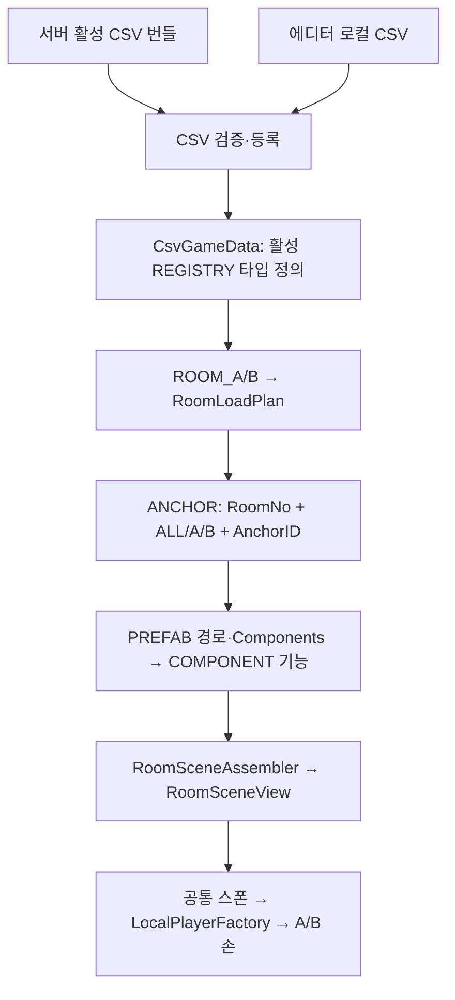

# 2인 협동 방탈출 Unity 클라이언트

> 문서 대조일: **2026-10-26**. 현재 코드·설정을 기준으로 설명을 점검했습니다. 본문의 과거 검사 수치·실행 기록은 해당 날짜의 결과입니다. [현재 상태·문서 검토 범위](Docs/문서_현행화_점검표.md)를 함께 확인합니다.

설명 기준일: **2026-10-26**. [종합 구조·데이터 연결·도식](Docs/ArchitectureReview.md), [클라이언트 구조 점검·수정 코드 해설](Docs/ClientArchitectureReview.md), [앞으로의 구현 규격](Docs/RefactorConventions.md)을 기준으로 봅니다. 각 기능 가이드의 과거 검증 수치는 당시 기록이며 현재 상태는 이 README와 최신 점검 문서를 따릅니다.

## 1. 역할과 실행 환경

두 플레이어가 서로 다른 방을 보며 음성으로 단서를 전달하는 1인칭 협동 게임입니다. 서버가 참가·ready·정답·문 허가·방 해금을 판정하고 클라는 자기 방/캐릭터/문/카메라/UI/사운드/영상을 표현합니다. 캐릭터 위치와 문 애니메이션을 상대 클라이언트에 동기화하지 않습니다.

| 항목 | 현재 구성 |
|---|---|
| Unity | 6000.2.8f1 / Unity 6.2 |
| 시작 / 게임 씬 | [Join](Assets/1.Scene/Join.unity) / [Ingame](Assets/1.Scene/Ingame.unity) |
| 빌드 씬 순서 | Join → Ingame → Vivox 수동 샘플 |
| 게임 통신 | UnityWebRequest + HTTP/Google Protobuf 바이너리 |
| 음성 | Vivox / Unity Authentication 별도 어댑터 |
| UI / 렌더링 | uGUI·TextMeshPro / URP 17.2.0 |
| 현재 로컬 CSV | [Assets/11.CSV](Assets/11.CSV), 원본 14개 / 활성 등록 14개 |
| 사운드 설정 | Resources/GameFeedback ScriptableObject. SOUND CSV 미사용 |

## 2. 접속·준비·게임 진입

[Start_UI·WaitingRoom_UI 연결·코드·검사 가이드](Docs/JoinMenu.md)를 참고합니다. 서버 없이 타이틀부터 확인하는 순서는 [로컬 플레이 테스트 가이드](Docs/LocalPlayTestGuide.md)를 따릅니다.

접속 주소는 [connection.json](Assets/StreamingAssets/Configuration/connection.json)으로 선택합니다. Join에 주소 입력창은 없습니다.

| 환경 | 선택 조건 | 현재 설정 |
|---|---|---|
| Editor | Unity Editor | http://192.168.1.34:3001 |
| TestBuild | Development Build 체크 | http://192.168.1.34:3001 |
| StableBuild | Development Build 해제 | config에 등록된 클라우드 주소 |

1. Unity에서 Join 씬을 열고 Play하면 Start_UI가 표시됩니다. **탈출하기**를 누르면 config 주소로 입장합니다. 새 메뉴는 autoConnect 값과 관계없이 버튼 입력을 기다립니다.
2. 최신 서버 상태에 한 명이면 WaitingRoom_UI를 생성합니다. 이미 두 명이면 대기 UI를 생성하지 않고 Ingame으로 진행합니다. 먼저 입장한 사람도 상대가 오면 기존 대기 화면에서 씬 전환으로 이어집니다.
3. 각 클라가 ready를 보고하고 서버가 두 참가자의 ready를 확인해 Playing을 보내야 대기 UI·조작 잠금이 해제됩니다.
4. 서버 없이 확인하려면 Start_UI의 **클라이언트 테스트 A/B**를 누릅니다. 새 메뉴에서는 autoConnect=false 변경이 필요 없습니다. 이 버튼은 에디터 전용이고 모든 빌드에서 제외됩니다.

세션 상태 자동 조회는 입장·준비 대기 중 1초, 게임 진행 중 5초입니다. 접속 유지는 별도로 3초이며 마지막 방 정답 후 상대 완료 확인은 1초입니다. 게임 중 상대 상태·방 해금 반영은 통신 지연 외에 최대 약 5초 늦어질 수 있습니다. [조회 주기 안내](Docs/SessionPolling.md)를 참고합니다.

서버 실패를 로컬 데이터/정답 판정으로 대체하지 않습니다. 안정화 빌드 주소는 현재 등록되어 있으며 config를 변경하면 재실행/새 빌드에 반영합니다. 자세한 선택·검증은 [접속 설정 안내](Docs/ConnectionConfiguration.md)를 봅니다.

## 3. 데이터와 오브젝트 조립

정의와 실행 상태를 분리합니다. CsvGameData는 REGISTRY.Active=Y 시트만 런타임 목록에 주입합니다. 비활성/미등록 시트는 빈 목록이며 원본 검증은 유지합니다. 23종 모델/스키마는 확장·고정 코퍼스 검사용으로 남아 있고, 파일만 추가한다고 자동 활성화하지 않습니다.

RoomLoadPlan은 한 데이터 스냅샷의 역할별 방·첫 방·ID/프리팹 경로·앵커 결과를 캐시합니다. 재입장에는 새 계획을 만들며 Unity 오브젝트를 전역 캐시하지 않습니다. 실제 입장과 개발자 미리보기는 RoomSceneAssembler를 공유합니다. Authored는 저장된 배치, ConnectionPoints는 출입 연결점 정렬을 사용합니다. 다음 방을 로드해도 기존 방은 유지합니다.

기획자는 [데이터 테이블 가이드](Docs/DesignerDataTableGuide.md), [데이터 기반 상호작용](Docs/DataDrivenInteraction.md), [CSV 로더](Docs/CsvReader.md)를 참고합니다. 현재 계약 밖의 새 Script/퍼즐 알고리즘은 코드 구현이 필요합니다.

## 4. 연결된 게임 기능

Closeup 종료 수명 보완(2026-10-23): 씬/Play 종료에서 Canvas가 플레이어보다 먼저 파괴되는 순서를 처리하고, 정답 UI의 늦은 갱신·반복 Dispose를 보호했습니다. 수정 이유와 회귀 검사 순서는 [상호작용 테스트 가이드](Docs/InteractionTestGuide.md)를 참고합니다.

| 기능 | 현재 코드 동작 | 주요 가이드 |
|---|---|---|
| 플레이어 | 공통 시트 스폰, A/B 손 프리팹 직접 참조, WASD·마우스 시점·캡슐/조작 잠금 | [스폰](Docs/PlayerSpawn.md), [이동](Docs/PlayerMovement.md), [시점/충돌](Docs/PlayerLookAndCollision.md) |
| 좌클릭/Closeup | 활성 상호작용 앵커·기능 선언으로 대상 구성, 전용 패널의 다이얼/버튼 입력 | [상호작용](Docs/DataDrivenInteraction.md), [검사](Docs/InteractionTestGuide.md) |
| 정답/문 | roomNo·정답으로 서버 요청, false와 통신 오류 구분, 허가 캐시 후 로컬 개폐 | [API](Docs/RoomApiAndProtobuf.md), [경첩](Docs/DoorHingeFix.md) |
| 방 진행 | 해금 ID 변경 시 추가 로드, 이전 방 유지·왕복, 실패 반복 생성 억제 | [개발자 방 클리어](Docs/DeveloperRoomClear.md) |
| 보행·발소리 | CHARACTER_STAT.HeadBob 진폭, 실제 이동 거리 기준 흔들림·Footstep 1→2→3 | [사운드·결과](Docs/GameFeedback.md) |
| UI/배경음 | UI음은 Closeup 전용, 열린 문 경계 통과 시 방별 배경음 3초 크로스페이드 | [사운드·결과](Docs/GameFeedback.md) |
| 협동 엔딩 | 한 명 7번 정답은 대기, 양쪽 완료 시 영상. 실제 영상 시작에 탈출 시간 고정 | [엔딩](Docs/EndingVideo.md) |
| 결과 | 영상 완주 후 Result_UI에 탈출 시간 표시, 확인으로 빌드 종료/Editor Play 종료 | [사운드·결과](Docs/GameFeedback.md) |
| 음성 | 공개 세션/음성 계약과 Vivox 어댑터로 자동 연결·종료 | [음성](Docs/SessionLeaveAndVoice.md) |

Result_UI 생성 성공 후 영상 포트/RenderTexture는 해제하고 결과 UI만 유지합니다. 사운드 큐의 직렬화 번호는 고정하며 배경음은 전환/최초 선택/재활성화 때 갱신합니다. 같은 월드 재연결은 중복 구독하지 않습니다.

방 조명은 기존 CSV 앵커 스폰을 사용하고, A/B별 베이크 프로브를 저장·복원하는 경로를 추가했습니다. [프로브 조명 작업·검사 가이드](Docs/RoomProbeLighting.md)를 따릅니다. ROOM_LIGHT_SPAWNTABLE은 사용하지 않습니다. R01_LEDPanel 전용 소리는 보류입니다. [기존 조명 안내](Docs/UnityBakedLightingGuide.md)의 초기 조사와 최신 구현 상태는 구분합니다.

손 모델은 A/B 공통 제어기의 대기·걷기 동작을 실제 이동 결과에 연결했습니다. 설정과 수명은 [손 애니메이션 안내](Docs/PlayerHandAnimation.md)를 참고합니다.

## 5. 빌드·리소스·계약 자동화

Windows Build Profiles에서 시작 씬 Join을 포함합니다. Development Build는 테스트 주소, 해제하면 stableBuild 주소를 사용합니다. **기존 stable 출력 폴더를 계속 사용**하고 실행 파일·Data·DLL 등 빌드 결과 전체를 함께 전달합니다. 임의 새 출력 폴더 규칙은 추가하지 않았습니다.

GameContentBuilder가 활성 REGISTRY와 선언된 PREFAB 참조를 빌드 자원에 연결합니다. 손/사운드/결과 UI는 전용 설정의 직접 참조를 사용합니다. 텍스처 압축과 모델 자원 검토는 [텍스처 압축 설명](Docs/TextureCompression.md)을 따릅니다. 이번 문서 갱신은 코드·설정·프리팹·베이크·압축 importer·빌드 산출물을 변경하지 않습니다. 과거 프로브 빌드와 이후 손 애니메이션 변경의 검사 시점을 구분합니다.

서버의 proto/OpenAPI/content-contract 생성 도구로 양쪽 계약을 맞춥니다. 생성 규격과 로컬 적용은 [문·정답 API 안내](Docs/RoomApiAndProtobuf.md)를 따릅니다. 서버 배포만으로 로컬 C# 기능 구현이나 Git 반영이 자동 실행되는 것은 아닙니다.

## 6. 개발자 검사와 과거 검사 기록

| 메뉴 | 목적 |
|---|---|
| Tools → Game → 시작·대기 UI 연결 검사 / 표시 검사 | Join 씬 참조 검사 / Play에서 격리 UI 생성 분기 검사 |
| Tools → CSV → 검사기 | 현재 CSV 형식·참조 검증 |
| Tools → Game → Room Clear Test | 방 클리어·방/오브젝트·플레이어 개발자 확인 |
| Tools → Game → 데이터 기반 상호작용 검사 | 기능 선언/대상 검증 |
| Tools → Game → 정답 입력 UI 로컬 검사 | 서버 없이 입력 UI/로컬 서비스 검사 |
| Tools → Game → 사운드·결과 UI 설정 검사 | 음원·설정·결과 참조 확인 |
| Tools → Game → Verify Ingame Wiring / Verify Gameplay Readiness | 씬 참조·플레이 준비 상태 |

개발자 문 허가와 실제 협동 정답 완료는 구분합니다. Room Clear Test의 문만 열었다고 엔딩이 되지는 않습니다. Join 로컬 A/B는 단독 실행 경로이므로 온라인 두 참가자의 협동 완료는 별도 테스트합니다.

| 2026-10-23 자동 검사 | 결과 |
|---|---|
| CSV·입장·시작 메뉴·접속·문·정답·상호작용 핵심 순수 C# | **329개 통과** |
| 플레이어 스폰·이동·시점·조작 | **78개 통과** |
| 보행·사운드·문 경계·탈출 시간 | **48개 통과** |
| 엔딩 협동 완료·재생 수명 | **41개 통과** |
| 실제 C# ↔ Node HTTP/Protobuf | **24개 통과** |
| 서버 전체 회귀 | **176개 통과** |
| Unity DLL 참조 전체 Editor/런타임 분리 컴파일 | 각각 오류 0·SerializeField/호환 DTO 필드 정적 경고 64개 |
| 현재 클라 CSV | 원본 14개/활성 14개·오류 0개 |

고정 23시트 코퍼스는 현재 콘텐츠와 별개로 검증 규칙/필드 보존을 검사합니다. net8 검사 소스는 설치된 net10 SDK의 임시 프로젝트로 검사했고 기존 대상 설정은 바꾸지 않았습니다.

동일 방/앵커 조회 1만 회의 관리 힙 할당은 24,240,000→0바이트였습니다. 초기 구성 비용을 제외한 .NET 순수 모델 측정이며 Unity FPS·GPU·전체 메모리 값은 아닙니다. 위 구조 점검 기록 이후 2026-10-23 프로브 A/B 로컬 실행과 손 동작·수명 31개 검사가 별도로 수행됐습니다. 프로브 호환 수정 당시 Stable 빌드 성공과 이후 손 코드의 플레이어용 참조 컴파일은 서로 다른 결과입니다. 이번 문서 갱신에서 유니티 실행·새 빌드·음성/영상·프로파일러·클라우드 재배포를 새로 수행하지 않았습니다.

## 7. 다음 확인과 설계 규격

결과 표시 후 영상 자원 해제, 배경음 전환 중 역주행/재활성화, 두 PC ready/7번 협동 엔딩을 실제 빌드로 확인합니다. Closeup의 정적인 복제 메시를 매 프레임 렌더링하는 경로는 실측 후 최적화 후보입니다. 전체 콘텐츠/충돌·오디오 장치 검증을 순수 모델 검사로 대체하지 않습니다.

새 기능은 책임/권한·데이터·명령·완료 이벤트·어댑터·수명·비용·실패 검사 순서로 추가합니다. GoF State/Decorator·비공개 DLL 분리·P2P/호스트 이전·결정적 replay를 구현 근거 없이 완료로 설명하지 않습니다. 구체 패턴과 선정 이유는 [최신 점검](Docs/ClientArchitectureReview.md)을 따릅니다.

## 2026-10-26 문서 현행화

현재 설정·손 애니메이션·객체 수명·프로브·문/엔딩과 과거 검사 기록을 대조했습니다. 이번 서버 전체 검사는 176개 통과했고 서버/클라이언트 CSV를 현재 공통 검증기로 확인했습니다. 원본 클라이언트 검사 구성 주의 사항과 이번에 새로 실행하지 않은 실기 범위는 [문서 현행화 점검표](Docs/문서_현행화_점검표.md)를 따릅니다.

클래스·메서드·데이터 컬럼과 코드 색인을 따라가려면 [클라이언트 상세 구조](Docs/ClientCodeArchitecture.md)를 봅니다. 서버 폴더의 초기 복사본 대신 이 파일을 상세 설명 원본으로 관리합니다.
