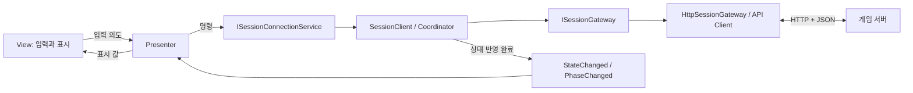

# 2인 네트워크 방탈출 — Unity 클라이언트

기준일: **2026-10-15**. 현재 소스와 지금까지의 검사 기록을 기준으로 정리합니다.

Unity 6 기반의 2인 방탈출 프로토타입입니다. 현재는 **서버 입장·역할 표시·자동 씬 준비 보고·상태 조회·생존 확인·퇴장·연결 종료 알림·Vivox 자동 연결**과 CSV Reader를 구성했습니다. 퍼즐과 실제 콘텐츠 로직은 아직 없습니다.

현재 게임 통신은 **HTTP + JSON**입니다. Protobuf 런타임과 생성물은 준비되어 있지만 실제 HTTP 요청에 사용하지는 않습니다. 네트워크와 화면의 역할은 분리했으며 별도 DLL 프로젝트로 배포한 단계는 아닙니다.

## 1. 프로젝트 열기와 준비

| 항목 | 현재 구성 |
|---|---|
| Unity | 6000.2.8f1, Unity 6.2 |
| 기본 씬 | Assets/1.Scene/SampleScene.unity |
| 게임 통신 | UnityWebRequest, HTTP + JSON |
| 음성 | Vivox 16.12.1, Unity Authentication 3.4.1 |
| UI | uGUI / TextMeshPro |
| 생성 메시지 | EscapeGame.Protocol.V1, Google.Protobuf DLL |

1. Unity Hub에서 프로젝트를 추가하고 위 버전으로 엽니다.
2. 패키지 복원과 스크립트 컴파일을 기다리고 Console 오류를 확인합니다.
3. [SampleScene](Assets/1.Scene/SampleScene.unity)을 엽니다.
4. 게임 서버를 먼저 실행한 뒤 Unity Play 모드로 진입합니다.
5. 게임 화면에서 서버 주소를 입력하고 입장합니다.

Packages/manifest.json에는 Git URL 기반 MCP for Unity 10.3.0 의존성이 있습니다. 복원 시 Unity 프로세스가 git 실행 파일을 찾을 수 있어야 합니다. MCP는 개발 보조 도구이며 게임 서버 접속 자체를 대신하지 않습니다.

음성 자동 연결에는 연결된 Unity Cloud 프로젝트의 Vivox 설정과 인터넷 연결이 필요합니다. 게임 서버 실행만으로 해당 설정이 만들어지지는 않습니다. 기존 Vivox 수동 샘플과 자동 연결을 동시에 실행하여 같은 프로세스의 SDK 로그인을 중복 소유하지 않도록 합니다.

## 2. 서버 주소와 빌드

| 서버 환경 | 같은 PC | 다른 PC |
|---|---|---|
| 로컬 개발 기본값 | http://127.0.0.1:3000 | local 기본 수신은 LAN용이 아님 |
| LAN test 기본값 | http://127.0.0.1:3001 | http://서버PC의실제IP:3001 |
| 로컬 Docker 기본값 | http://127.0.0.1:3001 | http://서버PC의실제IP:3001 |

다른 PC에서 127.0.0.1은 그 PC 자신입니다. 0.0.0.0은 서버 수신 설정이며 게임에 입력할 접속 주소가 아닙니다. Docker 기본 공개 포트는 호스트 3001 → 컨테이너 3000입니다.

게임 실행 전 해당 주소의 /health가 status=ok인지 확인합니다. health 성공과 세션 입장 성공은 별도 검사입니다. 서버 실행 명령과 Docker 갱신은 서버 저장소 README.md를 참고합니다.

Windows 빌드는 File → Build Profiles에서 구성하고 SampleScene을 첫 실행 씬으로 포함합니다. 현재 EditorBuildSettings에는 SampleScene이 첫 번째, Vivox 수동 샘플이 두 번째로 등록되어 있습니다. 출력 폴더 전체를 다른 PC로 복사하며 exe만 옮기지 않습니다. 소스 변경은 새로 빌드해야 실행 파일에 반영됩니다.

## 3. 플레이 시작까지의 자동 처리

1. 화면의 입장 요청을 세션 서비스가 받습니다.
2. 서버가 세션 ID, 참가자 ID, 역할 A/B와 참가 토큰을 반환합니다.
3. 클라이언트는 씬 로드와 지정된 필수 Behaviour 활성 여부를 확인합니다.
4. 준비 완료 시 ready API에 자동으로 보고합니다.
5. 자동 조회가 상대방 상태와 서버의 최종 단계를 반영합니다.
6. 두 명이 모두 준비되면 양쪽이 Playing을 확인합니다.

| 게임 단계 | 의미 |
|---|---|
| Waiting | 참가 인원 부족 |
| Loading | 두 명이지만 씬 준비 미완료 참가자 있음 |
| Playing | 두 명 모두 씬 준비 완료 |

ready는 **씬 로딩 완료 보고**입니다. 입장 버튼을 눌렀다는 사실만으로 준비 완료를 확정하지 않습니다. Playing은 서버가 결정하며, 현재는 로딩 장벽 통과를 뜻합니다. 실제 퍼즐 시작이나 콘텐츠 완료 판정은 아직 없습니다.

수동 Report Scene Loaded를 반복 호출할 필요는 없습니다. 디버깅 메뉴는 유지되어 있습니다. 첫 참가자는 자동 조회로 상대의 보고 결과를 확인합니다.

## 4. 공개 계약과 역할 분리

외부 기능은 [ISessionConnectionService](Assets/3.Script/Session/Contracts/ISessionConnectionService.cs)를 통해 요청하고 읽기 전용 SessionInfo를 받습니다. 화면은 HTTP 경로·인증 토큰·Wire DTO를 다루지 않습니다.

| 계층 | 대표 코드 | 책임 |
|---|---|---|
| 공개 계약 | Session/Contracts | 명령·결과·상태·이벤트 형식 |
| 세션 코어 | SessionClient, SessionCoordinator | 상태·인증 정보·작업 조정 |
| 공통 요청 | SessionRequestRunner, SessionCommandExecutor | 중복 요청·취소·오류 결과 처리 |
| 통신 경계 | ISessionGateway, HttpSessionGateway | 통신 중립 자료형과 HTTP DTO 사이 변환 |
| HTTP | SessionApiClient, SessionDtos | UnityWebRequest·주소·헤더·JSON |
| Phase / Result | Session/Phase, Session/Results | 단계 해석·응답 검증·실패 정책 |
| 자동화 | Polling / SceneLoaded / Heartbeat Controller | 정수 시간 기반 조회·준비·연결 감시 |
| Unity 연결 | Driver, SessionBootstrapper | Update·컴포넌트·생성·수명 |
| 화면 | Session/Presentation | 입력 이벤트·문구 변환·UI 연결 |



StateChanged는 반영 완료된 새 상태 값을 알립니다. PhaseChanged는 실제 단계가 달라질 때만 발생합니다. 같은 Loading 스냅샷을 여러 번 반영해도 단계 변경 이벤트를 반복하지 않습니다.

JoinAsync 등 명령은 완료·취소·실패 결과를 반환합니다. 전송 실패, 서버 결과 오류, 잘못된 응답을 구분하며 한국어 안내는 Presentation이 담당합니다. 명령과 결과 이벤트를 구분하여 UI에 네트워크 처리를 복사하지 않습니다.

현재 internal 코드는 같은 Assembly-CSharp 안에 있습니다. 같은 어셈블리에서 접근하는 것까지 차단되지는 않습니다. 별도 어셈블리·DLL 분리를 고려해 공개 계약과 의존성 방향을 먼저 정리한 상태입니다.

## 5. 자동화·시간·요청 수명

| 처리 | 현재 기본값 | 담당 |
|---|---|---|
| 스냅샷 조회 | 1000ms | SessionPollingController / Driver |
| 씬 준비 보고 재시도 | 1000ms | SessionSceneLoadedController / Driver |
| 생존 확인 전송 | 3000ms | SessionHeartbeatController / Driver |
| 정상 생존 응답 단절 기준 | 10000ms | SessionHeartbeatController |
| 생존 확인 요청 제한 | 2000ms | HeartbeatSettings → API Client |
| 일반 HTTP 요청 제한 | 10000ms | SessionApiClient |

간격은 int ms, 경과는 long ms입니다. StopwatchMillisecondClock과 MillisecondInterval을 재사용하고 코루틴 대신 Update → Tick으로 진행합니다. UnityWebRequest의 초 단위 timeout 경계에서만 정수 초로 올림 변환합니다.

일반 요청과 생존 확인은 공통 실행기 안에서 각 경로별 하나씩 수행합니다. 조회가 진행되는 동안에도 생존 확인 경로는 독립적으로 사용할 수 있습니다. 퇴장은 기존 요청을 취소·정리한 뒤 독점 요청으로 실행합니다.

Driver 비활성화는 해당 자동 작업의 취소 수명과 구독을 정리합니다. Bootstrapper 제거는 서비스 수명의 요청을 취소합니다. 이전 연결에서 늦게 돌아온 응답은 연결 버전 검사로 현재 연결을 덮어쓰지 않게 처리합니다.

짧은 조회 통신 실패는 재시도할 수 있습니다. 정상 생존 응답이 10000ms 끊기거나 폐기된 토큰·없는 세션이 확인되면 종료 상태와 알림으로 전환합니다. 제한을 넘긴 뒤에는 자동으로 이전 신분을 복구하지 않습니다.

## 6. 정상 퇴장과 연결 종료

| 상황 | 사용자 화면과 내부 처리 |
|---|---|
| 나가기 선택 | Leaving 공개 → 자동 요청 취소 → leave → 로컬 상태·음성 정리 |
| 퇴장 응답 확인 실패 | 로컬은 종료, 서버 자리는 생존 만료로 정리됨을 안내 |
| 서버 단절·참가 권한 소멸 | 연결 종료 알림, 요청 취소·상태·음성 정리 |
| 강제 종료 | 퇴장 전달을 보장하지 않고 서버 만료가 자리 정리 |
| 다시 입장 | 새 참가자 ID·토큰으로 신규 입장 |

게임 단계 Waiting/Loading/Playing과 연결 상태 NotConnected/Connected/Leaving/Disconnected는 다릅니다. 서버 중단 뒤 복구되면 새 입장을 요청합니다. 기존 참가자의 진행 상태를 복구하는 재접속 기능은 아직 없습니다.

## 7. Vivox 자동 연결

```text
게임 세션 StateChanged
  → SessionVoiceCoordinator: 입장/퇴장 목표 판단
  → IVoiceChatService / VoiceChatService: 연결 상태·순서 관리
  → IVoiceGateway / VivoxVoiceGateway: Unity Services·Vivox SDK 호출
  → VoiceStatusPresenter / View: 별도 음성 상태 표시
```

음성은 게임 입장 직후 시작하므로 Waiting/Loading에서도 채널에 참가할 수 있습니다. 세션 ID로 같은 채널명을 계산하며 접속 URL이나 역할 A/B가 달라도 같은 세션이면 같은 음성방입니다. 게임 참가 토큰은 음성 채널명으로 사용하지 않습니다.

SDK 순서는 Unity Services 초기화 → Vivox 초기화 → 필요 시 Unity Authentication 익명 인증 → Vivox 로그인 → AudioOnly 채널 입장입니다. 이미 인증되어 있으면 인증을 재사용합니다. 게임 참가자 ID와 Unity Authentication ID가 같다고 가정하지 않습니다.

음성 초기화·인증·로그인·입장·정리 실패를 음성 상태로 분리합니다. 음성 실패 자체가 게임 세션을 종료하지 않습니다. 퇴장/연결 종료 시 즉시 송수신을 차단하고 비동기 정리를 진행합니다. 반복 조회마다 재로그인하지 않습니다.

**현재 보류:** 두 PC 새 빌드에서 연결됨(2명)은 확인했지만 양방향 목소리가 들리지 않았습니다. Bluetooth 이어폰·마이크 장치 문제를 포함한 실제 송수신 검사는 사용자님 요청으로 보류했습니다. 연결 표시만으로 음성 검증 완료로 판단하지 않습니다. 기존 수동 샘플 음성 검사와 자동 연결 빌드 검사는 구분합니다.

## 8. SampleScene과 코드 위치

| 씬 요소 | 역할 |
|---|---|
| SessionJointest | 로컬 참가자의 Bootstrapper·자동 Driver·테스트 메뉴·VoiceBootstrapper |
| SessionJointest_2 | 같은 Editor에서 두 번째 게임 참가자를 검사하는 보조 객체 |
| 접속 Canvas | 주소 입력·입장/나가기·단계·역할·인원·오류 표시 |
| 음성 상태 화면 | 게임 접속 화면과 별개로 음성 상태·인원 표시 |

두 객체는 현재 씬에 활성 상태로 있고 입장은 명령으로 수행합니다. 보조 객체에는 VoiceBootstrapper가 없습니다. 두 PC 검사에서는 각 PC의 화면으로 한 번씩 입장하며 보조 객체의 수동 입장까지 실행해 정원을 채우지 않도록 합니다.

```text
Assets/3.Script/
  Session/Contracts/          공개 계약
  Session/Runtime/            내부 세션 서비스·Gateway 계약
  Session/Phase/, Results/    단계·결과 처리
  Session/Heartbeat/          생존 확인·연결 감시
  Session/Presentation/       입력·표시·알림
  Session/                    조립·Coordinator·공통 실행기·자동화
  Networking/                 HTTP·DTO·Gateway
  Voice/Contracts/            음성 공개 계약
  Voice/Runtime/              음성 조정·서비스·SDK 경계
  Voice/Infrastructure/       Vivox SDK 어댑터
  Voice/Presentation/         음성 화면
  Common/Timing/, Readiness/  정수 시계·간격·준비 검사
  Common/Csv/                 엔진 중립 CSV 해석·로드
  Data/Infrastructure/        CSV 파일·TextAsset 어댑터
  Generated/Protocol/         생성 메시지·전용 asmdef
  Tests/                      Protobuf·CSV 수동 검사
```

## 9. Protobuf와 CSV

### Protobuf

Google.Protobuf.dll은 Assets/Plugins/Protobuf에 있고 생성물은 Assets/3.Script/Generated/Protocol에 있습니다. Standalone에 ESCAPE_PROTOBUF_RUNTIME이 설정되어 전용 어셈블리를 활성화합니다. 다른 타깃의 심볼과 실행은 별도 확인 대상입니다.

생성 namespace는 EscapeGame.Protocol.V1입니다. 생성 파일을 직접 고치지 않고 서버 저장소의 protocol/escape/v1 원본과 생성 도구를 사용합니다. 현재 계약은 조회 응답·스냅샷·역할·단계·오류이며 모든 API를 포함하지 않습니다.

ProtocolRoundTripTester의 Test Protobuf Round Trip 메뉴로 Play 모드에서 왕복 검사를 할 수 있습니다. 이는 바이너리 직렬화/역직렬화 검사이며 현재 JSON API를 자동 전환하지는 않습니다.

### CSV

Excel·스프레드시트에서 내보낸 **UTF-8 쉼표 CSV**를 직접 읽습니다. CsvLoader가 입력 소스와 파서를 연결하며 결과는 읽기 전용 CsvDocument/CsvRow입니다. 숫자 모양의 값도 문자열로 보관하고 실제 컬럼의 정수 변환은 아직 하지 않습니다.

1. 유효한 CSV를 Assets에 넣습니다.
2. 빈 GameObject에 CsvLoadTester를 추가합니다.
3. Csv Asset을 연결하고 컴포넌트 메뉴의 Load CSV를 실행합니다.
4. Console에서 헤더 목록·수와 행 수를 확인합니다. Edit/Play 모두 지원합니다.

검사기는 자동 실행하지 않으며 기존 SampleScene에 추가하지 않았습니다. 실데이터·필수 컬럼·ID·테이블 참조·전역 DataManager·자동 초기화는 아직 없습니다. 문법·중복/빈 헤더·칸 수·UTF-8 오류를 검사합니다. [CSV 안내](Docs/CsvReader.md)를 참고합니다.

## 10. 기본 검사 순서와 기록

1. 서버 /health를 확인합니다.
2. 한 명 입장 → 역할·인원·Waiting을 확인합니다.
3. 다른 클라이언트 입장 → 자동 준비 보고 후 양쪽 Playing을 확인합니다.
4. 같은 단계의 조회가 반복되어도 PhaseChanged가 중복되지 않는지 확인합니다.
5. 한쪽 정상 퇴장 → 남은 쪽 Waiting/1명 → 신규 입장을 확인합니다.
6. 한쪽 강제 종료 → 약 10~15초 뒤 자리 정리 → 신규 입장을 확인합니다.
7. 서버 중단 → 약 10~15초 뒤 연결 종료 알림·음성 정리 → 서버 복구 후 신규 입장을 확인합니다.

10~15초는 주기 검사·네트워크·화면 반영을 고려한 관찰 여유이며 설정값이 아닙니다. 서버 만료는 마지막 수신, 클라이언트 단절은 마지막 정상 생존 응답부터 10000ms입니다.

에디터 세션 검사와 게임 빌드 접속은 통과 이력이 있습니다. 음성 자동 연결의 실제 송수신은 보류입니다. 최신 CSV는 공통 27개 C#/TS 검사·독립 C# 검사·Unity DLL 참조 컴파일까지 확인했으며 실제 Editor import/Play와 새 빌드는 아직 별도 확인이 필요합니다. 이번 README 정리에서는 실행 코드나 씬을 바꾸거나 게임 검사를 재실행하지 않았습니다.

Windows 기본 로그 경로는 다음과 같습니다. Company Name / Product Name 변경 시 경로도 바뀝니다.

```text
%USERPROFILE%\AppData\LocalLow\DefaultCompany\listen\Player.log
```

## 11. 남은 범위와 설계 기준

남은 작업은 콘텐츠·테이블 확정, 타입 변환·검증·조회 계층, 게임 명령/상태 동기화, 기존 참가자 복구, Protobuf 실통신, 음성 장치 검증입니다. 서버의 실제 클라우드 배포와 Git CI/CD도 후속입니다.

MonoBehaviour는 수명·Update·Unity 어댑터 중심으로 유지합니다. 읽기 전용 정의와 가변 플레이 상태, 규칙과 표현을 분리합니다. Facade·Adapter·Observer·Factory·Presenter와 명시적 DI는 각 책임에 맞춰 사용하며 enum 상태를 모두 개별 State 클래스로 늘리지는 않습니다.

기본 수치·시간은 정수 단위입니다. 향후 네트워크·리플레이에는 정수 외에도 명령 순서·Tick·난수·상태 소유 설계가 필요합니다. 지금 구조만으로 P2P·전용 서버·결정론이 모두 완성된 것은 아닙니다.

## 12. 상세 문서와 공유 파일

- [세션 역할 경계](Docs/SessionArchitecture.md)
- [정상 퇴장·음성 자동 연결](Docs/SessionLeaveAndVoice.md)
- [CSV Reader](Docs/CsvReader.md)
- 서버 저장소: README.md, docs/project-overview/README.md, docs/TestGuid.md

Git에는 Assets와 필요한 .meta, Packages, ProjectSettings, 문서를 공유합니다. 필요한 런타임 DLL과 생성 코드도 프로젝트 의존성에 포함됩니다. Library·Temp·Logs·빌드 출력·자동 생성 csproj/sln은 재생성 가능한 산출물입니다. 별도 저장소 경로와 개인 배포 설정은 각 PC 환경에 맞게 관리합니다.
